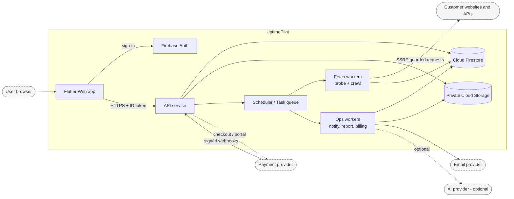
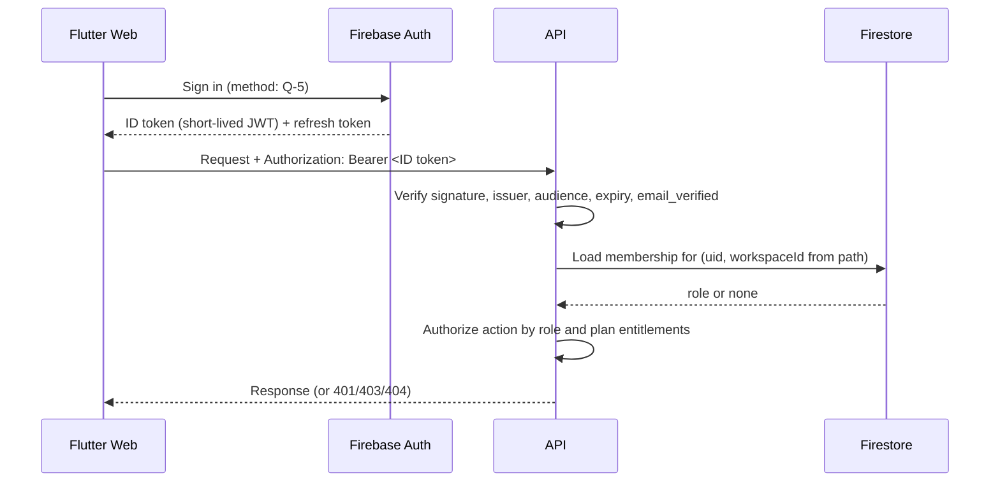
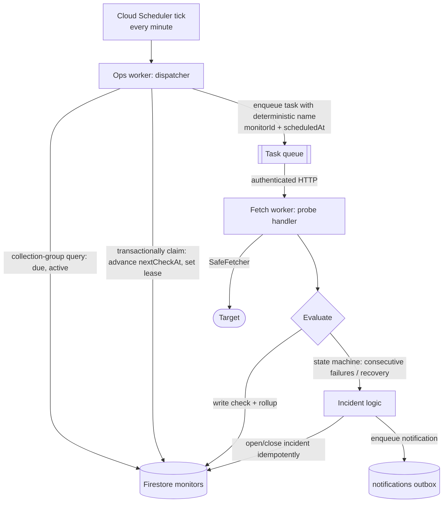
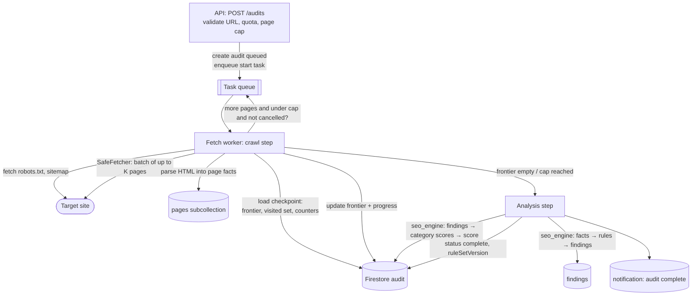
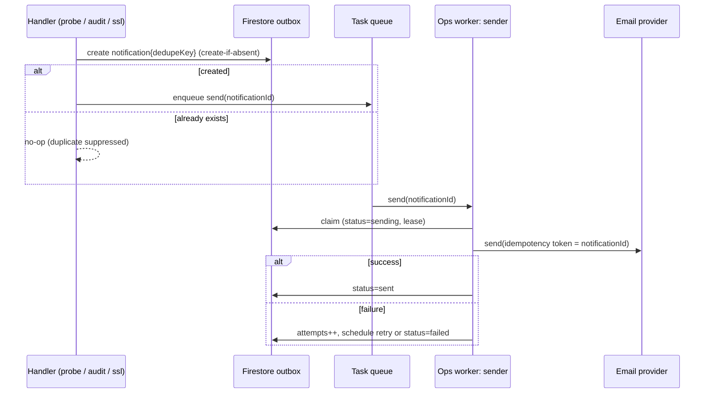
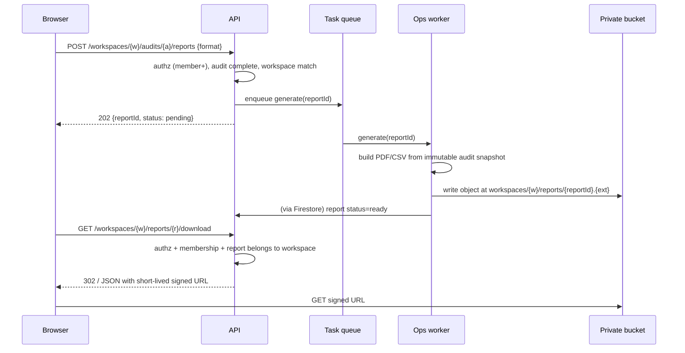
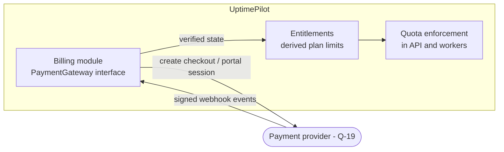
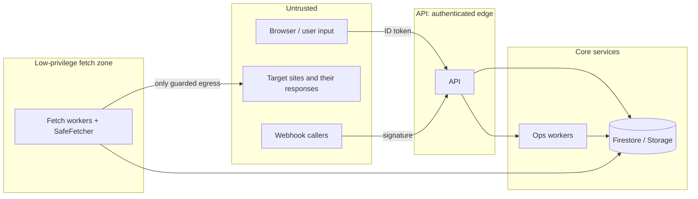
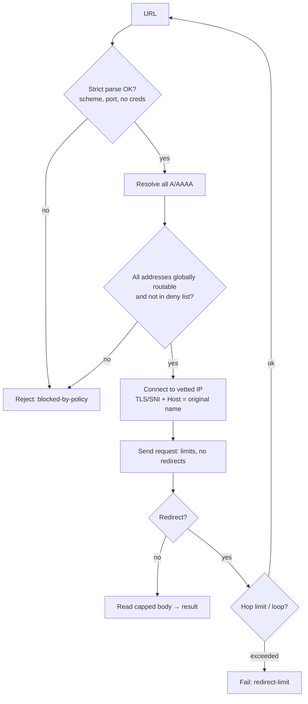

# UptimePilot Architecture

| | |
|---|---|
| Status | Draft v0.1, **proposal; nothing here is built** |
| Last updated | 2026-10-21 |
| Related | [`CLAUDE.md`](../CLAUDE.md), [`PRODUCT_SPEC.md`](PRODUCT_SPEC.md) (requirement IDs such as `MON-7` refer to it), [`ADR/`](ADR/) |

## How to read this document

The repository contains **no application code, no `pubspec.yaml`, no Firebase config, no Dockerfile and no CI** (verified 2026-10-21). Nothing here describes an existing system.

- **[Decided]**: fixed by the project brief or `CLAUDE.md`.
- **[Proposed]**: a recommendation in this draft. It becomes binding only when accepted, ideally as an ADR in `docs/ADR/`.
- **[Verify]**: depends on a package, API or platform limit that I have not confirmed in this repository or environment. Run a spike before relying on it.
- **[Q-n]**: an unresolved question, listed in [section 17](#17-decisions-alternatives-and-open-questions).

Package names, cloud products and numeric limits mentioned below are candidates. None is installed or provisioned.

---

## 1. System overview

### 1.1 Principles [Decided unless noted]

1. **The browser never fetches user-supplied URLs.** All probing and crawling happens in backend workers, which keep running when the user closes the tab.
2. **The backend is the only trust boundary.** Authorization, tenant isolation, quotas and SSRF controls are enforced server-side (`CLAUDE.md`).
3. **SEO findings and scores are deterministic.** The crawler, rule engine and scorer work without AI. AI is an optional, replaceable recommendation service layered on verified findings.
4. **Business logic is pure Dart, separate from UI and transport**, so it is unit-testable and shareable. [Proposed structure in §2.3 and §3.2]
5. **Jobs are idempotent and resumable.** Any worker can crash or be retried without duplicating incidents, emails or reports.

### 1.2 Context diagram



### 1.3 Component responsibilities

| Component | Responsibility | Must not |
|---|---|---|
| **Flutter Web app** | UI, sign-in via Firebase Auth SDK, calls the API, renders state | Fetch customer URLs, hold secrets, decide authorization, compute scores |
| **API service** | Verify identity, authorize by workspace role, enforce quotas, CRUD, enqueue jobs, issue report downloads, receive billing webhooks | Perform long-running crawls or outbound fetches of customer URLs |
| **Scheduler + task queue** | Time-based triggers and reliable, retried, rate-limited job delivery | Contain business logic |
| **Fetch workers** (probe, crawl) | The only components that request user-supplied URLs; run checks, certificate inspection, crawls, then rules and scoring | Hold broad privileges (they are the SSRF-exposed surface) |
| **Ops workers** | Dispatch due work, send email, render reports, process billing events, call the optional AI service | Fetch user-supplied URLs |
| **Firestore** | System of record | Be accessed directly by browsers in the MVP (§5) |
| **Cloud Storage** | Private report files | Serve any object publicly |
| **Firebase Auth** | Credentials and ID tokens | Store authorization data |

Cloud products named here (Firebase Auth, Firestore, Cloud Storage) are **[Decided]** by the brief. Everything else (Cloud Run, Cloud Tasks, Cloud Scheduler, etc.) is **[Proposed]** (§14, Q-1).

---

## 2. Flutter Web frontend

### 2.1 Responsibilities and constraints [Decided]

- Presentation and interaction only. No business rules that gate security, quotas or scoring.
- Browser limits make direct monitoring impossible anyway (CORS, mixed content, closed tabs); this reinforces principle 1.
- Server state is fetched from the API. Optimistic UI is allowed only for non-critical interactions.

### 2.2 Layering [Proposed]

Feature-first, with three layers inside each feature:

```
presentation  → widgets, pages, view-models/controllers (no HTTP, no Firebase)
domain        → entities, value objects, repository interfaces (pure Dart)
data          → API client, DTO mapping, repository implementations
```

Dependencies point inward: `presentation → domain ← data`.

State management, routing and DI are **[Proposed]**: Riverpod and `go_router` are reasonable candidates but are **not yet in the repo [Q-2]**. Whatever is chosen is recorded in an ADR. The `flutter-professional-development` project skill applies when implementing.

### 2.3 Repository layout [Proposed]

A single repository with Dart workspace-style packages, so pure logic can be shared between the Flutter app and the server:

```
eazy-monitor-360/
├── apps/
│   ├── web/                      # Flutter Web app
│   │   ├── lib/
│   │   │   ├── app/              # bootstrap, router, theme, DI, env config
│   │   │   ├── core/             # api client, error model, auth session, l10n, widgets
│   │   │   └── features/
│   │   │       ├── auth/
│   │   │       ├── workspaces/        # switcher, members, invitations
│   │   │       ├── monitors/
│   │   │       ├── incidents/
│   │   │       ├── ssl/
│   │   │       ├── seo_audits/        # start, progress, results, findings
│   │   │       ├── reports/
│   │   │       ├── notifications/     # recipients, preferences
│   │   │       ├── billing/
│   │   │       └── admin/             # platform admin (route-guarded + server-enforced)
│   │   └── test/
│   └── server/                   # Dart backend, multiple entrypoints (§3)
│       ├── bin/{api,fetch_worker,ops_worker}.dart
│       ├── lib/src/{http,auth,tenancy,modules/...,infra/...}
│       └── test/
├── packages/
│   ├── domain/                   # pure Dart: entities, quotas, uptime math, incident state machine
│   ├── seo_engine/               # pure Dart: HTML parsing → rules → findings → score (no I/O)
│   ├── safe_fetch/               # pure Dart + dart:io: SSRF-guarded HTTP client (§15)
│   └── api_contracts/            # request/response DTOs shared by app and server
├── firebase/                     # firestore.rules, firestore.indexes.json, emulator config
├── infra/                        # IaC and deploy config (tool: Q-1)
└── docs/
```

Rationale: `seo_engine` and `domain` contain the logic most worth testing, so keeping them free of Flutter, HTTP and Firebase makes them cheap to test and impossible to couple to UI (`CLAUDE.md` rule 6). Whether to use a monorepo at all, and which workspace tooling, is **[Q-3]**.

### 2.4 Frontend security notes

- Firebase client config values are not secrets, but nothing else sensitive ships in the bundle (no service accounts, provider keys, AI keys, signing keys).
- Route guards improve UX only; the API rejects unauthorized requests regardless.
- The ID token is attached to API calls and refreshed by the SDK; the app handles `401` by re-authenticating and returning to the prior page (`PRODUCT_SPEC` §10).
- Report downloads open a short-lived URL returned by the API (§10), never a guessable storage path.
- Reports and user-supplied strings (page titles, URLs from crawled sites) are untrusted and rendered as text, never as HTML.

---

## 3. Dart backend

### 3.1 Framework choice: Shelf vs Dart Frog

`CLAUDE.md` says to select based on the repository. **The repository has no backend setup, so there is no existing choice to follow.** This is a **[Proposed]** decision to be ratified in an ADR [Q-4].

| Criterion | Shelf | Dart Frog |
|---|---|---|
| Nature | Minimal middleware/handler primitives | Opinionated framework with file-based routing and conventions [Verify: recent versions and its Shelf relationship before adopting] |
| Control of `dart:io` `HttpServer`, headers, body limits, timeouts | Direct | Available but one layer further away |
| Fit for non-HTTP entrypoints (workers share modules) | Neutral, modules are plain Dart | Neutral, but the file-routing convention applies only to HTTP |
| Convention/boilerplate for a larger team | Must be defined by us (router, DI, error mapping) | Provided |
| Dependency surface (matters for a security-critical service) | Smaller | Larger |

**Recommendation [Proposed]: Shelf** (with a router package), because:
1. The security-critical parts are not HTTP routing: they are the SSRF-guarded client, auth middleware, tenancy context and job handlers. We want explicit control of the request pipeline and smallest dependency surface there.
2. Workers and the API share module code; a plain-Dart module structure avoids binding domain code to a web framework's conventions.
3. The cost of Shelf, hand-rolled conventions, is acceptable and is written down once in this document.

Dart Frog is a defensible alternative if the team values its conventions and tooling more than control. The architecture below does not depend on the choice, because HTTP is isolated in `lib/src/http`.

### 3.2 Server structure [Proposed]

One Dart package, three entrypoints, one container image (or three images built from the same code):

```
bin/api.dart           public HTTP API (verifies users)
bin/fetch_worker.dart  internal HTTP handlers for probe/crawl tasks (verifies task caller)
bin/ops_worker.dart    internal handlers: dispatch, notify, report, billing events, AI
```

```
lib/src/
  http/        pipeline, middleware (auth, tenancy, rate-limit, error mapping, request-id), routing
  auth/        token verification, platform-admin check
  tenancy/     TenantContext, role checks, membership lookup
  modules/
    workspaces/ monitors/ incidents/ ssl/ audits/ reports/ notifications/ billing/ admin/
      (each: application services + repository interfaces; domain types from packages/domain)
  infra/       firestore, storage, tasks/queue, email, payments, ai (implementations behind interfaces)
  jobs/        job envelopes, idempotency helpers, retry policy, handlers
  config/      typed env config, secret loading
```

Rules [Proposed]:
- **Application services depend on interfaces** (`MonitorRepository`, `EmailSender`, `PaymentGateway`, `AiRecommender`, `Clock`, `SafeFetcher`). Implementations live in `infra/`. This is what makes logic testable without Firebase or the network.
- Every service method that touches tenant data takes a **`TenantContext`** (verified uid, workspaceId, role) as its first argument. There is no repository method that accepts a bare workspace ID from a request.
- A single error model maps domain errors → HTTP responses; internals and secrets are never returned (`PRODUCT_SPEC` §10, X-6).
- Time is injected (`Clock`) so incident, SSL-threshold and quota logic can be tested deterministically.

### 3.3 Why split API from fetch workers

The fetch workers run the code path most exposed to hostile input (arbitrary URLs, arbitrary HTML, SSRF attempts). Separating them from the API lets us give them **a different service identity with minimal permissions**, different egress controls, independent scaling and independent failure (§15.8). Workers authenticate callers as Google-authenticated queue/scheduler tasks, not as end users (§8.4).

---

## 4. Authentication and server-side identity verification

### 4.1 Flow [Decided: Firebase Auth. Details Proposed]



### 4.2 Token verification

- The API verifies every ID token: signature against Google's published signing keys (cached with respect to cache headers), `iss` = the project's securetoken issuer, `aud` = the Firebase project ID, `exp`/`iat`, and a non-empty `sub`. It reads `email_verified` for gates such as AUTH-2.
- **[Verify]** Whether a maintained Dart Admin SDK is usable (`dart_firebase_admin` or similar). **I have not confirmed any such package's state.** Fallback: verify the JWT with a generic JWT library plus Google's public keys, and call Firestore/Storage through Google's REST/gRPC APIs using Application Default Credentials. This is the main technical risk in the stack and gets a **spike before commitment [Q-6]**.
- Never trust identity from request bodies, query strings or client-supplied headers other than the bearer token.
- Revocation: ID tokens are valid until expiry (about an hour). Security-sensitive operations (member removal, billing changes, admin actions) additionally check live membership/state in Firestore on each request, so removal takes effect on the next request (WS-4). Optionally check token revocation for sensitive operations [Q-7].

### 4.3 Authorization model

Authorization is **not** stored in token claims in the MVP: roles are read from `workspaces/{wid}/members/{uid}` on each request (one document read, cacheable for seconds per instance at most). Reasons: immediate effect of role changes, no stale-claim problem, supports multi-workspace membership (Q-2 in the spec) without claim-size limits.

- **Platform administrators** are marked by a custom claim set out-of-band **and** an allow-list document that the admin API double-checks; admin endpoints live under a separate route prefix with their own middleware (ADM-1, ADM-5). MFA enforcement for admin accounts is required [Q-8].
- **Service-to-service**: worker endpoints are not callable with user tokens (§8.4).

### 4.4 Unauthenticated surface

Only: health endpoints (no sensitive detail), invitation acceptance preview (token-gated), payment webhooks (signature-gated, §11), and static web assets. Everything else returns `401`.

---

## 5. Firestore data access and tenant isolation

### 5.1 Access model [Proposed, important]

**In the MVP, browsers do not read or write Firestore directly. All access goes through the API.** Firestore security rules are `deny all` for client SDKs and serve as defense in depth against a misconfigured client or leaked config.

| Option | Pros | Cons |
|---|---|---|
| **A. API-only (recommended)** | One enforcement point, trivially auditable tenant isolation, quotas and validation can't be bypassed, SSRF-sensitive inputs always pass the server | No Firestore realtime listeners in the UI (use polling/refresh), API carries all read load |
| B. Client reads allowed via rules | Realtime dashboards cheaply | Rules become a second authorization implementation that must be kept in sync and tested; data-shaping and quota leakage risk |

If realtime views are later needed, move to B for **read-only, narrowly scoped** paths with rules covered by emulator tests.

The server uses service credentials and therefore **bypasses security rules**. That means isolation is only as strong as our server code, so tenant scoping is built into the type system (§5.4) and verified by tests.

### 5.2 Data model sketch [Proposed]

Tenant-owned data lives under the workspace document so every path embeds the tenant:

```
users/{uid}                                   profile, preferences
workspaces/{wid}                              name, ownerUid, planId, entitlements snapshot, status
workspaces/{wid}/members/{uid}                role, addedAt
invitations/{inviteId}                        wid, role, tokenHash, expiresAt, usedAt   (top-level to look up by token hash)
workspaces/{wid}/monitors/{mid}               type, url, config, intervalSec, status, nextCheckAt, lease, certState
workspaces/{wid}/monitors/{mid}/checks/{cid}  ts, ok, httpStatus, latencyMs, errorCategory   (retention: Q-9)
workspaces/{wid}/monitors/{mid}/rollups/{id}  hourly/daily aggregates for charts and uptime %
workspaces/{wid}/incidents/{iid}              monitorId, kind (downtime|certificate), openedAt, closedAt, ...
workspaces/{wid}/audits/{aid}                 startUrl, status, progress, ruleSetVersion, score, categoryScores, pageCap, frontier checkpoint
workspaces/{wid}/audits/{aid}/pages/{pid}     url, status, extracted facts (title, h1s, canonical, robots meta, links, images)
workspaces/{wid}/audits/{aid}/findings/{fid}  ruleId, category, severity, urls, evidence
workspaces/{wid}/reports/{rid}                auditId, format, status, storagePath, expiresAt
workspaces/{wid}/notifications/{nid}          outbox: type, dedupeKey, recipients, status, attempts
plans/{planId}                                price, quotas as configuration (BILL-4)
platform/auditLog/{id}                        admin actions (append-only)
jobs/{jobId}                                  idempotency/lease records (optional, §8)
```

Notes:
- Subcollection layout makes tenant deletion (WS-6) a bounded, enumerable operation, though Firestore recursive deletion must be done by a job.
- Due-work queries (`nextCheckAt <= now AND status == active`) use a **collection-group query on `monitors`** with a composite index; each monitor document therefore stores `workspaceId` redundantly. Index definitions live in `firebase/firestore.indexes.json`.
- Crawled page *facts* are stored, not full HTML, to bound storage and privacy exposure (PRODUCT_SPEC §9.5, Q-8 there). Evidence is the extracted snippet plus location.

### 5.3 Write volume and cost [Verify, Q-9]

Per-check documents are the dominant write load: a Pro tenant with 150 monitors at 1-minute intervals is ~216,000 writes/day. Interval limits (spec Q-5) and plan economics (spec Q-17) must be decided **with a cost model before the schema is frozen**. Mitigations to evaluate:
- Write a check document only on state change or at a sampled rate, and keep running aggregates in the rollup document.
- Bucket checks into hourly documents.
- Use TTL policies for retention [Verify availability and behavior in the Firestore edition used].
- If volume demands it, move time-series to a different store (decision deferred, Q-9).

The uptime formula (HIST-2) must be computed identically from raw or rolled-up data (HIST-5); this is unit-tested in `packages/domain`.

### 5.4 Tenant isolation mechanics [Proposed]

1. **TenantContext is mandatory.** Authentication middleware yields a `Principal(uid)`; tenancy middleware resolves `(workspaceId from route) + Principal → membership → TenantContext(uid, wid, role)`. If there is no membership, the response is `404` (not `403`) for resource routes, so existence is not leaked.
2. **Repositories are constructed per tenant or take `TenantContext`**; they build paths as `workspaces/${ctx.workspaceId}/...` internally. Callers cannot pass a raw path.
3. **IDs from the client are looked up under the tenant path only.** A monitor ID from workspace B simply does not exist under workspace A's path.
4. **Collection-group queries are restricted to internal worker code** (dispatcher), never reachable from user-facing handlers.
5. **Worker job payloads carry `workspaceId` and resource IDs; workers re-load the resource under that path and re-check it still exists, is active and quota-valid** before acting. Payloads are not trusted blindly beyond being authenticated.
6. **Tests:** a cross-tenant matrix (create resources in tenant A; attempt every read/write/list/download as tenant B and as an unauthenticated caller; expect no data) runs for every resource type against the Firestore emulator in CI (AC-3, AC-42).
7. **Firestore rules** deny client access; rules tests assert the denial.

### 5.5 Transactions and consistency

- Quota-checked creates (MON-10) use a transaction (or a counter document updated transactionally) so concurrent requests can't exceed the quota.
- Incident open/close and notification enqueue use deterministic document IDs so duplicates collapse (§8.3, §9).

---

## 6. Website monitoring worker architecture

### 6.1 Flow



### 6.2 Design points [Proposed]

- **Dispatch, don't poll in workers.** A per-minute scheduled tick runs the dispatcher, which finds monitors with `nextCheckAt <= now`, claims them in a transaction (advancing `nextCheckAt` by the interval and bounding the claim), and enqueues one task per check. The queue provides retries, rate limiting and horizontal fan-out.
- **Deterministic task names** (`check-{monitorId}-{scheduledAtEpoch}`) mean a retried dispatcher run cannot enqueue the same check twice.
- **Probe handler** loads the monitor under its tenant path, re-checks `status == active` and that the monitor still exists (paused/deleted between enqueue and run → no-op), runs the request through `SafeFetcher` (§15), classifies the result into the error categories in MON-4, then records the check.
- **Incident state machine** lives in `packages/domain` and is pure: input (current monitor state, new check result, config N) → output (new state, events). The handler persists the result and emits events. Idempotency: the check document ID is `{scheduledAt}`; incident IDs are derived from `{monitorId, openedAtCheckId}` so a retried handler reopens/closes nothing twice (AC-11, AC-12).
- **Missed checks** (dispatcher outage, queue backlog) are recorded as *unknown* gaps, never as up (PRODUCT_SPEC §10). The dispatcher computes next run from the schedule, not "now", and caps catch-up so an outage doesn't cause a flood.
- **SSL inspection** runs on its own lower-frequency schedule per HTTPS monitor (SSL-6), as a separate task type using the same guarded connection logic; expiry-threshold crossing is computed in domain code and deduplicated with a key `ssl:{monitorId}:{certFingerprint}:{threshold}` (SSL-3).
- **Fairness:** per-workspace concurrency/ rate limits at dispatch so one tenant's 150 monitors can't starve others; per-target-host limits to avoid hammering one host (also an abuse control, ADM-6).
- **Scale-out:** the fetch worker is stateless; scaling is by instance count. If dispatcher claim contention becomes a bottleneck, shard by a hash prefix [Q-10].
- **Single region at MVP.** Multi-region probing is deferred and its absence is a stated assumption (spec Appendix A); a single-region outage could cause false "down" results, mitigated by the consecutive-failure rule and a self-check (§13).

---

## 7. SEO crawler and audit worker architecture

### 7.1 Principles

- Server-delivered HTML only; no JavaScript execution (SEO-4).
- Honors robots.txt for its own user-agent (SEO-3), polite and bounded (SEO-6).
- **Crawl (I/O) and analysis (pure) are separate stages.** The rule engine runs on stored page facts and has no network access, so it is deterministic and re-runnable.
- Works fully without AI (§12 of this document / AI-4).

### 7.2 Pipeline



### 7.3 Design points [Proposed]

- **Chunked, resumable execution.** An audit is processed in steps: each task fetches a bounded batch of pages (e.g. a few dozen or a time budget), persists page facts and the frontier checkpoint, then enqueues the next step. A crash or timeout loses at most one batch; retry resumes from the checkpoint. This avoids dependence on any single long-running request (platform request-timeout limits **[Verify]**) and supports cancellation between steps (SEO-7). Alternative considered: a long-running batch job per audit (§17, ADR candidate).
- **Idempotent steps.** Page documents use a deterministic ID (hash of the normalized URL), so refetching after a retry overwrites rather than duplicates. Step tasks carry a sequence number; a step whose number is not the audit's `nextStep` is a no-op.
- **Scope rules.** Same registrable-site only (definition of "same site": subdomains in/out, `www` handling, ports: **[Q-11]**); URL normalization (fragment removal, case, default ports, trailing slash policy, tracking-parameter handling) is a pure, tested function; crawl-trap defenses (parameter explosion, calendars, infinite paths) via page cap, depth cap and repeated-pattern limits.
- **Robots and politeness.** robots.txt fetched and cached for the audit; per-host concurrency and delay; honor crawl-delay [policy: Q-12]. Disallowed pages are recorded as "blocked by robots" facts (relevant to the crawlability category), not fetched.
- **Link checking.** Internal links are covered by the crawl; external link checks are limited (small cap, HEAD-then-GET with `SafeFetcher`, per-audit budget) because they are the highest SSRF/abuse surface.
- **Page facts, not HTML.** Extraction (title, meta, headings, canonical, robots directives, hreflang if later, links, images with alt, viewport, lang, status, redirect chain, response size, content type) is done in the crawl step with a size-bounded HTML parser. Raw HTML is not retained (privacy/storage). Evidence strings are stored with each fact. HTML parsing library: **[Verify, Q-13]**; it must be safe on malformed or hostile HTML and bounded in memory/time.
- **Analysis stage** (`packages/seo_engine`): `facts → Rule[] → Finding[]`; `Finding[] → CategoryScore[] → Score`. Pure functions, versioned rule set, golden-file tests with fixture sites (AC-19..AC-22). The exact sub-score math is **not defined yet** (spec Q-12) and must be written (in `docs/SEO_RULES.md`) before this package is implemented. Every finding must carry evidence derived from stored facts or it isn't emitted (AC-20).
- **Immutability.** After completion the audit's findings and score are never mutated; re-analysis under a new rule version creates a new analysis record, never edits the old one (SEO-8, SCORE-4).
- **Failure modes.** Start URL unreachable/blocked → audit ends `failed` with a specific reason; partial results policy per spec Q-20; failures don't consume audit quota [spec Q-6, pending].
- **Cancellation.** A `cancelRequested` flag is checked at the start of each step.

### 7.4 AI is outside this pipeline

AI recommendations are generated **on demand, after** an audit completes, from stored findings (§12). If AI is disabled or down, nothing above changes.

---

## 8. Scheduled jobs, retries, timeouts, idempotency and failure recovery

### 8.1 Job catalogue [Proposed]

| Job | Trigger | Runs in | Idempotency key |
|---|---|---|---|
| Dispatch due checks | Scheduler, every minute | ops worker | per-tick; task names deterministic |
| Probe monitor | Queue task | fetch worker | `check-{mid}-{scheduledAt}` |
| SSL inspection | Queue task (scheduled by dispatcher) | fetch worker | `ssl-{mid}-{scheduledAt}` |
| Crawl step | Queue task | fetch worker | `audit-{aid}-step-{n}` |
| Analyze audit | Queue task | fetch worker (no network) or ops worker | `analyze-{aid}-{ruleSetVersion}` |
| Send notification | Outbox claim / queue task | ops worker | `dedupeKey` (§9) |
| Generate report | Queue task | ops worker | `report-{aid}-{format}-{n}` |
| AI recommendation | On demand | ops worker | `ai-{ruleId}-{evidenceHash}` |
| Billing event | Webhook → queue | ops worker | provider event ID |
| Retention / cleanup | Scheduler, daily | ops worker | per-run, resumable |
| Expired invitation / link cleanup | Scheduler, daily | ops worker | per-run |
| Stuck-job reaper | Scheduler, every few minutes | ops worker | per-run |

### 8.2 Retry policy [Proposed; numbers are starting points to tune]

- Queue-level retries with **exponential backoff and jitter**, a max attempts count, and a **max retry duration** per task type.
- **Probe checks are not retried on target failure.** A failed check is a valid *result*, not a job failure. Only *infrastructure* errors (our crash, Firestore unavailable) are retried, and a retried check records the same `scheduledAt`.
- Crawl steps: retry infrastructure errors up to a small limit; per-page fetch failures are recorded as page facts (e.g. status/errorCategory), not retried indefinitely (a bounded retry for transient network errors is acceptable).
- Notifications: retry with backoff up to a limit, then mark `failed` and surface to admins (NOTIF-7).
- Terminal failures land in a **dead-letter state** visible to platform admins (ADM-2) with the payload ID and last error (no secrets).

### 8.3 Idempotency patterns

1. **Deterministic IDs** for derived documents (checks, incidents, pages, notifications) so repeated execution overwrites or conflicts harmlessly.
2. **Create-if-absent** (`create` semantics) for "first writer wins" effects, such as sending one down-email per incident.
3. **Step sequence numbers / compare-and-set** on audit and report documents.
4. **Webhook event dedupe** by provider event ID.
5. **Transactions** wherever read-then-write decides an outcome (quota, claims).

Handlers must be safe to run twice; tests deliberately run each handler twice (X-4).

### 8.4 Timeouts and caller authentication

- Every outbound request has connect, total, and read-size limits (§15.6). Every handler has an overall deadline shorter than the queue's task deadline so it fails cleanly and gets retried instead of being killed mid-write.
- Worker HTTP endpoints accept only requests carrying a **Google-signed OIDC identity token** from the expected scheduler/queue service account (audience = the worker URL), verified like user tokens but against a different issuer/claims. Workers are additionally not publicly invokable at the network/IAM layer (platform ingress and invoker-permission settings, **[Verify]**).

### 8.5 Failure recovery

- **Leases.** Claims (dispatcher, audit steps, report generation) include a lease expiry. A **reaper** job finds expired leases/stuck `running` states and requeues or fails them.
- **Dispatcher outage:** due monitors accumulate; on recovery the dispatcher catches up within a cap and marks the gap unknown (§6.2).
- **Queue outage:** dispatcher claim happened but enqueue failed → the claim lease expires and the monitor becomes due again. Claim and enqueue ordering is designed so the failure mode is "check delayed", never "check lost silently".
- **Poison tasks:** limited attempts, then dead-letter; never infinite loops.
- **Firestore unavailable:** handlers fail fast and retry; no partial multi-document state without a recovery path (use transactions/batched writes or recoverable sequences).
- **Backups/restore:** managed backups for Firestore and storage versioning, with a documented restore drill [Q-14].

---

## 9. Email notification delivery and deduplication

### 9.1 Outbox pattern [Proposed]

Domain events never send email directly. They write a notification document (the **outbox**), and a sender delivers it.



### 9.2 Deduplication keys

| Event | `dedupeKey` |
|---|---|
| Monitor down | `down:{incidentId}` |
| Monitor recovered | `up:{incidentId}` |
| Certificate threshold | `ssl:{monitorId}:{certFingerprint}:{thresholdDays}` |
| Audit complete/failed | `audit:{auditId}:{status}` |
| Report ready (optional) | `report:{reportId}` |
| Plan-limit warning | `quota:{workspaceId}:{metric}:{periodOrLevel}` |

Because the notification document ID or key is deterministic and written create-if-absent, concurrent or retried handlers cannot produce two emails for one incident (AC-35). Sending to a provider that supports idempotency keys adds a second layer **[Verify per provider]**; a crash between "provider accepted" and "mark sent" can still duplicate in rare cases, which is an accepted at-least-once trade-off for non-critical mail, documented here.

### 9.3 Content and preferences

- Recipients resolved at send time from workspace/monitor settings and current membership (a removed user stops receiving mail). Per-type mute honored except mandatory security/account mail (NOTIF-6).
- Templates are versioned, contain no secrets (NOTIF-5, AC-36), and links go to authenticated pages; they never embed report content directly.
- Provider is not chosen [Q-15]. It is behind an `EmailSender` interface. Sender-domain authentication (SPF/DKIM/DMARC) and bounce/complaint handling (suppression list) are required for production; provider webhooks for bounces are verified like other webhooks (§11).
- Rate limits protect against notification storms (e.g. flapping monitor): minimum interval between emails per monitor, digest fallback [Q-16].

---

## 10. Private report storage and secure downloads

### 10.1 Flow



### 10.2 Controls [Proposed]

- **Bucket posture:** uniform bucket-level access, **public access prevention enforced**, no public IAM bindings, no browser-facing CORS beyond what downloads need. Objects live under a tenant-prefixed path; the path is *not* a secret and not an access control, the API check is.
- **Download authorization:** every download re-authorizes the caller against the workspace and the report's workspace ID. The API returns a **short-lived signed URL** (minutes) **[Verify]** that signed-URL generation works with the workload's credentials on the chosen platform (it may require a signing permission or key-less signBlob). Alternative: the API streams the object itself (simpler authz, higher API load and egress cost); acceptable for MVP-scale files [Q-17].
- **Content type & disposition:** set `Content-Type` explicitly and `Content-Disposition: attachment` to prevent inline execution of attacker-influenced content. Responses include `X-Content-Type-Options: nosniff`.
- **PDF/CSV safety:** CSV cell-injection neutralization (REP-4, AC-33); all crawled strings treated as untrusted when laid out in PDF. PDF generation library: **[Verify, Q-18]** (a Dart PDF package is a candidate; font/Unicode coverage for Indian-language page titles needs testing).
- **Immutability & reproducibility:** reports derive from the audit snapshot (REP-6); regenerating produces content-equivalent output.
- **Lifecycle:** retention/deletion per policy (spec Q-8) via bucket lifecycle rules plus workspace-deletion jobs; failed/partial uploads are cleaned by the reaper.
- **Auditability:** download events logged (who, which report, when) without logging the signed URL.

---

## 11. Subscription and payment integration boundaries

### 11.1 Boundary [Proposed]



- **Quotas are enforced by reading entitlements, never by calling the payment provider on the request path.** Each workspace document holds a plan ID and an `entitlements` snapshot derived from `plans/{planId}` configuration plus any admin overrides.
- **Plan definitions are configuration** in Firestore (or deployed config), so provisional prices/quotas (PRODUCT_SPEC §5.10, BILL-4) can change without a code release. The numbers in the product spec are **unvalidated hypotheses** and are not hard-coded in this architecture.
- **Webhook endpoint:** public route, verifies the provider's signature on the raw body, rejects stale timestamps, dedupes by event ID, persists the event, then enqueues processing (so a slow handler never causes provider retries to pile up). Only verified events change plan state (BILL-8, AC-39).
- **Card data never touches our servers** (BILL-7): hosted checkout/portal only.
- **Reconciliation job** periodically compares provider subscription state with ours to repair missed webhooks [Q-19].
- **Downgrade, dunning, trials, taxes (GST), invoices** are product decisions (spec Q-18, Q-19) and are deliberately not designed here. The architecture only reserves the seams: `PaymentGateway`, the event inbox, and entitlement recomputation.
- **Provider is not chosen.** No payment SDK or account is assumed to exist [Q-19]. India-specific payment requirements (e.g. recurring-payment rules) must be reviewed when choosing.

---

## 12. AI recommendation service (optional)

- Behind an interface `AiRecommender { Future<Recommendation> explain(Finding finding); }` with a **no-op/disabled implementation** that is the default. The product works fully with it.
- Input is only the verified finding (rule ID, evidence, URL). No secrets, no other tenant data, no raw HTML beyond the evidence snippet (AI-5, AC-30).
- Output is stored separately from findings (`recommendations/{ruleId+evidenceHash}`), labeled as AI-generated, and cannot write to findings or scores. The write path has no access to modify them: the service returns text, and a distinct component persists it.
- Failure, timeout, quota or provider outage returns a recoverable "unavailable" state (AI-4). Caching by `(ruleId, evidenceHash)` controls cost (AI-7).
- Prompt-injection hygiene: crawled page text is untrusted. It is delimited as data in prompts, and the output is rendered as text only and never treated as instructions or markup.
- Provider, model, data-handling terms and cost ceiling: spec Q-13. Keys live in the secret store (§14.5).

---

## 13. Observability: logging, metrics, health, tracing, alerts

### 13.1 Logging [Proposed]
- Structured JSON logs with `severity`, `requestId`/`traceId`, `workspaceId`, `jobId`, `component`, and outcome. Written to stdout for the platform's log collector.
- **Never log:** tokens, API-monitor headers/bodies, signed URLs, email bodies, full page content, secrets. A log-scrubbing test covers known secret fields (X-6, NFR-S4).
- Admin and security-relevant events go to the separate append-only audit log (ADM-3), not only to general logs.

### 13.2 Metrics (labeled by component; low-cardinality labels, never per-URL)
- Dispatcher: due-monitor count, **scheduling lag** (now − `nextCheckAt` at claim), claimed/enqueued counts.
- Probe: checks by outcome and error category, latency histogram, SSRF-blocked count.
- Crawl: audits queued/running/failed, pages per second, step duration, cap-hit count.
- Queue: depth, oldest-task age, retries, dead-letters.
- Notifications: sent/failed/retried, provider latency, bounce rate.
- Reports: generation time and failure rate.
- API: request rate, error rate, latency by route, 401/403/404 rates, rate-limit hits.
- Billing: webhook failures, reconciliation drift.
- Business-safety gauges: active monitors per plan, quota-rejection rate.

### 13.3 Health checks
- `/healthz` (liveness; process up, no dependency calls) and `/readyz` (readiness; can reach Firestore and queue, config loaded). Neither returns sensitive details. Platform probes use them.
- A **deep self-check job** (synthetic canary monitors against an UptimePilot-controlled endpoint) verifies the whole chain: dispatch → probe → record → alert. This is the guard against monitoring failing silently ("monitoring the monitor", PRODUCT_SPEC §9.3).

### 13.4 Tracing
- Propagate a trace/correlation ID from API → task payload → worker → provider calls, using the platform's trace-context header. Distributed-tracing library/exporter for Dart: **[Verify, Q-20]**; fall back to correlation IDs in structured logs if no mature exporter exists.

### 13.5 Operational alerts (to the on-call channel; not through the product's own customer email path)
- Scheduling lag above threshold; no checks recorded in the last N minutes.
- Queue age/depth above threshold; dead-letter count above zero.
- Canary failure; worker or API error-rate spike; elevated SSRF-blocked rate (possible abuse).
- Notification failure rate; webhook signature failures; reconciliation drift.
- Cost/usage anomalies (Firestore writes, egress, AI spend).
- An **external dead-man's switch**: a heartbeat sent from the system to a separate third-party/independent monitor, so a total outage still pages someone [Q-21].

---

## 14. Environments, deployment and CI/CD

### 14.1 Environments

| Environment | Purpose | Backing | Data |
|---|---|---|---|
| **Development** (local) | Day-to-day work | Firebase emulators (Auth, Firestore), local fake task queue, fake email/payment/AI | Synthetic only |
| **Test** (CI) | Automated tests | Emulators in CI, containerized, ephemeral | Fixtures only |
| **Staging / UAT** | Pre-release verification, UAT, load tests | Its own cloud project, own Firebase project, provider sandboxes | Synthetic or anonymized; **never production data** |
| **Production** | Customers | Own project, own Firebase project, own secrets | Real |

Rules [Proposed]:
- **Separate cloud/Firebase projects per environment** (not just separate collections), so IAM, quotas and blast radius are isolated.
- Config is typed and environment-injected; no environment is inferred from hostnames in code. Secrets come from a managed secret store per environment; none are in the repository, Docker images or CI logs (`CLAUDE.md` rule 10).
- Third-party integrations use sandbox/test credentials outside production; sending real email from non-prod is blocked by an allow-list.
- Fetch workers in non-prod may monitor only an allow-listed set of targets, which also keeps tests from probing arbitrary third parties.
- Whether "test" is a long-lived cloud environment or only CI emulators is **[Q-22]**.

### 14.2 Proposed runtime platform [Proposed, Q-1]

Because Firebase/Firestore are fixed, Google Cloud is the natural host. Candidates (none provisioned):

| Need | Proposal | Notes / alternatives |
|---|---|---|
| Dart services (API, workers) | **Cloud Run** containers | Dart compiles to a native executable; container image required. Alternatives: GKE (more ops), Compute Engine VMs |
| Queue with retries/rate limits | **Cloud Tasks** (HTTP targets) | Alternative: Pub/Sub (pull/push), more flexible fan-out, weaker per-task scheduling/dedupe by name |
| Cron triggers | **Cloud Scheduler** | |
| Static hosting for Flutter Web | **Firebase Hosting** | Alternative: Cloud Storage + CDN |
| Secrets | **Secret Manager** | |
| Observability | Cloud Logging, Monitoring, Trace | |
| Region | single region chosen for latency to customers and cost [Q-1] | |
| Egress control | Serverless VPC egress / NAT for stable source IPs [Q-23] | Stable egress IP would let customers allow-list UptimePilot; also a SSRF control surface (§15.8) |

Limits (request timeouts, concurrency, instance sizing, cold starts, signed-URL support, per-queue rate caps) must be **confirmed against current platform documentation** before the design is frozen. I have not verified them here.

### 14.3 CI/CD [Proposed]

CI provider is not yet determined (the repository has no CI config, and its remote host is unknown) **[Q-24]**. Pipeline stages, provider-independent:

1. **On every PR:** `dart format --set-exit-if-changed`, `dart analyze` / `flutter analyze` (fatal on warnings), unit tests (`packages/*`, server, Flutter widget tests), emulator-backed integration tests (tenant-isolation matrix, rules tests), dependency vulnerability scan, secret scan.
2. **Security gates:** the SSRF test suite (private ranges, IPv6 forms, redirect hops, DNS rebinding simulation, metadata endpoints) is a required check and cannot be skipped.
3. **On merge to the integration branch:** build container images, tag by commit SHA, push to the registry, deploy to **staging** automatically, run smoke/canary tests.
4. **Promotion to production:** manual approval gate, deploy the *same* image digest, gradual rollout/traffic split, automatic rollback on health or error-rate regression.
5. **Firestore rules and indexes** deploy as versioned artifacts alongside the code, with index deployment sequenced *before* code that needs it.
6. **Flutter Web** builds with environment-specific config and is deployed separately from the API (versioned contracts via `api_contracts` allow independent rollout; breaking changes need a compatibility window).
7. **Cloud auth from CI** uses short-lived federated identity, not long-lived key files.
8. **Infrastructure as code** for all cloud resources (tool: Q-1/Q-24), reviewed like application code.

Rollback and migration practices: backward-compatible schema changes (expand → migrate → contract), data migrations as resumable idempotent jobs.

---

## 15. Security architecture

### 15.1 Trust boundaries



Everything from users, targets and webhook callers is untrusted input. Target responses (headers, HTML, certificates, redirects) are hostile by default.

### 15.2 SSRF threat model

Attack: a user submits a URL (monitor target, API target, audit start URL, or any link discovered during a crawl) hoping the worker will request an internal resource: cloud metadata (credentials theft), internal services, loopback, other tenants' infrastructure. Bypass attempts: private IPs in alternate notations, hostnames resolving to private IPs, DNS that changes between check and use (rebinding), redirects to internal targets, IPv6 and IPv4-mapped forms, unusual schemes/ports, URL parser confusion.

### 15.3 SafeFetcher: the only outbound path (`packages/safe_fetch`) [Proposed; spike required]

All code that requests a user-influenced URL must go through `SafeFetcher`; **no other code path may construct an HTTP client for such URLs** (enforced by code review, a lint/test that bans direct `HttpClient`/`http` usage outside the package, and CI). Behavior per request and **per redirect hop**:

1. **Parse and normalize** the URL with a strict parser. Reject: non-`http`/`https` schemes; embedded credentials (`user:pass@`); empty/invalid host; control characters; excessive length; ports outside an allow-list (default `80`, `443`; widening is a deliberate policy decision, Q-25). Normalize IDN to punycode and the host to lowercase. Reject numeric-host oddities (decimal, octal, hex, shortened IPv4 forms) by only accepting canonical IP literals or DNS names.
2. **Resolve DNS ourselves** and obtain **all** A and AAAA records. If **any** address is disallowed, reject (do not "pick a good one").
3. **Block-list check** on every resolved address (after normalizing IPv4-mapped IPv6 and embedded-IPv4 forms such as NAT64/6to4 to their IPv4 equivalent):
   - IPv4: `0.0.0.0/8`, `10.0.0.0/8`, `100.64.0.0/10` (CGNAT), `127.0.0.0/8`, `169.254.0.0/16` (link-local, **includes cloud metadata `169.254.169.254`**), `172.16.0.0/12`, `192.0.0.0/24`, `192.0.2.0/24`, `192.88.99.0/24`, `192.168.0.0/16`, `198.18.0.0/15`, `198.51.100.0/24`, `203.0.113.0/24`, `224.0.0.0/4` (multicast), `240.0.0.0/4` (reserved), `255.255.255.255`.
   - IPv6: `::/128`, `::1/128`, `::ffff:0:0/96` (mapped, evaluate the embedded IPv4), `64:ff9b::/96` (NAT64, evaluate embedded), `100::/64`, `2001:db8::/32`, `2002::/16` (6to4, evaluate embedded), `fc00::/7` (ULA), `fe80::/10` (link-local), `ff00::/8` (multicast), and any metadata address used by the platform (e.g. `fd00:ec2::254` style ranges).
   - Also deny well-known internal hostnames (e.g. `localhost`, `metadata.google.internal`, `*.internal`, `*.local`) and the platform's own service hostnames.
   - The deny list is code **plus an allow-by-default-public check**: prefer "only globally routable unicast addresses are allowed" over enumerating bad ranges, with the list above as an explicit test corpus. The list is reviewed against current IANA special-purpose registries when implemented.
4. **Connect to the validated IP, not the hostname** (closes DNS rebinding / TOCTOU): open the socket to the specific vetted `InternetAddress`, then perform TLS with SNI and certificate hostname verification against the *original hostname*, and send the original `Host` header. **[Verify]** How to achieve this in Dart's `dart:io` (e.g. via `HttpClient.connectionFactory` or a custom socket + TLS upgrade) is the core spike (Q-26). If it can't be done cleanly, the fallback is a dedicated hardened egress proxy. Re-resolving the hostname between validation and connection is **not** acceptable.
5. **No automatic redirects.** Disable the client's redirect following and follow `Location` manually: re-run steps 1–4 on every hop, cap hops (e.g. 5–10), detect loops, cap total elapsed time, and record the chain as evidence. Scheme downgrades (https → http) are allowed only as a recorded finding, never silently. Cross-host redirects are re-validated like new requests.
6. **Request limits:** connect timeout, total timeout, per-read idle timeout; response **body size cap** (stop reading beyond N bytes); **decompression-bomb protection** (cap decompressed size, not just wire size); limit on header size and count; content-type allow-list for crawling (HTML/XML/text), others are HEAD-only or skipped; no reading of response bodies for uptime checks beyond what's configured.
7. **No ambient credentials or headers:** requests carry only a fixed UptimePilot `User-Agent`, plus API-monitor headers explicitly configured by the tenant (stored encrypted, MON-11). Cookies are not persisted across targets. Proxy environment variables are ignored.
8. **Method restrictions** for API monitors (allow-list of methods); request bodies size-capped.
9. **Outbound rate limits:** per-workspace, per-target-host, and global concurrency caps, with circuit breakers for hosts that repeatedly time out. Prevents the platform being used as a DoS or port-scanner (error messages are normalized so response timing/messages don't turn it into a scanning oracle for internal networks).
10. **Error reporting:** to users, "this address isn't allowed" / "couldn't connect"; never the resolved IP, internal hostnames or raw exceptions.



### 15.4 Test corpus for SSRF [Decided requirement: AC-7..AC-10, AC-25]

Unit and integration tests must cover at least: each blocked IPv4/IPv6 range; alternate IP notations; IPv4-mapped/embedded IPv6; hostnames resolving to private IPs (including mixed public+private answers); a fake resolver that returns a public IP at validation and a private one at connect time (rebinding); redirect to private IP, to metadata IP, to a `file:`/`gopher:` scheme, and to a hostname that resolves privately; redirect loops and long chains; credentials in URLs; ports outside the allow-list; oversized and compressed-bomb responses; slow-loris style slow responses; and IDN/homograph/uppercase host forms. A fake resolver and fake socket layer are injected so tests need no real network.

### 15.5 Authentication and authorization (summary of §4)
- Verified ID tokens on every user route; live membership lookup per request; role checks in application services; platform-admin routes isolated with MFA.
- Server-to-server routes accept only Google-signed OIDC tokens from known service accounts.
- Webhooks accept only correctly signed payloads.

### 15.6 Tenant isolation (summary of §5)
- Tenant embedded in every data path; `TenantContext` required; `404` on non-membership; cross-tenant test matrix in CI; Firestore rules deny-all for clients; worker payloads re-validated.

### 15.7 Application-level protections
- Rate limiting per user, workspace and IP on sign-up, audit start, report generation, AI, invitation and password-adjacent endpoints (NFR-S5). Strict request-body size limits and timeouts at the API.
- Input validation at the API boundary with a typed schema; reject unknown fields where sensible.
- Secure headers on web and API (CSP appropriate for Flutter Web [Verify requirements], HSTS, `nosniff`, frame restrictions). CORS limited to the app's origin(s).
- Encrypted-at-rest secrets for API monitor headers: envelope encryption with a managed KMS key **[Verify, Q-27]**; values are write-only from the client's perspective (MON-11).
- Dependency pinning, vulnerability scanning, minimal container images, non-root runtime.
- Invitation and report tokens are random, stored as hashes, single-use or time-limited.
- Audit logging for privileged and sensitive actions (X-5).

### 15.8 Defense in depth for the fetch zone
SSRF code is the primary control. These secondary controls limit damage if it fails:
1. **Dedicated service identity** for fetch workers with only the permissions they need (their own Firestore paths for writing results, task invocation); **no access to Secret Manager, KMS decrypt for unrelated secrets, the report bucket, or billing data**. Compromising the metadata token yields little. (Note the API-monitor secret decryption is a needed privilege, which argues for decrypting only at probe time via a narrowly scoped key [Q-27].)
2. **Network egress controls:** place fetch workers behind a VPC/NAT with firewall rules that deny RFC1918, link-local and metadata ranges at the network layer, in addition to application checks **[Verify feasibility on the chosen platform]**. A stable egress IP range also helps customers allow-list us.
3. **No inbound path** from fetch workers to internal admin/ops endpoints other than through authenticated, narrow channels.
4. Resource limits (memory/CPU/time) per instance, so a hostile page can't exhaust a worker; HTML parsing is bounded.
5. Monitoring for blocked-SSRF spikes and unusual destinations (§13.5).

---

## 16. Diagrams index

| Diagram | Section |
|---|---|
| System context | §1.2 |
| Authentication sequence | §4.1 |
| Monitoring dispatch/probe flow | §6.1 |
| SEO audit pipeline | §7.2 |
| Notification outbox sequence | §9.1 |
| Report generation and download | §10.1 |
| Billing boundary | §11.1 |
| Trust boundaries | §15.1 |
| SafeFetcher decision flow | §15.3 |

---

## 17. Decisions, alternatives and open questions

### 17.1 Key decisions

| # | Decision | Status | Alternatives considered | Rationale |
|---|---|---|---|---|
| D-1 | Flutter Web frontend; Dart backend; Firebase Auth; Firestore; private Cloud Storage | **Decided** (brief) | – | Given |
| D-2 | All outbound fetching in backend workers, never in the browser | **Decided** | Browser-side checks | CORS and closed-tab limits make it infeasible; security |
| D-3 | AI optional; crawler, findings and scoring are deterministic and AI-free | **Decided** | AI-generated findings | Product rule (`CLAUDE.md` #7) |
| D-4 | Shelf for the backend | Proposed | Dart Frog | Control and small surface for security-critical code (§3.1) |
| D-5 | API-only Firestore access; rules deny clients | Proposed | Client reads via rules | Single enforcement point (§5.1) |
| D-6 | Roles read from Firestore per request, not custom claims | Proposed | Claims-based roles | Immediate revocation, multi-workspace (§4.3) |
| D-7 | Dispatcher + queue for monitoring | Proposed | Per-monitor long-lived timers/loops; workers polling Firestore | Reliable retries, fan-out, no in-memory schedule loss (§6) |
| D-8 | Chunked, resumable crawl steps | Proposed | One long-running job per audit | Crash recovery, timeout independence (§7.3) |
| D-9 | Outbox + create-if-absent dedupe for email | Proposed | Send inline from handlers | Exactly-once-ish behavior (§9) |
| D-10 | Separate low-privilege fetch workers | Proposed | Single service | Limits SSRF blast radius (§3.3, §15.8) |
| D-11 | Google Cloud runtime: Cloud Run, Tasks, Scheduler, Secret Manager | Proposed | GKE, VMs, Pub/Sub | Fits Firebase, low ops (§14.2) |
| D-12 | Separate cloud projects per environment | Proposed | One project, namespaced data | Isolation and blast radius (§14.1) |
| D-13 | Store extracted page facts, not raw HTML | Proposed | Store full HTML | Privacy, cost, determinism via stored facts |
| D-14 | Plans/quotas as configuration; quotas read from entitlements | Proposed | Hard-coded | Unvalidated pricing (§11) |
| D-15 | Monorepo with shared pure-Dart packages | Proposed | Separate repos | Shared domain/contract code, one CI (§2.3) |

Each accepted decision should become an ADR in `docs/ADR/` (currently empty).

### 17.2 Spikes required before commitment

| Spike | Question | Blocks |
|---|---|---|
| S-1 | Is there a maintained, usable Dart option for Firebase token verification and Firestore/Storage access (Admin SDK-like), or must we use REST/gRPC + JWT libraries? | Entire backend (Q-6) |
| S-2 | Can `dart:io` connect to a pre-vetted IP while preserving SNI/hostname verification and `Host`; is `HttpClient.connectionFactory` or a custom TLS upgrade sufficient? | `SafeFetcher` (Q-26) |
| S-3 | Signed-URL generation on the chosen runtime identity | Report downloads (Q-17) |
| S-4 | Firestore write-volume/cost model for checks at planned intervals and tenants | Schema, pricing (Q-9) |
| S-5 | HTML parsing and PDF generation package suitability (safety, memory bounds, Unicode) | Crawler, reports (Q-13, Q-18) |
| S-6 | Platform limits: request timeout, concurrency, Cloud Tasks quotas and dedupe window, egress options | Job design, §14 |

### 17.3 Open questions

| ID | Question |
|---|---|
| Q-1 | Confirm Google Cloud runtime products, region, and IaC tool. |
| Q-2 | State management, routing, DI choice for Flutter (Riverpod/go_router are only candidates). |
| Q-3 | Monorepo layout and workspace tooling for pub packages. |
| Q-4 | Ratify Shelf vs Dart Frog as an ADR. |
| Q-5 | Which sign-in methods (spec Q-1); account-linking and MFA policy for customers. |
| Q-6 | Outcome of spike S-1. |
| Q-7 | Do sensitive operations check token revocation? |
| Q-8 | Mandatory MFA for platform admins, and how admin accounts are provisioned. |
| Q-9 | Check retention, write-volume strategy, and whether Firestore remains right for time-series data. |
| Q-10 | Dispatcher sharding approach if claim contention appears. |
| Q-11 | Definition of "same site" for crawl scope (subdomains, www, ports). |
| Q-12 | Crawl-delay and robots handling policy; user-agent string and documentation page. |
| Q-13 | HTML parsing library. |
| Q-14 | Backup, restore and disaster-recovery objectives (RPO/RTO). |
| Q-15 | Email provider and bounce-handling design. |
| Q-16 | Notification flapping policy and digest behavior. |
| Q-17 | Signed URL versus API-streamed downloads. |
| Q-18 | PDF generation approach. |
| Q-19 | Payment provider, tax, reconciliation, dunning (spec Q-19). |
| Q-20 | Tracing/metrics libraries for Dart. |
| Q-21 | External dead-man's-switch service. |
| Q-22 | Is there a long-lived "test" cloud environment, or only CI emulators? |
| Q-23 | Do we need and offer a stable egress IP range? |
| Q-24 | CI provider (repo has no CI; remote host unknown). |
| Q-25 | Allowed outbound ports policy beyond 80/443. |
| Q-26 | Outcome of spike S-2; fallback to an egress proxy. |
| Q-27 | KMS design for encrypted API-monitor secrets and which service may decrypt. |
| Q-28 | Per-tenant domain-ownership verification before audits (spec Q-11) affects the abuse model. |

### 17.4 Items needing confirmation before implementation starts

1. Accept or amend decisions D-4 through D-15, and record them as ADRs.
2. Complete spikes S-1 and S-2 first; the rest of the backend depends on them.
3. Write `docs/SEO_RULES.md` (rule catalogue and score math) before building `seo_engine`.
4. Settle the cost model (S-4) before freezing the Firestore schema.
5. Choose the runtime region and confirm platform limits (S-6).
