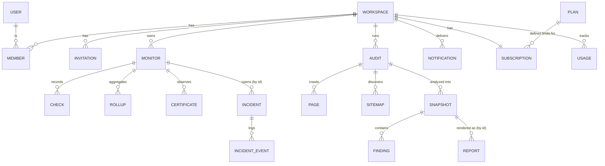

# UptimePilot Firestore Schema

| | |
|---|---|
| Status | Draft v0.1, **proposal; nothing here is deployed** |
| Last updated | 2026-10-21 |
| Related | [`PRODUCT_SPEC.md`](PRODUCT_SPEC.md) (requirement IDs such as `MON-5`), [`ARCHITECTURE.md`](ARCHITECTURE.md) (§5 sketch, which this document refines), [`CLAUDE.md`](../CLAUDE.md) |

> **No Firestore collection, index, security rule, TTL policy or `firestore.indexes.json` exists.** The repository contains no application code or Firebase configuration. Everything below is a design to be validated, then implemented and deployed deliberately.

## How to read this document

- **[Proposed]**: a recommendation in this draft, not yet accepted.
- **⚠ Validate**: a choice that must be verified (cost, platform limit, legal, or load) before production. All such items are collected in [§13](#13-validation-register-deviations-and-open-questions).
- Example documents are illustrative; IDs and values are made up. Timestamps are shown as ISO strings but are Firestore `timestamp` values.
- Product numbers (plan prices, quotas, retention periods) are **provisional** per `PRODUCT_SPEC.md` and appear here only as configuration examples.

---

## 1. Scope, conventions and limits

### 1.1 Access model (from ARCHITECTURE §5.1)

Browsers do not access Firestore. **All reads and writes go through the backend API and workers using service credentials**, which bypass security rules. Client security rules are `deny all` (defense in depth, [§9](#9-security-rules-design-principles)). Therefore **tenant isolation is enforced by backend code and data layout, not by rules alone** ([§8](#8-tenant-isolation-strategy), [§10](#10-backend-authorization-requirements)).

### 1.2 Field types

`string`, `int` (64-bit), `double`, `bool`, `timestamp`, `map`, `array<T>`, `bytes`, `null`. Enumerations are stored as lowercase `string`s and validated by the backend (rules cannot be relied on to validate server writes). **Firestore `reference` values are not used**; relations are stored as ID strings so documents survive moves, exports and emulator restores. Money is stored as integer minor units (paise), never `double`.

### 1.3 Naming

Fields are `lowerCamelCase`. Timestamps end in `At`; durations end in `Ms` or `Sec`; ID relations end in `Id` (or `Ids`). Counts are `…Count`. Boolean fields read as predicates (`capReached`, `cancelRequested`).

### 1.4 Envelope fields

Every document in a workspace-scoped collection carries, in addition to its listed fields:

| Field | Type | Req | Notes |
|---|---|:--:|---|
| `workspaceId` | string | ✓ | Redundant with the path; **must equal the path segment** (validated on every write). Needed for collection-group queries, exports and defensive checks. |
| `schemaVersion` | int | ✓ | Starts at `1`. Lets readers handle old shapes during migrations. |
| `createdAt` | timestamp | ✓ | Server-generated at create. Never client-supplied. |
| `updatedAt` | timestamp | on mutable docs | Server-generated on each write. Absent on immutable documents. |

Global (top-level) documents carry `schemaVersion`, `createdAt` and, if mutable, `updatedAt`.

### 1.5 Timestamps

- **Audit/bookkeeping timestamps** (`createdAt`, `updatedAt`, `readyAt`, `appliedAt`, …) are **server-generated** by the backend, using Firestore's server-timestamp transform where the write API supports it, otherwise the backend's injected `Clock`. Values from request bodies are never accepted for these fields.
- **Logical times** (`scheduledAt` of a check, `bucketStart`, `notAfter` of a certificate, provider event times) are facts about the world or the schedule, set by the system from authoritative sources.
- Inequality queries on timestamps are always UTC; presentation time zones are a UI concern.
- Clock source for workers is the platform clock; skew is bounded by lease margins (§1.8).

### 1.6 Document IDs [Proposed]

| Kind | Strategy | Used for |
|---|---|---|
| **Random opaque** | 20-character `[A-Za-z0-9]` string from a CSPRNG, **generated server-side** (the client SDK is not used) | Workspaces, monitors, audits, reports, invitations, incidents' non-derived parts |
| **Identity** | The Firebase Auth `uid` | `users`, `members`, `platformAdmins`, `notificationPreferences` |
| **Deterministic derived** | Stable function of the natural key, e.g. `sha256(...)` truncated to 32 hex chars, or a zero-padded timestamp | Anything written by retried/at-least-once code: checks, pages, findings, notifications, webhook events, alerts |
| **Config slug** | Fixed human-readable string | `plans/free`, `default`, `current` |

Rules:
1. **No PII, URLs, or secrets in document IDs** (IDs appear in logs, URLs and error messages). URLs and emails are hashed.
2. IDs never contain `/`, are never `.`/`..`, and never match `__.*__` (Firestore restrictions) **⚠ Validate against current limits**.
3. Unguessable IDs are a convenience, **not an access control**. Authorization checks always run.
4. Zero-padded fixed-width numbers (e.g. 10-digit epoch seconds) are used where lexicographic order must equal chronological order.
5. Sequential IDs are acceptable only where write rate per parent is low (per-monitor checks); they would hotspot at very high rates **⚠ Validate** (Firestore guidance on sequential keys).

### 1.7 Size and query bounds (platform limits are **⚠ Validate** against current Firestore documentation)

- Documents stay far below the 1 MiB limit: **target < 50 KB**, hard application cap 200 KB, enforced by truncating/bounding every free-text and array field (limits are listed per collection).
- **Every list query has a limit.** Default page size 25, maximum 100. Worker scans: dispatch batches ≤ 500, cleanup batches ≤ 200. There is no unbounded `get all`, and no offset pagination.
- Batched/transactional writes stay ≤ 500 operations; larger jobs are chunked and resumable.
- A single document is not written more than about once per second sustained (hot counters are avoided; see `usage`).

### 1.8 Leases

Documents claimed by workers carry `leaseUntil` (timestamp) and `leaseToken` (string). A claim is a transaction that checks `leaseUntil <= now` and sets both. Handlers finish well before `leaseUntil`; the reaper reclaims expired leases. Lease margins exceed expected clock skew.

### 1.9 Retention fields

Documents deleted by TTL carry **`purgeAt`** (timestamp) and a Firestore TTL policy on that field per collection group. **⚠ Validate:** TTL deletion is asynchronous (not instantaneous), does not guarantee exact timing, and does not delete a document's subcollections, so subcollection cleanup uses explicit jobs (§7).

---

## 2. Tenant model: subcollections vs top-level collections

### 2.1 The two options

| | A. Workspace-scoped subcollections | B. Top-level collections with a `workspaceId` field |
|---|---|---|
| Path | `workspaces/{wid}/monitors/{mid}` | `monitors/{mid}` with `workspaceId: wid` |
| Tenant in path | **Yes**; impossible to build a path that omits the tenant | No; depends on a `where workspaceId == X` in every query |
| Missed filter | Query is scoped by construction | **One missed filter leaks across tenants** (and server credentials bypass rules, so rules would not catch it) |
| Security rules (if ever used for client access) | Path variable `wid` makes membership checks simple | Rules must check `resource.data.workspaceId` per doc; queries must provably include the filter |
| Tenant deletion (WS-6) | Enumerate one subtree | Query-and-delete across every collection, with risk of missing some |
| Global scans (dispatcher, reaper) | Needs **collection-group queries** and collection-group-scope indexes | Simple top-level queries |
| Cross-tenant ID collisions | Possible in theory (IDs are only unique within a parent); collection-group results must be disambiguated by `workspaceId` | IDs unique per collection |
| Moving a doc between workspaces | Copy + delete | Update one field (not a supported product operation) |
| Hot spots | Naturally spread by tenant | Large collections need care |
| Analytics/export | Collection-group export or per-tenant export | Straightforward |

### 2.2 Decision [Proposed]

**Use workspace-scoped subcollections for all tenant-owned data (Option A).** The tenant boundary is the most important invariant in the system (`CLAUDE.md` #8); making it structural (a property of the path) is stronger than making it a property of every query.

Consistency rules:

| Rule | Statement |
|---|---|
| **R1** | A document owned by exactly one workspace lives under `workspaces/{wid}/…`, always. No tenant-owned top-level collections. |
| **R2** | Top-level collections exist only for entities that **exist outside or across workspaces**: `users`, `plans`, platform data (`platformAdmins`, `adminAuditEvents`, `securityEvents`, `blockedHosts`), provider-level ingestion (`paymentWebhookEvents`), and global email suppression. |
| **R3** | Server-internal scans that must cross tenants (due-monitor dispatch, lease reaping, outbox sending, invitation-token lookup, "my workspaces") use **collection-group queries**, only from worker/service code paths, never from user-facing handlers. Documents scanned this way carry the redundant `workspaceId`. |
| **R4** | Every collection-group result is re-loaded or re-validated under its tenant path before acting (`workspaceId` field must equal the path's workspace segment). |
| **R5** | Payloads from provider webhooks (tenant unknown at arrival) land top-level, then resolve to a `workspaceId` and apply to tenant data. |

Accepted costs: collection-group indexes must be defined explicitly; `workspaceId` is stored redundantly; cross-tenant analytics needs a collection-group export. **⚠ Validate:** the dispatcher's collection-group query at the expected scale (index size, cost, read amplification) before freezing.

---

## 3. Structure overview

```
users/{uid}
plans/{planId}
paymentWebhookEvents/{eventKey}
platformAdmins/{uid}
adminAuditEvents/{eventId}
securityEvents/{eventId}
blockedHosts/{hostHash}
emailSuppressions/{emailHash}

workspaces/{workspaceId}
├── members/{uid}
├── invitations/{inviteId}
├── monitors/{monitorId}
│   ├── secrets/current
│   ├── checks/{checkId}
│   ├── rollups/{bucketId}
│   ├── certificates/{fingerprint32}
│   └── certAlerts/{alertId}
├── incidents/{incidentId}
│   └── events/{seq}
├── audits/{auditId}
│   ├── crawlMeta/robots
│   ├── sitemaps/{sitemapId}
│   ├── pages/{pageId}
│   └── snapshots/{snapshotId}
│       └── findings/{findingId}
├── recommendations/{recKey}
├── reports/{reportId}
│   └── downloads/{downloadId}
├── notificationSettings/{default | monitor_{monitorId}}
├── notificationPreferences/{uid}
├── notifications/{notificationId}
├── subscriptions/current
├── subscriptionEvents/{eventKey}
├── usage/{current | period-YYYYMM}
├── auditEvents/{eventId}
└── idempotencyKeys/{keyHash}
```



Relations marked "by id" are ID strings, not subcollection nesting.

---

## 4. Collection reference

Template for each entry: **Purpose · ID · Fields · Example · Authorization · Queries · Indexes · Retention.** Fields tables list collection-specific fields; envelope fields (§1.4) are implied for workspace-scoped collections. "Req" = required (must be present and valid); optional fields may be absent or `null`.

### 4.1 Global collections

#### G1. `users/{uid}`

**Purpose.** Minimal profile for a person, keyed to Firebase Auth. Authentication data (credentials, providers) stays in Firebase Auth; this holds only what the app needs.
**ID.** Firebase Auth `uid` (identity).

| Field | Type | Req | Notes |
|---|---|:--:|---|
| `email` | string | ✓ | Lowercased copy, synced from the verified token. Needed to resolve notification recipients without per-send Auth lookups. ⚠ Validate (privacy: could resolve from Auth at send time instead) |
| `emailVerified` | bool | ✓ | Mirror of the token claim; the token, not this field, gates AUTH-2. |
| `displayName` | string | | ≤ 100 chars |
| `locale` | string | | e.g. `en-IN` |
| `timeZone` | string | | IANA name |
| `defaultWorkspaceId` | string | | Must be a workspace the user belongs to; validated on use |
| `status` | enum | ✓ | `active` \| `disabled` |

```json
{
  "email": "asha@example.com", "emailVerified": true, "displayName": "Asha",
  "locale": "en-IN", "timeZone": "Asia/Kolkata",
  "defaultWorkspaceId": "Wk3pQ9xT2mR7vLc4HnZa", "status": "active",
  "schemaVersion": 1, "createdAt": "2026-10-21T09:00:00Z", "updatedAt": "2026-10-21T09:00:00Z"
}
```

**Authorization.** Read/write only the caller's own document via `GET/PATCH /me`; `status` and `email` are server-managed, never client-patchable. Platform admins reach it only via the audited admin API. No workspace role grants access to another user's profile (members see `displayName` and `role` through the membership API view, not the raw document).
**Queries.** Get by `uid`. No lookup-by-email query is needed (invitations match the verified token email).
**Indexes.** None beyond automatic single-field.
**Retention.** Kept while the account exists. On account deletion: document deleted, memberships removed, owned workspaces must be transferred or deleted first; references in audit logs remain as the opaque `uid`.

#### G2. `plans/{planId}`

**Purpose.** Plan definitions as **configuration** (BILL-4). All numbers are **provisional, unvalidated pricing hypotheses** (PRODUCT_SPEC §5.10), not market facts.
**ID.** Config slug: `free`, `starter`, `agency`, `pro`.

| Field | Type | Req | Notes |
|---|---|:--:|---|
| `displayName` | string | ✓ | |
| `status` | enum | ✓ | `active` \| `hidden` \| `retired` |
| `version` | int | ✓ | Incremented on every change |
| `provisional` | bool | ✓ | `true` until pricing is validated; UI/marketing must not present provisional plans as committed offers |
| `price` | map | ✓ | `{currency: "INR", amountMinor: int, interval: "month"}`; `amountMinor` is paise (₹699 → 69900) |
| `quotas` | map | ✓ | See below. A `null` value means **"not yet decided" and is a launch blocker** (PRODUCT_SPEC Q-5/6/7); enforcement code treats it as the most restrictive safe default and logs a warning |
| `effectiveFrom` | timestamp | ✓ | |
| `updatedBy` | string | ✓ | Platform admin uid |

`quotas` keys (**⚠ Validate**, only the first two come from the brief): `maxMonitors` (int), `maxPagesPerAudit` (int), `minCheckIntervalSec` (int\|null), `historyRetentionDays` (int\|null), `maxMembers` (int\|null), `maxAuditsPerMonth` (int\|null), `maxReportsPerMonth` (int\|null), `maxAiRequestsPerMonth` (int\|null).

```json
{
  "displayName": "Starter", "status": "active", "version": 1, "provisional": true,
  "price": { "currency": "INR", "amountMinor": 69900, "interval": "month" },
  "quotas": { "maxMonitors": 10, "maxPagesPerAudit": 50, "minCheckIntervalSec": null,
              "historyRetentionDays": null, "maxMembers": null, "maxAuditsPerMonth": null,
              "maxReportsPerMonth": null, "maxAiRequestsPerMonth": null },
  "effectiveFrom": "2026-10-21T00:00:00Z", "updatedBy": "ADMIN_UID",
  "schemaVersion": 1, "createdAt": "2026-10-21T00:00:00Z", "updatedAt": "2026-10-21T00:00:00Z"
}
```

**Authorization.** Read: any authenticated user may read `active` plans via the API (pricing page). Write: platform admins only, audited (`adminAuditEvents`). Workspaces never read this per request; they use their `entitlements` snapshot (W1).
**Queries.** List `status == active`, `limit ≤ 20`. Get by id.
**Indexes.** Automatic only.
**Retention.** Plans are never deleted, only `retired`, because workspaces reference `planId`/`planVersion`. Editing a plan does **not** silently change existing workspaces' entitlements (an explicit, audited "apply" step recomputes them).

#### G3. `paymentWebhookEvents/{eventKey}`

**Purpose.** Idempotency ledger and inbox for verified payment-provider events. The provider is **not yet chosen** (PRODUCT_SPEC Q-19), so fields stay provider-neutral.
**ID.** `{provider}__{sha256(providerEventId)[:40]}` (deterministic; **create-if-absent is the idempotency gate**).

| Field | Type | Req | Notes |
|---|---|:--:|---|
| `provider` | string | ✓ | Provider key |
| `providerEventId` | string | ✓ | Raw event ID (opaque, non-secret) |
| `type` | string | ✓ | Provider event type |
| `providerCreatedAt` | timestamp | ✓ | Event time per provider; used to ignore stale/out-of-order events |
| `receivedAt` | timestamp | ✓ | Server |
| `status` | enum | ✓ | `received` → `queued` → `processing` → `processed` \| `ignored` \| `failed` |
| `attempts` | int | ✓ | |
| `workspaceId` | string\|null | | Resolved from the provider's customer/subscription reference; `null` until resolved |
| `payloadHash` | string | ✓ | sha256 of the verified raw body |
| `summary` | map | | **Minimal sanitized extract** needed for processing (subscription ref, plan key, status, amounts); never full payloads, never card or customer personal data |
| `lastErrorCode` | string | | Short code; no raw payload |
| `processedAt` | timestamp | | |
| `purgeAt` | timestamp | ✓ | See retention |

```json
{
  "provider": "exampleprovider", "providerEventId": "evt_123", "type": "subscription.updated",
  "providerCreatedAt": "2026-10-21T10:00:00Z", "receivedAt": "2026-10-21T10:00:02Z",
  "status": "processed", "attempts": 1, "workspaceId": "Wk3pQ9xT2mR7vLc4HnZa",
  "payloadHash": "ab12…", "summary": { "subscriptionRef": "sub_9", "planKey": "starter", "status": "active" },
  "processedAt": "2026-10-21T10:00:03Z", "purgeAt": "2028-10-21T00:00:00Z",
  "schemaVersion": 1, "createdAt": "2026-10-21T10:00:02Z"
}
```

**Authorization.** Written only by the webhook handler **after signature verification**; unverified requests create **no** document (they increment a `securityEvents` counter). Read only by billing workers and platform admins (audited). Never exposed to workspace users.
**Queries.** Get by id (dedupe). Worker pickup: `status in [received, queued]` limited to 100 (composite, below). Support lookup: by `workspaceId` + `receivedAt desc`.
**Indexes.** `(status ASC, receivedAt ASC)`; `(workspaceId ASC, receivedAt DESC)`.
**Retention.** Provisional: 24 months (financial/dispute traceability), then TTL on `purgeAt`. ⚠ Validate with legal/accounting (tax-record rules). Because `summary` is minimal, retention risk is low.

#### G4. `platformAdmins/{uid}`

**Purpose.** Allow-list of platform administrators, double-checked with a custom claim (ADM-1, ADM-5).
**ID.** `uid`.

| Field | Type | Req | Notes |
|---|---|:--:|---|
| `role` | enum | ✓ | `support` \| `operator` \| `admin` |
| `addedBy` | string | ✓ | uid |
| `disabledAt` | timestamp\|null | | Soft-disable |
| `mfaEnrolled` | bool | ✓ | Admin API refuses admins without MFA (**⚠ Validate** how MFA state is verified server-side) |

```json
{ "role": "support", "addedBy": "SUPERADMIN_UID", "disabledAt": null, "mfaEnrolled": true,
  "schemaVersion": 1, "createdAt": "2026-10-21T00:00:00Z", "updatedAt": "2026-10-21T00:00:00Z" }
```

**Authorization.** Created and modified **out-of-band** (operator script/console under change control), never through the customer-facing API. Read only by the admin auth middleware.
**Queries.** Get by uid. **Indexes.** None. **Retention.** Retained; disabled rather than deleted, with changes logged in `adminAuditEvents`.

#### G5. `adminAuditEvents/{eventId}`

**Purpose.** Append-only record of platform-administrator actions and any admin access to customer data (ADM-3).
**ID.** Random opaque.

| Field | Type | Req | Notes |
|---|---|:--:|---|
| `at` | timestamp | ✓ | Server |
| `actorUid` | string | ✓ | |
| `actorRole` | string | ✓ | |
| `action` | string | ✓ | Dotted verb, e.g. `workspace.suspend`, `plan.update`, `customerData.view` |
| `targetType` | string | ✓ | |
| `targetId` | string | ✓ | |
| `workspaceId` | string | | Affected tenant, if any |
| `reason` | string | ✓ for sensitive actions | Free text ≤ 500; ticket reference preferred |
| `result` | enum | ✓ | `success` \| `denied` \| `error` |
| `requestId` | string | ✓ | Correlates to logs |
| `changes` | map | | Whitelisted fields, before/after, **no secrets or personal data** |

```json
{ "at": "2026-10-21T11:00:00Z", "actorUid": "ADMIN_UID", "actorRole": "support",
  "action": "customerData.view", "targetType": "monitor", "targetId": "mon…",
  "workspaceId": "Wk3pQ9xT2mR7vLc4HnZa", "reason": "Ticket 4821", "result": "success",
  "requestId": "req-77", "schemaVersion": 1, "createdAt": "2026-10-21T11:00:00Z" }
```

**Authorization.** Create-only by the admin API (the application identity has no update/delete code path). **⚠ Validate:** Firestore IAM cannot separate "create" from "update/delete" for the same service account, so true immutability needs a secondary sink (e.g. an export to a locked-retention log/bucket). Read: platform admins with `admin` role only, audited.
**Queries.** `at DESC` (limit ≤ 100); by `workspaceId` + `at DESC`; by `actorUid` + `at DESC`.
**Indexes.** `(workspaceId ASC, at DESC)`; `(actorUid ASC, at DESC)`.
**Retention.** Provisional 24 months online, then TTL on `purgeAt` (the immutable sink may retain longer). ⚠ Validate with legal.

#### G6. `securityEvents/{eventId}`

**Purpose.** Aggregated security signals: auth-failure bursts, cross-tenant access denials, SSRF blocks, webhook signature failures, rate-limit hits (feeds operational alerts, ARCHITECTURE §13.5).
**ID.** Deterministic: `{type}_{minuteBucketEpoch}_{keyHash}`, so repeated events in the same minute increment one document instead of writing thousands (bounded writes under attack).

| Field | Type | Req | Notes |
|---|---|:--:|---|
| `type` | enum | ✓ | `auth_failed` \| `tenant_denied` \| `ssrf_blocked` \| `webhook_signature_failed` \| `rate_limited` \| `admin_denied` |
| `bucketStart` | timestamp | ✓ | Minute |
| `count` | int | ✓ | Atomic increment |
| `workspaceId` | string | | If attributable |
| `actorUid` | string | | If attributable |
| `subject` | map | | Non-sensitive: e.g. `{ruleCode, hostHash}`; **no full URLs, tokens or raw IPs** (IP prefix `/24` or `/48` at most, ⚠ Validate with privacy review) |
| `purgeAt` | timestamp | ✓ | |

```json
{ "type": "ssrf_blocked", "bucketStart": "2026-10-21T11:05:00Z", "count": 14,
  "workspaceId": "Wk3pQ9xT2mR7vLc4HnZa", "subject": { "ruleCode": "private_ip", "hostHash": "9c1f…" },
  "purgeAt": "2027-01-19T00:00:00Z", "schemaVersion": 1, "createdAt": "2026-10-21T11:05:01Z" }
```

**Authorization.** Written by API/worker code; read by platform admins and the alerting job only.
**Queries.** `type == X` + `bucketStart DESC` (limit ≤ 100); `workspaceId == X` + `bucketStart DESC`.
**Indexes.** `(type ASC, bucketStart DESC)`; `(workspaceId ASC, bucketStart DESC)`.
**Retention.** Provisional 90 days via TTL on `purgeAt`.

#### G7. `blockedHosts/{hostHash}`

**Purpose.** Abuse control: hosts/domains that must not be monitored or crawled (ADM-6), consulted by `SafeFetcher` in addition to IP rules.
**ID.** `sha256(lowercase registrable host or exact host)[:32]`.

| Field | Type | Req | Notes |
|---|---|:--:|---|
| `host` | string | ✓ | Normalized hostname |
| `matchType` | enum | ✓ | `exact` \| `suffix` |
| `reason` | string | ✓ | Short code + note |
| `blockedBy` | string | ✓ | Admin uid |
| `expiresAt` | timestamp\|null | | `null` = permanent |

```json
{ "host": "victim.example", "matchType": "suffix", "reason": "abuse-report-1042",
  "blockedBy": "ADMIN_UID", "expiresAt": null, "schemaVersion": 1,
  "createdAt": "2026-10-21T00:00:00Z", "updatedAt": "2026-10-21T00:00:00Z" }
```

**Authorization.** Write: platform admins, audited. Read: fetch workers and API (cached in memory with short TTL). **Queries.** Get by hash (exact and each parent suffix, ≤ 5 gets per check, cached). **Indexes.** None. **Retention.** Until `expiresAt`/removal; removal is audited.

#### G8. `emailSuppressions/{emailHash}`

**Purpose.** Do-not-send list from bounces, complaints and unsubscribes (NOTIF-6/7).
**ID.** `HMAC-SHA256(lowercase email, server pepper)[:40]`. The pepper is held in the secret store, so the document does not reveal the address. ⚠ Validate.

| Field | Type | Req | Notes |
|---|---|:--:|---|
| `reason` | enum | ✓ | `hard_bounce` \| `complaint` \| `unsubscribe_all` |
| `providerEventRef` | string | | Opaque ref |
| `scope` | enum | ✓ | `marketing_and_alerts` \| `non_mandatory` (mandatory security mail may still send, policy decision) |

```json
{ "reason": "hard_bounce", "scope": "non_mandatory", "providerEventRef": "bnc_88",
  "schemaVersion": 1, "createdAt": "2026-10-21T12:00:00Z" }
```

**Authorization.** Written by the email-provider webhook handler (signature verified); read by the sender. **Queries.** Get by hash before every send. **Indexes.** None. **Retention.** Retained (deleting it would re-enable mail to a bounced address); reviewed periodically. ⚠ Validate against privacy-law erasure requests.

---

### 4.2 Workspace root and membership

#### W1. `workspaces/{workspaceId}`

**Purpose.** The tenant root: identity, ownership, plan, entitlements and lifecycle state.
**ID.** Random opaque.

| Field | Type | Req | Notes |
|---|---|:--:|---|
| `name` | string | ✓ | 1–80 chars |
| `ownerUid` | string | ✓ | Must equal the member with `role == owner` (invariant, §10) |
| `status` | enum | ✓ | `active` \| `suspended` \| `deleting` |
| `statusReason` | string | | Code (not free text with personal data) |
| `planId` | string | ✓ | `free` for new workspaces |
| `planVersion` | int | ✓ | Version of the plan the entitlements were derived from |
| `entitlements` | map | ✓ | Snapshot of effective limits (same keys as `plans.quotas`) after any admin overrides; **the only thing request-time quota checks read** |
| `entitlementsOverride` | map | | Admin-set overrides, audited |
| `createdBy` | string | ✓ | uid |
| `deletionRequestedAt` | timestamp | | |
| `deletionScheduledFor` | timestamp | | Grace period end |

```json
{
  "name": "Acme Agency", "ownerUid": "7fK2mQxP9aLdR3sTzV8bYcNe1HoU", "status": "active",
  "planId": "free", "planVersion": 1,
  "entitlements": { "maxMonitors": 5, "maxPagesPerAudit": 25, "minCheckIntervalSec": null,
                    "historyRetentionDays": null, "maxMembers": null, "maxAuditsPerMonth": null,
                    "maxReportsPerMonth": null, "maxAiRequestsPerMonth": null },
  "createdBy": "7fK2mQxP9aLdR3sTzV8bYcNe1HoU",
  "workspaceId": "Wk3pQ9xT2mR7vLc4HnZa", "schemaVersion": 1,
  "createdAt": "2026-10-21T09:00:00Z", "updatedAt": "2026-10-21T09:00:00Z"
}
```

(`workspaceId` on this document equals its own ID.)
**Authorization.** Read: any member of the workspace. Update `name`: owner/admin. `ownerUid`, `planId`, `entitlements*`, `status`: **server-only** (ownership transfer by owner; plan/entitlements by billing code or platform admin; `suspended` by platform admin). Create: any verified user (creates their own workspace, subject to a per-user workspace limit, **⚠ Validate** PRODUCT_SPEC Q-2).
**Queries.** Get by id (every authenticated request loads or caches it for status/entitlements, so suspended/deleting workspaces are rejected). Deletion sweep: `status == deleting AND deletionScheduledFor <= now`, limit 50.
**Indexes.** `(status ASC, deletionScheduledFor ASC)` on `workspaces`.
**Retention.** Deleted per WS-6 after the grace period: a deletion job removes all subcollections, the storage prefix, and then the root document; billing/audit records required by law are anonymized or retained per §7.

#### W2. `workspaces/{wid}/members/{uid}`

**Purpose.** Membership and role. **Authorization source of truth.**
**ID.** The member's `uid` (identity), so "is X a member and with which role" is a single `get`.

| Field | Type | Req | Notes |
|---|---|:--:|---|
| `uid` | string | ✓ | Equals the ID; stored so collection-group queries can filter on it |
| `role` | enum | ✓ | `owner` \| `admin` \| `member` |
| `addedBy` | string | ✓ | uid (self for the creator) |
| `inviteId` | string | | Source invitation, if any |
| `roleChangedAt` | timestamp | | |

```json
{ "uid": "7fK2mQxP9aLdR3sTzV8bYcNe1HoU", "role": "owner", "addedBy": "7fK2mQxP9aLdR3sTzV8bYcNe1HoU",
  "workspaceId": "Wk3pQ9xT2mR7vLc4HnZa", "schemaVersion": 1,
  "createdAt": "2026-10-21T09:00:00Z", "updatedAt": "2026-10-21T09:00:00Z" }
```

**Authorization.** Read own membership: self. List/read others: owner/admin/member (display data only). Create/update/delete: owner/admin per the permission matrix (admins cannot touch the owner or grant `owner`); **owner transfer is a transaction updating `workspaces.ownerUid` and two member docs**. Removal deletes the document, effective on the next request (WS-4).
**Queries.** (1) **Hottest read:** `get(workspaces/{wid}/members/{uid})` on every request. (2) List members: `orderBy createdAt, limit ≤ 100`. (3) "My workspaces": **collection group** `members where uid == X`, limit 50 (workspace switcher; server-only).
**Indexes.** Collection-group single-field index on `uid` (scope: collection group, `members`). ⚠ Validate (not automatic for collection-group queries).
**Retention.** Lives with the workspace; deleted on removal. A removed member's authored data keeps their opaque `uid`.

#### W3. `workspaces/{wid}/invitations/{inviteId}`

**Purpose.** Pending, single-use, expiring invitations (WS-3).
**ID.** Random opaque. The emailed token is a separate 256-bit random value; only its hash is stored.

| Field | Type | Req | Notes |
|---|---|:--:|---|
| `tokenHash` | string | ✓ | sha256 hex of the token; collection-group lookup key |
| `inviteeEmail` | string | ✓ | Lowercased; **personal data**, cleared at acceptance/expiry by cleanup and deleted by TTL |
| `role` | enum | ✓ | `admin` \| `member` (never `owner`) |
| `status` | enum | ✓ | `pending` \| `accepted` \| `revoked` \| `expired` |
| `invitedBy` | string | ✓ | uid |
| `expiresAt` | timestamp | ✓ | Logical validity |
| `acceptedAt` / `acceptedBy` | timestamp / string | | |
| `purgeAt` | timestamp | ✓ | `expiresAt` or acceptance + 30 days |

```json
{ "tokenHash": "e3b0c4…", "inviteeEmail": "dev@example.com", "role": "member", "status": "pending",
  "invitedBy": "7fK2mQxP9aLdR3sTzV8bYcNe1HoU", "expiresAt": "2026-10-28T09:00:00Z",
  "purgeAt": "2026-11-27T09:00:00Z", "workspaceId": "Wk3pQ9xT2mR7vLc4HnZa",
  "schemaVersion": 1, "createdAt": "2026-10-21T09:00:00Z", "updatedAt": "2026-10-21T09:00:00Z" }
```

**Authorization.** Create/revoke/list: owner/admin. Accept: any signed-in user **whose verified token email equals `inviteeEmail`**; acceptance is a transaction (`pending → accepted`, create `members/{uid}`), so it is single-use and race-safe. The token alone never grants access.
**Queries.** Collection group `invitations where tokenHash == H` (server-only, limit 1). Admin list: `status == pending`, `createdAt DESC`, limit ≤ 100. Cleanup: collection group `status == pending AND expiresAt <= now`, limit 200.
**Indexes.** Collection-group on `tokenHash`; `(status ASC, createdAt DESC)` (collection); `(status ASC, expiresAt ASC)` (collection group).
**Retention.** TTL on `purgeAt` (30 days past resolution).

---

### 4.3 Monitoring

#### W4. `workspaces/{wid}/monitors/{monitorId}`

**Purpose.** A monitor's configuration, current state and scheduling state (MON-1..MON-11).
**ID.** Random opaque.

| Field | Type | Req | Notes |
|---|---|:--:|---|
| `name` | string | ✓ | ≤ 100 |
| `type` | enum | ✓ | `website` \| `api` |
| `url` | string | ✓ | As entered, validated by `SafeFetcher` rules; ≤ 2048; no credentials in URL |
| `host` | string | ✓ | Normalized hostname (per-host rate limiting, ADM-6) |
| `method` | enum | ✓ | `GET` default; API monitors may use an allow-list of methods |
| `headerNames` | array<string> | | Names only, ≤ 20, for display. **Values are secrets** (W5) |
| `hasBody` | bool | | Body is stored in W5 |
| `expectedStatus` | array<int> | ✓ | Accepted codes, ≤ 20 (default 200–399 expressed explicitly) |
| `intervalSec` | int | ✓ | ≥ plan minimum |
| `timeoutSec` | int | ✓ | Bounded by platform maximum |
| `maxRedirects` | int | ✓ | ≤ platform maximum |
| `failureThreshold` | int | ✓ | Consecutive failures before an incident (MON-5) |
| `status` | enum | ✓ | `active` \| `paused` \| `quota_suspended` \| `deleting` |
| `state` | enum | ✓ | `pending` \| `up` \| `down` \| `unknown` |
| `stateSince` | timestamp | | |
| `consecutiveFailures` | int | ✓ | |
| `lastCheck` | map | | `{checkId, scheduledAt, ok, httpStatus, latencyMs, errorCategory}`, denormalized for list views |
| `openIncidentId` | string\|null | | Downtime incident currently open |
| `nextCheckAt` | timestamp\|null | | `null` when paused/deleting |
| `leaseUntil` / `leaseToken` | timestamp / string | | §1.8 |
| `sslEnabled` | bool | ✓ | True for `https:` URLs |
| `certNextCheckAt` | timestamp\|null | | `null` when no SSL inspection is due/enabled |
| `certState` | map | | `{fingerprint32, notAfter, status}` summary of the current certificate |
| `configVersion` | int | ✓ | Incremented on config change; probes record it so history is explainable |
| `createdBy` | string | ✓ | uid |

```json
{
  "name": "Marketing site", "type": "website", "url": "https://example.com/", "host": "example.com",
  "method": "GET", "headerNames": [], "hasBody": false, "expectedStatus": [200,301,302],
  "intervalSec": 300, "timeoutSec": 10, "maxRedirects": 5, "failureThreshold": 3,
  "status": "active", "state": "up", "stateSince": "2026-10-21T09:05:00Z", "consecutiveFailures": 0,
  "lastCheck": { "checkId": "1792584000", "scheduledAt": "2026-10-21T12:00:00Z", "ok": true,
                 "httpStatus": 200, "latencyMs": 182, "errorCategory": null },
  "openIncidentId": null, "nextCheckAt": "2026-10-21T12:05:00Z",
  "sslEnabled": true, "certNextCheckAt": "2026-10-22T09:05:00Z",
  "certState": { "fingerprint32": "4d9a…", "notAfter": "2027-01-15T00:00:00Z", "status": "valid" },
  "configVersion": 1, "createdBy": "7fK2mQxP9aLdR3sTzV8bYcNe1HoU",
  "workspaceId": "Wk3pQ9xT2mR7vLc4HnZa", "schemaVersion": 1,
  "createdAt": "2026-10-21T09:00:00Z", "updatedAt": "2026-10-21T12:00:01Z"
}
```

**Authorization.** Read: any member. Create/edit: owner/admin/member (delete rights: PRODUCT_SPEC Q-3). **Creation is a transaction** that checks `entitlements.maxMonitors` against `usage/current.monitorsActive` and increments it (MON-10, AC-13). Worker-managed fields (`state`, `stateSince`, `consecutiveFailures`, `lastCheck`, `openIncidentId`, `nextCheckAt`, `lease*`, `certState`, `certNextCheckAt`) are written only by workers; the user-facing update path ignores them.
**Queries.**
1. List: `orderBy createdAt desc`, optional `status ==` or `state ==`, limit ≤ 100, cursor-paginated.
2. Dashboard "down": `state == down orderBy stateSince desc`, limit ≤ 100.
3. **Dispatch (collection group, worker-only):** `status == active AND nextCheckAt <= now orderBy nextCheckAt asc limit ≤ 500`.
4. **Cert dispatch (collection group, worker-only):** `status == active AND certNextCheckAt <= now orderBy certNextCheckAt asc limit ≤ 200`.

**Indexes.** Collection scope: `(status ASC, createdAt DESC)`; `(state ASC, stateSince DESC)`. Collection-group scope: `(status ASC, nextCheckAt ASC)`; `(status ASC, certNextCheckAt ASC)`.
**Retention.** Lives until deleted by a user; deletion sets `status = deleting`, decrements usage, then a job deletes subcollections (`checks`, `rollups`, `certificates`, `certAlerts`, `secrets`) in bounded chunks, then the document. Incidents and past notifications are retained per their own policies. **⚠ Validate:** the single-document write rate of `lastCheck`/`nextCheckAt` updates at 1-minute intervals (fine per monitor) and the dispatcher index size at scale.

#### W5. `workspaces/{wid}/monitors/{monitorId}/secrets/current`

**Purpose.** Encrypted API-monitor secrets (auth header values, request body) kept **apart from the monitor document** so list/detail responses and logs can never accidentally include them (MON-11).
**ID.** Fixed: `current`.

| Field | Type | Req | Notes |
|---|---|:--:|---|
| `headers` | map<string,string> | | header name → **ciphertext** (base64) |
| `bodyCiphertext` | string | | Optional |
| `keyVersion` | string | ✓ | Reference to the KMS key version used (a reference name, not key material) |
| `secretVersion` | int | ✓ | Increments on rotation or edit |

```json
{ "headers": { "Authorization": "AQICAHg…(ciphertext)" }, "keyVersion": "projects/…/cryptoKeyVersions/1",
  "secretVersion": 2, "workspaceId": "Wk3pQ9xT2mR7vLc4HnZa", "schemaVersion": 1,
  "createdAt": "2026-10-21T09:00:00Z", "updatedAt": "2026-10-21T09:10:00Z" }
```

**Authorization.** Write: API (encrypt-only privilege, if the key design allows, ⚠ Validate ARCHITECTURE Q-27). Read/decrypt: probe worker identity only. **No API read endpoint returns this document or its values**; the UI shows only `headerNames` and "set/replace". Never logged.
**Queries.** Get by path. **Indexes.** None. **Retention.** Deleted with the monitor.

#### W6. `workspaces/{wid}/monitors/{monitorId}/checks/{checkId}`

**Purpose.** One uptime check result (MON-4, HIST-1).
**ID.** Deterministic: `scheduledAt` as **10-digit zero-padded epoch seconds** (e.g. `1792584000`). A retried probe for the same schedule slot targets the same ID, and **create-if-absent** makes the write idempotent. ⚠ Validate: sub-second intervals are out of scope; if intervals < 1 s were ever allowed this ID would collide.

| Field | Type | Req | Notes |
|---|---|:--:|---|
| `scheduledAt` | timestamp | ✓ | Logical slot (equals the ID) |
| `startedAt` | timestamp | ✓ | When the probe began (server clock) |
| `ok` | bool | ✓ | |
| `state` | enum | ✓ | `up` \| `down` (a missed slot has no document and is shown as unknown) |
| `httpStatus` | int\|null | | |
| `latencyMs` | int\|null | | Total time to complete the check; `null` if it never connected |
| `errorCategory` | enum\|null | | `dns_failure` \| `connect_timeout` \| `tls_error` \| `unexpected_status` \| `redirect_limit` \| `blocked_by_policy` \| `response_too_large` \| `internal_error`; `null` when ok |
| `redirectCount` | int | | |
| `responseBytes` | int | | Bytes read (capped) |
| `configVersion` | int | ✓ | Monitor config used |
| `purgeAt` | timestamp | ✓ | `scheduledAt + retention` (plan retention, resolved at write time) |

```json
{ "scheduledAt": "2026-10-21T12:00:00Z", "startedAt": "2026-10-21T12:00:00Z", "ok": true, "state": "up",
  "httpStatus": 200, "latencyMs": 182, "errorCategory": null, "redirectCount": 1, "responseBytes": 18734,
  "configVersion": 1, "purgeAt": "2026-11-20T12:00:00Z", "workspaceId": "Wk3pQ9xT2mR7vLc4HnZa",
  "schemaVersion": 1, "createdAt": "2026-10-21T12:00:01Z" }
```

(Checks are immutable; there is no `updatedAt`.)
**Authorization.** Read: any member via the API. Written only by the probe worker, in a **transaction with the monitor-state update and the rollup increment**, guarded by "check document does not exist".
**Queries.** Recent: `orderBy __name__ desc` (equivalently `scheduledAt desc`), limit ≤ 100, cursor. Window: `scheduledAt >= from AND scheduledAt < to`, bounded page size. Failures: `ok == false orderBy scheduledAt desc`, limit ≤ 100.
**Indexes.** Single-field automatic on `scheduledAt`; composite `(ok ASC, scheduledAt DESC)`.
**Retention.** TTL on `purgeAt`. Provisional: 30/90/365 days by plan (PRODUCT_SPEC Q-7). **A plan change does not rewrite `purgeAt` of existing checks** (documented behavior). ⚠ Validate cost model (ARCHITECTURE S-4): a Pro tenant at 1-minute intervals writes ~216k check documents/day; **alternatives to evaluate before freezing**: (a) write per-check documents only on state change or sampling, relying on rollups for history; (b) hourly bucket documents holding up to 60 compact entries; (c) a non-Firestore time-series store. Uptime math (HIST-2) must match across representations.

#### W7. `workspaces/{wid}/monitors/{monitorId}/rollups/{bucketId}`

**Purpose.** Aggregates for charts and uptime percentages over long ranges (HIST-1, HIST-5) without scanning raw checks.
**ID.** `h_{yyyyMMddHH}` (hour, UTC) or `d_{yyyyMMdd}` (day, UTC). Bounded range queries use document-ID ranges (`d_20261001` … `d_20261031`).

| Field | Type | Req | Notes |
|---|---|:--:|---|
| `granularity` | enum | ✓ | `hour` \| `day` |
| `bucketStart` | timestamp | ✓ | |
| `expectedCount` | int | ✓ | Slots expected in the bucket given active periods |
| `checkCount` | int | ✓ | Recorded checks |
| `upCount` / `downCount` | int | ✓ | |
| `unknownCount` | int | ✓ | `expectedCount - checkCount`, computed by closure job |
| `latencyCount`, `latencySumMs`, `latencyMinMs`, `latencyMaxMs` | int | ✓ | |
| `latencyHistogram` | map<string,int> | | Fixed bucket upper-bound → count, for approximate percentiles ⚠ Validate |
| `closed` | bool | ✓ | `true` once the closure job finalizes the bucket |
| `purgeAt` | timestamp | ✓ | |

```json
{ "granularity": "hour", "bucketStart": "2026-10-21T12:00:00Z", "expectedCount": 12, "checkCount": 12,
  "upCount": 12, "downCount": 0, "unknownCount": 0,
  "latencyCount": 12, "latencySumMs": 2301, "latencyMinMs": 150, "latencyMaxMs": 260,
  "latencyHistogram": { "100": 0, "250": 11, "500": 1 }, "closed": false,
  "purgeAt": "2027-10-21T00:00:00Z", "workspaceId": "Wk3pQ9xT2mR7vLc4HnZa",
  "schemaVersion": 1, "createdAt": "2026-10-21T12:00:01Z", "updatedAt": "2026-10-21T12:55:01Z" }
```

**Authorization.** Read: members. Written only by the probe worker in the same transaction that creates the check (so the increment is applied exactly once per check), and by the closure job.
**Queries.** Range by ID prefix and bounds, `limit ≤ 400`.
**Indexes.** None beyond automatic (ID-range queries).
**Retention.** Hourly: provisional 90 days; daily: provisional 13 months (longer than raw checks). TTL on `purgeAt`. ⚠ Validate. Hot-document concern: each bucket takes ≤ 60 writes/hour per monitor (fine); revisit if intervals shrink.

#### W8. `workspaces/{wid}/incidents/{incidentId}`

**Purpose.** Downtime and certificate incidents (INC-1, INC-2, SSL-4).
**ID.** Deterministic: `{monitorId}-{kind}-{openedAtEpochSec}`. A retried handler recomputes the same ID, so opening is idempotent (AC-11).

| Field | Type | Req | Notes |
|---|---|:--:|---|
| `monitorId` | string | ✓ | |
| `kind` | enum | ✓ | `downtime` \| `certificate` |
| `status` | enum | ✓ | `open` \| `resolved` |
| `openedAt` | timestamp | ✓ | Logical: `scheduledAt` of the check that crossed the threshold |
| `openedByCheckId` | string | ✓ | |
| `resolvedAt` | timestamp\|null | | |
| `resolvedByCheckId` | string\|null | | |
| `durationSec` | int\|null | | Set on resolve |
| `failedCheckCount` | int | ✓ | |
| `firstErrorCategory` / `lastErrorCategory` | enum | ✓ | Same enum as checks |
| `certFingerprint32` | string | | For `certificate` incidents |
| `monitorName` | string | ✓ | Denormalized for lists/emails; refreshed on rename is **not** required (historical) |
| `eventSeq` | int | ✓ | Next event number for `events` |

```json
{ "monitorId": "Mn8vB2qX7rTc4LdZ9aPe", "kind": "downtime", "status": "resolved",
  "openedAt": "2026-10-21T13:00:00Z", "openedByCheckId": "1792587600",
  "resolvedAt": "2026-10-21T13:12:00Z", "resolvedByCheckId": "1792588320", "durationSec": 720,
  "failedCheckCount": 3, "firstErrorCategory": "connect_timeout", "lastErrorCategory": "connect_timeout",
  "monitorName": "Marketing site", "eventSeq": 3, "workspaceId": "Wk3pQ9xT2mR7vLc4HnZa",
  "schemaVersion": 1, "createdAt": "2026-10-21T13:00:02Z", "updatedAt": "2026-10-21T13:12:03Z" }
```

**Authorization.** Read: members. Written only by probe/cert workers via the pure incident state machine (ARCHITECTURE §6.2). Users cannot create or edit incidents (acknowledge/notes would be a later, separate field set).
**Queries.** Open incidents: `status == open orderBy openedAt desc`, limit ≤ 100. By monitor: `monitorId == X orderBy openedAt desc`, limit ≤ 100. Date range: `openedAt` range with limit ≤ 100.
**Indexes.** `(status ASC, openedAt DESC)`; `(monitorId ASC, openedAt DESC)`; `(monitorId ASC, status ASC, openedAt DESC)` if the UI filters both.
**Retention.** Provisional: 13 months or plan history retention, whichever is longer; then TTL via `purgeAt` (add the field when the policy is fixed ⚠ Validate). Events live and die with their incident (cleanup job, since TTL doesn't cascade).

#### W9. `workspaces/{wid}/incidents/{incidentId}/events/{seq}`

**Purpose.** Bounded timeline of significant incident transitions. **Not** one event per failed check (write bound).
**ID.** Zero-padded 6-digit sequence from `incidents.eventSeq` (assigned in the same transaction), so duplicates collapse on retry.

| Field | Type | Req | Notes |
|---|---|:--:|---|
| `type` | enum | ✓ | `opened` \| `error_category_changed` \| `notification_queued` \| `resolved` \| `manually_closed` |
| `at` | timestamp | ✓ | Logical time of the cause |
| `checkId` | string | | |
| `detail` | map | | Small, no secrets (e.g. `{from, to}`, `{notificationId}`) |

```json
{ "type": "opened", "at": "2026-10-21T13:00:00Z", "checkId": "1792587600",
  "detail": { "errorCategory": "connect_timeout" }, "workspaceId": "Wk3pQ9xT2mR7vLc4HnZa",
  "schemaVersion": 1, "createdAt": "2026-10-21T13:00:02Z" }
```

**Authorization.** As incidents. **Queries.** `orderBy __name__ asc`, limit ≤ 100 (incidents have few events; hard cap 200 per incident enforced by the writer). **Indexes.** None. **Retention.** Deleted with the parent incident.

#### W10. `workspaces/{wid}/monitors/{monitorId}/certificates/{fingerprint32}`

**Purpose.** SSL certificate observations: one document per distinct certificate seen on the monitor (SSL-1).
**ID.** First 32 hex characters of the certificate's SHA-256 fingerprint. A renewed certificate gets a new document; the old one is kept as history.

| Field | Type | Req | Notes |
|---|---|:--:|---|
| `fingerprintSha256` | string | ✓ | Full 64-hex |
| `subjectCn` | string | | |
| `issuer` | string | ✓ | Issuer DN (bounded 300 chars) |
| `notBefore` / `notAfter` | timestamp | ✓ | |
| `sans` | array<string> | | ≤ 25 entries, each ≤ 255; `sanCount` holds the true count |
| `sanCount` | int | ✓ | |
| `hostnameMatches` | bool | ✓ | Monitored host covered by subject/SAN |
| `chainValid` | bool | ✓ | |
| `trustError` | string\|null | | Short code (e.g. `expired`, `self_signed`, `untrusted_root`, `hostname_mismatch`) |
| `protocol` | string | | e.g. `TLSv1.3` |
| `status` | enum | ✓ | `valid` \| `expiring` \| `expired` \| `invalid` |
| `firstSeenAt` / `lastSeenAt` | timestamp | ✓ | Server |
| `purgeAt` | timestamp | ✓ | |

```json
{ "fingerprintSha256": "4d9a…(64 hex)", "subjectCn": "example.com", "issuer": "CN=Example CA",
  "notBefore": "2026-10-15T00:00:00Z", "notAfter": "2027-01-15T00:00:00Z",
  "sans": ["example.com","www.example.com"], "sanCount": 2, "hostnameMatches": true,
  "chainValid": true, "trustError": null, "protocol": "TLSv1.3", "status": "valid",
  "firstSeenAt": "2026-10-21T09:05:00Z", "lastSeenAt": "2026-10-21T09:05:00Z",
  "purgeAt": "2027-04-15T00:00:00Z", "workspaceId": "Wk3pQ9xT2mR7vLc4HnZa",
  "schemaVersion": 1, "createdAt": "2026-10-21T09:05:00Z", "updatedAt": "2026-10-21T09:05:00Z" }
```

**Authorization.** Read: members. Written by the cert-inspection worker only. Contains only public certificate data.
**Queries.** Current certificate: get by `monitor.certState.fingerprint32`. History: `orderBy lastSeenAt desc`, limit ≤ 20. **Indexes.** Automatic. **Retention.** TTL: `notAfter + 90 days` (provisional).

#### W11. `workspaces/{wid}/monitors/{monitorId}/certAlerts/{alertId}`

**Purpose.** Expiry-alert ledger: guarantees each threshold alerts at most once per certificate (SSL-2, SSL-3).
**ID.** `{fingerprint32}_{thresholdDays}`, **created with create-if-absent** before the notification is enqueued.

| Field | Type | Req | Notes |
|---|---|:--:|---|
| `fingerprint32` | string | ✓ | |
| `thresholdDays` | int | ✓ | e.g. 30, 14, 7, 1 (defaults are PRODUCT_SPEC Q-5) |
| `notAfter` | timestamp | ✓ | |
| `triggeredAt` | timestamp | ✓ | |
| `notificationId` | string | ✓ | ID of the `notifications` record created for this alert |
| `purgeAt` | timestamp | ✓ | |

```json
{ "fingerprint32": "4d9a…", "thresholdDays": 30, "notAfter": "2027-01-15T00:00:00Z",
  "triggeredAt": "2026-12-16T09:05:00Z", "notificationId": "a7c1…", "purgeAt": "2027-04-15T00:00:00Z",
  "workspaceId": "Wk3pQ9xT2mR7vLc4HnZa", "schemaVersion": 1, "createdAt": "2026-12-16T09:05:00Z" }
```

**Authorization.** Worker-written; members may read (shown on the monitor's SSL panel). **Queries.** Get by id (the gate); list per monitor `orderBy triggeredAt desc`, limit ≤ 20. **Indexes.** Automatic. **Retention.** TTL: `notAfter + 90 days`.

---

### 4.4 SEO audits

#### W12. `workspaces/{wid}/audits/{auditId}`

**Purpose.** An SEO audit **job**: request, configuration, progress and lifecycle. Result data lives in snapshots (W16). (SEO-1..SEO-10)
**ID.** Random opaque.

| Field | Type | Req | Notes |
|---|---|:--:|---|
| `startUrl` | string | ✓ | ≤ 2048, validated |
| `siteKey` | string | ✓ | Normalized host for grouping re-runs and comparisons (SEO-9) |
| `status` | enum | ✓ | `queued` \| `running` \| `cancelling` \| `analyzing` \| `completed` \| `failed` \| `cancelled` |
| `failureReason` | enum\|null | | `start_unreachable` \| `blocked_by_robots` \| `blocked_by_policy` \| `internal_error` \| `timeout` |
| `failureDetail` | string | | Short, safe, user-displayable; no internals |
| `pageCap` | int | ✓ | **Snapshot of the plan cap at start**; the crawler never exceeds it (AC-18) |
| `maxDepth` | int | ✓ | |
| `options` | map | ✓ | `{respectRobots: true, externalLinkCheck: bool, externalLinkBudget: int}` |
| `pagesDiscovered`, `pagesFetched`, `pagesFailed`, `pagesBlocked` | int | ✓ | Progress counters |
| `capReached` | bool | ✓ | |
| `nextStep` | int | ✓ | Step sequence; a step whose number ≠ `nextStep` is a no-op (ARCHITECTURE §7.3) |
| `nextDiscoverSeq` | int | ✓ | Allocator for page frontier order |
| `leaseUntil` / `leaseToken` | timestamp / string | | §1.8 |
| `cancelRequested` | bool | ✓ | |
| `ruleSetVersion` | string | ✓ | Version used for analysis |
| `currentSnapshotId` | string\|null | | |
| `latestScore` | int\|null | | Denormalized from the snapshot for lists |
| `usageCounted` | map | ✓ | `{pages: int}` pages already added to usage counters, for idempotent usage deltas |
| `requestedBy` | string | ✓ | uid |
| `startedAt` / `finishedAt` | timestamp | | |
| `purgeAt` | timestamp | ✓ | |

```json
{ "startUrl": "https://example.com/", "siteKey": "example.com", "status": "completed",
  "failureReason": null, "pageCap": 25, "maxDepth": 6,
  "options": { "respectRobots": true, "externalLinkCheck": false, "externalLinkBudget": 0 },
  "pagesDiscovered": 31, "pagesFetched": 25, "pagesFailed": 0, "pagesBlocked": 2, "capReached": true,
  "nextStep": 3, "nextDiscoverSeq": 32, "cancelRequested": false,
  "ruleSetVersion": "rules-1.0.0", "currentSnapshotId": "rules-1.0.0", "latestScore": 72,
  "usageCounted": { "pages": 25 }, "requestedBy": "7fK2mQxP9aLdR3sTzV8bYcNe1HoU",
  "startedAt": "2026-10-21T14:00:05Z", "finishedAt": "2026-10-21T14:03:40Z",
  "purgeAt": "2027-10-21T00:00:00Z", "workspaceId": "Wk3pQ9xT2mR7vLc4HnZa",
  "schemaVersion": 1, "createdAt": "2026-10-21T14:00:00Z", "updatedAt": "2026-10-21T14:03:41Z" }
```

**Authorization.** Read: members. Create: owner/admin/member via the API, in a **transaction** that checks the audit/page quotas and increments `usage` (SEO-10; failures' quota treatment is PRODUCT_SPEC Q-6/Q-20). Cancel: members set `cancelRequested` through the API only. All progress fields are worker-written.
**Queries.** Recent: `orderBy createdAt desc`, limit ≤ 100. By status: `status == X orderBy createdAt desc`. Previous audits of a site: `siteKey == X orderBy createdAt desc limit 2` (comparison). **Reaper (collection group, worker-only):** `status in [queued, running, analyzing] AND leaseUntil <= now`, limit 100.
**Indexes.** `(status ASC, createdAt DESC)`; `(siteKey ASC, createdAt DESC)`; collection group `(status ASC, leaseUntil ASC)`. ⚠ Validate: `in` + inequality query shape, otherwise run one query per status.
**Retention.** Provisional: 12 months (or plan retention) via `purgeAt`. A cleanup job deletes subcollections (`pages`, `sitemaps`, `crawlMeta`, `snapshots` and `findings`) in chunks when the audit is purged; TTL does not cascade. Reports derived from the audit follow their own retention (W19).

#### W13. `workspaces/{wid}/audits/{auditId}/crawlMeta/robots`

**Purpose.** What robots.txt said (SEO-3) and crawl-level facts, so crawlability findings carry evidence.
**ID.** Fixed: `robots`.

| Field | Type | Req | Notes |
|---|---|:--:|---|
| `url` | string | ✓ | |
| `present` | bool | ✓ | |
| `httpStatus` | int\|null | | |
| `fetchedAt` | timestamp | ✓ | |
| `sizeBytes` | int | | Capped read |
| `sha256` | string | | Digest of the fetched file (evidence integrity) |
| `ourGroupRules` | array<string> | | Rules applying to our user-agent/`*`, ≤ 200 lines, each ≤ 300 chars |
| `crawlDelaySec` | int\|null | | |
| `sitemapUrls` | array<string> | | Declared `Sitemap:` URLs, ≤ 50 |
| `parseWarnings` | array<string> | | ≤ 20 codes |

```json
{ "url": "https://example.com/robots.txt", "present": true, "httpStatus": 200,
  "fetchedAt": "2026-10-21T14:00:06Z", "sizeBytes": 212, "sha256": "f1c0…",
  "ourGroupRules": ["Disallow: /admin/"], "crawlDelaySec": null,
  "sitemapUrls": ["https://example.com/sitemap.xml"], "parseWarnings": [],
  "workspaceId": "Wk3pQ9xT2mR7vLc4HnZa", "schemaVersion": 1, "createdAt": "2026-10-21T14:00:06Z" }
```

**Authorization.** Worker-written; members read. **Queries.** Get by path. **Indexes.** None. **Retention.** Deleted with the audit.

#### W14. `workspaces/{wid}/audits/{auditId}/sitemaps/{sitemapId}`

**Purpose.** Sitemap crawl metadata (sitemap presence/validity checks).
**ID.** `sha256(normalizedSitemapUrl)[:32]`.

| Field | Type | Req | Notes |
|---|---|:--:|---|
| `url` | string | ✓ | |
| `discoveredVia` | enum | ✓ | `robots` \| `default_path` \| `sitemap_index` |
| `kind` | enum | ✓ | `index` \| `urlset` \| `invalid` |
| `httpStatus` | int\|null | | |
| `fetchedAt` | timestamp | ✓ | |
| `urlCount` | int | | Entries seen (parse is capped; `truncated` indicates cap) |
| `truncated` | bool | ✓ | |
| `parseError` | string\|null | | Short code |
| `sampleUrls` | array<string> | | ≤ 10 |

```json
{ "url": "https://example.com/sitemap.xml", "discoveredVia": "robots", "kind": "urlset",
  "httpStatus": 200, "fetchedAt": "2026-10-21T14:00:07Z", "urlCount": 31, "truncated": false,
  "parseError": null, "sampleUrls": ["https://example.com/"],
  "workspaceId": "Wk3pQ9xT2mR7vLc4HnZa", "schemaVersion": 1, "createdAt": "2026-10-21T14:00:07Z" }
```

Per-URL "listed in sitemap" state is recorded on page documents (`inSitemap`); sitemap-listed URLs beyond the page cap are counted, not stored. ⚠ Validate that this is enough evidence for the "sitemap lists non-200 URLs" rule.
**Authorization / Queries / Indexes.** As W13; list `limit ≤ 50`. **Retention.** Deleted with the audit.

#### W15. `workspaces/{wid}/audits/{auditId}/pages/{pageId}`

**Purpose.** One crawled URL: doubles as the **crawl frontier** (`fetchState == queued`) and as the extracted **page facts** the rule engine consumes. Raw HTML is never stored (ARCHITECTURE D-13).
**ID.** `sha256(normalizedUrl)[:32]` (deterministic; refetch after a retry overwrites).

| Field | Type | Req | Notes |
|---|---|:--:|---|
| `url` | string | ✓ | Normalized, ≤ 2048 |
| `depth` | int | ✓ | |
| `discoverSeq` | int | ✓ | Order assigned from `audits.nextDiscoverSeq` ranges |
| `discoveredFromId` | string\|null | | pageId |
| `source` | enum | ✓ | `start` \| `link` \| `sitemap` \| `redirect` |
| `fetchState` | enum | ✓ | `queued` \| `fetched` \| `blocked_robots` \| `blocked_policy` \| `failed` \| `skipped_cap` \| `skipped_type` |
| `fetchedAt` | timestamp | | |
| `httpStatus` | int\|null | | |
| `statusClass` | int | ✓ | 0 (none) / 2 / 3 / 4 / 5 for indexing |
| `finalUrl` | string | | After redirects |
| `redirectChain` | array<map> | | ≤ 10 × `{url, status}` |
| `contentType` | string | | |
| `responseBytes` | int | | |
| `fetchMs` | int | | |
| `errorCategory` | enum\|null | | Same family as checks |
| `inSitemap` | bool | | |
| `facts` | map | | See below; bounded |

`facts` (all bounded, all optional): `title {text≤300, length}`, `metaDescription {text≤500, length}`, `h1 {count, texts≤5×200}`, `headingLevelSkips bool`, `canonical {hrefs≤3, count, resolvesTo?}`, `robotsMeta {noindex, nofollow, source}`, `xRobotsTag {noindex, nofollow}`, `lang string|null`, `viewportPresent bool`, `images {total, missingAlt, emptyAlt, missingAltSamples≤10 [{src}]}`, `mixedContentCount int`, `internalLinks [≤100 {pageId, url}]`, `internalLinkCount int`, `externalLinks [≤25 {url, status|null, errorCategory|null}]`, `externalLinkCount int`, `isHttps bool`. Bounds exist so a hostile page can't bloat storage; truncation sets `facts.truncated = true`. **⚠ Validate** actual document sizes against real sites; the rule set (`docs/SEO_RULES.md`, not yet written) may require more or fewer facts.

```json
{ "url": "https://example.com/about", "depth": 1, "discoverSeq": 4, "discoveredFromId": "1b2c…",
  "source": "link", "fetchState": "fetched", "fetchedAt": "2026-10-21T14:00:20Z",
  "httpStatus": 200, "statusClass": 2, "finalUrl": "https://example.com/about", "redirectChain": [],
  "contentType": "text/html", "responseBytes": 20211, "fetchMs": 240, "errorCategory": null, "inSitemap": true,
  "facts": { "title": { "text": "About us", "length": 8 }, "metaDescription": null,
             "h1": { "count": 1, "texts": ["About"] }, "canonical": { "hrefs": ["https://example.com/about"], "count": 1 },
             "robotsMeta": { "noindex": false, "nofollow": false, "source": "meta" }, "lang": "en",
             "viewportPresent": true, "images": { "total": 3, "missingAlt": 1, "emptyAlt": 0,
             "missingAltSamples": [{ "src": "/img/team.jpg" }] }, "internalLinkCount": 12, "isHttps": true },
  "workspaceId": "Wk3pQ9xT2mR7vLc4HnZa", "schemaVersion": 1,
  "createdAt": "2026-10-21T14:00:12Z", "updatedAt": "2026-10-21T14:00:20Z" }
```

**Authorization.** Read: members (page explorer, evidence links). Written only by the crawl worker. Third-party page text is untrusted and rendered as text only.
**Queries.** Frontier: `fetchState == queued orderBy discoverSeq asc limit K` (K = per-step batch, ≤ 100). Explorer: `orderBy discoverSeq asc`, limit ≤ 100, cursor; by status class: `statusClass == 4 orderBy discoverSeq`. Analysis reads all pages in bounded chunks of ≤ 200 (≤ plan cap total).
**Indexes.** `(fetchState ASC, discoverSeq ASC)`; `(statusClass ASC, discoverSeq ASC)`.
**Retention.** Deleted with the audit (cleanup job). May be deleted earlier than snapshots/findings (once findings are final, pages are only needed for page explorer); policy ⚠ Validate. Page counts are bounded by `pageCap` (≤ 1,000 provisional).

#### W16. `workspaces/{wid}/audits/{auditId}/snapshots/{snapshotId}`

**Purpose.** The **immutable result** of analyzing an audit under one rule-set version: score, category breakdown, counts. Reports and comparisons read this, so output is reproducible (SEO-8, SCORE-4, REP-6).
**ID.** The rule-set version string (e.g. `rules-1.0.0`). Re-analysis under a new version adds a new snapshot; **an existing snapshot is never modified.**

| Field | Type | Req | Notes |
|---|---|:--:|---|
| `auditId` | string | ✓ | |
| `ruleSetVersion` | string | ✓ | |
| `weights` | map<string,int> | ✓ | Category → percent used (e.g. metadata 20, crawlability 20, …), so the snapshot is self-describing |
| `score` | int | ✓ | 0–100. **UptimePilot Technical SEO Score**, a proprietary diagnostic score (not a Google score, not a ranking prediction) |
| `categoryScores` | map<string,map> | ✓ | `{category: {score, weight, evaluated, passed, failed}}` |
| `findingCounts` | map | ✓ | `{total, bySeverity:{…}, byCategory:{…}}` |
| `pagesAnalyzed` | int | ✓ | |
| `pageCap` | int | ✓ | |
| `capReached` | bool | ✓ | |
| `crawlStartedAt` / `crawlFinishedAt` | timestamp | ✓ | |
| `inputDigest` | string | ✓ | sha256 over the canonical ordering of page facts analyzed (supports determinism audits, AC-19) |
| `disclaimerKey` | string | ✓ | Key of the mandatory score-disclaimer text version shown with this score |
| `computedAt` | timestamp | ✓ | Server |

```json
{ "auditId": "Au5rY1mN8kQe3WcZ7bTx", "ruleSetVersion": "rules-1.0.0",
  "weights": { "metadata_headings": 20, "crawlability_indexability": 20, "http_status_links": 20,
               "canonical_sitemap": 15, "image_accessibility": 10, "https_technical": 15 },
  "score": 72,
  "categoryScores": { "metadata_headings": { "score": 64, "weight": 20, "evaluated": 25, "passed": 16, "failed": 9 } },
  "findingCounts": { "total": 37, "bySeverity": { "high": 4, "medium": 20, "low": 13 }, "byCategory": { "metadata_headings": 18 } },
  "pagesAnalyzed": 25, "pageCap": 25, "capReached": true,
  "crawlStartedAt": "2026-10-21T14:00:05Z", "crawlFinishedAt": "2026-10-21T14:03:30Z",
  "inputDigest": "77ab…", "disclaimerKey": "seo-score-disclaimer-v1", "computedAt": "2026-10-21T14:03:40Z",
  "workspaceId": "Wk3pQ9xT2mR7vLc4HnZa", "schemaVersion": 1, "createdAt": "2026-10-21T14:03:40Z" }
```

(The sub-score math is undefined until `docs/SEO_RULES.md` exists, PRODUCT_SPEC Q-12; the example numbers are illustrative only.)
**Authorization.** Read: members. Created once by the analysis worker (create-if-absent). **No update or delete path in application code** except audit-level cleanup.
**Queries.** Get by ID; list per audit `orderBy computedAt desc`, limit ≤ 20.
**Indexes.** Automatic. **Retention.** With the audit (`purgeAt`); cleanup cascades to findings.

#### W17. `workspaces/{wid}/audits/{auditId}/snapshots/{snapshotId}/findings/{findingId}`

**Purpose.** An individual, **evidence-backed** SEO finding (SCORE-5). A finding without non-empty evidence is never written (AC-20).
**ID.** `sha256(ruleId + "|" + scopeKey)[:32]` where `scopeKey` is the `pageId` for page-scoped rules or `"site"`/a rule-defined discriminator for site-scoped ones. Deterministic, so re-running analysis of the same data yields the same IDs.

| Field | Type | Req | Notes |
|---|---|:--:|---|
| `ruleId` | string | ✓ | Stable rule identifier |
| `category` | enum | ✓ | One of the six scoring categories |
| `severity` | enum | ✓ | Levels to be defined in `docs/SEO_RULES.md` (e.g. `critical`\|`high`\|`medium`\|`low`\|`info`) |
| `severityRank` | int | ✓ | Numeric rank for ordering (higher = more severe) |
| `scope` | enum | ✓ | `page` \| `site` |
| `pageId` | string\|null | | For page scope |
| `url` | string\|null | | Display copy of the page URL |
| `relatedPageIds` | array<string> | | Site-scope: sample ≤ 25 |
| `affectedCount` | int | ✓ | True count (≥ 1) |
| `evidence` | array<map> | ✓ | **Non-empty**, ≤ 10 items, each `{kind, observed, expected?, location?}` with bounded strings (≤ 500 chars): kinds such as `text`, `status`, `redirect_chain`, `html_snippet`, `header`, `robots_line` |
| `evidenceHash` | string | ✓ | sha256 of canonical evidence (cache key for AI recommendations) |
| `ruleSetVersion` | string | ✓ | |

```json
{ "ruleId": "meta.description.missing", "category": "metadata_headings", "severity": "medium", "severityRank": 2,
  "scope": "page", "pageId": "3f9e…", "url": "https://example.com/about", "relatedPageIds": [], "affectedCount": 1,
  "evidence": [{ "kind": "html_snippet", "observed": "<head> contains no <meta name=\"description\">",
                 "location": { "pageId": "3f9e…" } }],
  "evidenceHash": "c2d1…", "ruleSetVersion": "rules-1.0.0",
  "workspaceId": "Wk3pQ9xT2mR7vLc4HnZa", "schemaVersion": 1, "createdAt": "2026-10-21T14:03:39Z" }
```

(Immutable; no `updatedAt`.)
**Authorization.** Read: members. Written only by the analysis worker, in batches ≤ 400 writes. Findings are never edited by AI or users (AI-2); "ignore/accept" state (PRODUCT_SPEC Q-21) would live in a separate collection, not here.
**Queries.** `orderBy severityRank desc`, limit ≤ 100; by category: `category == X orderBy severityRank desc`; by rule: `ruleId == X`; by page: `pageId == X`; "findings affecting page": `relatedPageIds array-contains X`.
**Indexes.** `(severityRank DESC, ruleId ASC)`; `(category ASC, severityRank DESC)`; `(ruleId ASC, severityRank DESC)`; `(pageId ASC, severityRank DESC)`.
**Retention.** With the snapshot/audit. ⚠ Validate write cost: one document per (rule × page) can reach thousands per audit at the 1,000-page cap; if too costly, aggregate page-level findings per rule into documents with sampled evidence while keeping the full evidence retrievable from `pages`.

#### W18. `workspaces/{wid}/recommendations/{recKey}`

**Purpose.** Cache of **AI-generated** advisory text keyed to verified evidence (AI-1..AI-7). Optional: the product works without this collection.
**ID.** `sha256(ruleId + "|" + evidenceHash + "|" + promptVersion)[:32]`. Workspace-scoped because evidence contains the tenant's URLs.

| Field | Type | Req | Notes |
|---|---|:--:|---|
| `ruleId` | string | ✓ | |
| `evidenceHash` | string | ✓ | Links to findings |
| `promptVersion` | string | ✓ | |
| `modelId` | string | ✓ | Provider model identifier |
| `text` | string | ✓ | ≤ 4,000 chars; stored as plain text; rendered as text only |
| `aiGenerated` | bool | ✓ | Always `true`; UI shows the label |
| `usage` | map | | Token counts for cost tracking |
| `generatedAt` | timestamp | ✓ | |
| `purgeAt` | timestamp | ✓ | |

```json
{ "ruleId": "meta.description.missing", "evidenceHash": "c2d1…", "promptVersion": "p1",
  "modelId": "provider-model-id", "text": "Add a unique 120–160 character description …", "aiGenerated": true,
  "usage": { "inputTokens": 310, "outputTokens": 140 }, "generatedAt": "2026-10-21T14:10:00Z",
  "purgeAt": "2027-04-21T00:00:00Z", "workspaceId": "Wk3pQ9xT2mR7vLc4HnZa", "schemaVersion": 1,
  "createdAt": "2026-10-21T14:10:00Z" }
```

**Authorization.** Read: members. Written only by the AI worker; **has no write path to findings, scores or snapshots**. **Queries.** Get by ID. **Indexes.** None. **Retention.** TTL 6 months (provisional; provider data-handling terms are undecided, PRODUCT_SPEC Q-13).

---

### 4.5 Reports

#### W19. `workspaces/{wid}/reports/{reportId}`

**Purpose.** Metadata for a generated PDF or CSV (REP-1..REP-9). File bytes live in **private Cloud Storage**; this document never contains a URL or signed URL.
**ID.** If the client sends an `Idempotency-Key`: `r` + `sha256(auditId|snapshotId|format|key)[:31]`; otherwise random opaque.

| Field | Type | Req | Notes |
|---|---|:--:|---|
| `auditId`, `snapshotId` | string | ✓ | Source snapshot (immutable) |
| `format` | enum | ✓ | `pdf` \| `csv` |
| `status` | enum | ✓ | `pending` \| `generating` \| `ready` \| `failed` \| `expired` \| `deleted` |
| `requestedBy` | string | ✓ | uid |
| `objectName` | string | when ready | `workspaces/{wid}/reports/{reportId}.{ext}`; bucket identified by deployment config, not stored |
| `contentType` | string | when ready | |
| `sizeBytes` | int | when ready | |
| `sha256` | string | when ready | |
| `generatorVersion` | string | ✓ | |
| `includesAi` | bool | ✓ | |
| `attempts` | int | ✓ | |
| `leaseUntil` / `leaseToken` | timestamp / string | | §1.8 |
| `errorCode` | string\|null | | Safe short code |
| `readyAt` | timestamp | | |
| `expiresAt` | timestamp | ✓ | After this the file is deleted and status becomes `expired` |
| `purgeAt` | timestamp | ✓ | Document TTL, after the file is gone |

```json
{ "auditId": "Au5rY1mN8kQe3WcZ7bTx", "snapshotId": "rules-1.0.0", "format": "pdf", "status": "ready",
  "requestedBy": "7fK2mQxP9aLdR3sTzV8bYcNe1HoU",
  "objectName": "workspaces/Wk3pQ9xT2mR7vLc4HnZa/reports/Rp4kT8nB2xQw.pdf",
  "contentType": "application/pdf", "sizeBytes": 183422, "sha256": "99de…", "generatorVersion": "1",
  "includesAi": false, "attempts": 1, "errorCode": null, "readyAt": "2026-10-21T14:05:00Z",
  "expiresAt": "2027-01-19T14:05:00Z", "purgeAt": "2027-02-18T00:00:00Z",
  "workspaceId": "Wk3pQ9xT2mR7vLc4HnZa", "schemaVersion": 1,
  "createdAt": "2026-10-21T14:04:30Z", "updatedAt": "2026-10-21T14:05:00Z" }
```

**Authorization.** Request: members. Status read: members. **Download authorization is re-checked on each download** (membership, `report.workspaceId == path wid`, `status == ready`, not expired) before issuing a short-lived signed URL or streaming. The object path is not an access control. Worker writes status fields.
**Queries.** Recent: `orderBy createdAt desc`, limit ≤ 100. Per audit: `auditId == X orderBy createdAt desc`. **Reaper (collection group, worker-only):** `status in [pending, generating] AND leaseUntil <= now`. Expiry sweep (collection group): `status == ready AND expiresAt <= now`, limit 200.
**Indexes.** `(createdAt DESC)` automatic; `(auditId ASC, createdAt DESC)`; collection group `(status ASC, leaseUntil ASC)`; collection group `(status ASC, expiresAt ASC)`.
**Retention.** Provisional: file available 90 days (`expiresAt`); the expiry job deletes the object, sets `status = expired`; the document is deleted by TTL a month later. Workspace deletion removes the storage prefix. ⚠ Validate with spec Q-8. Bucket lifecycle rules act as a backstop only.

#### W20. `workspaces/{wid}/reports/{reportId}/downloads/{downloadId}`

**Purpose.** Download access log (who accessed which report and how) for audit and abuse review.
**ID.** Random opaque.

| Field | Type | Req | Notes |
|---|---|:--:|---|
| `at` | timestamp | ✓ | Server |
| `actorUid` | string | ✓ | |
| `method` | enum | ✓ | `signed_url` \| `stream` |
| `urlTtlSec` | int | | For `signed_url` |
| `purgeAt` | timestamp | ✓ | |

```json
{ "at": "2026-10-21T14:06:00Z", "actorUid": "7fK2mQxP9aLdR3sTzV8bYcNe1HoU", "method": "signed_url",
  "urlTtlSec": 300, "purgeAt": "2027-01-19T00:00:00Z", "workspaceId": "Wk3pQ9xT2mR7vLc4HnZa",
  "schemaVersion": 1, "createdAt": "2026-10-21T14:06:00Z" }
```

The signed URL itself is **never stored or logged**. **Authorization.** Written by the API on issuing access; read by owner/admin. **Queries.** `orderBy at desc`, limit ≤ 100. **Indexes.** Automatic. **Retention.** Provisional 90 days via TTL.

---

### 4.6 Notifications

#### W21. `workspaces/{wid}/notificationSettings/{settingId}`

**Purpose.** Who is notified about what (NOTIF-3).
**ID.** `default` (workspace-wide) or `monitor_{monitorId}` (per-monitor override).

| Field | Type | Req | Notes |
|---|---|:--:|---|
| `memberRecipientUids` | array<string> | ✓ | Members to notify; ≤ 50; each must still be a member at send time |
| `externalRecipients` | array<map> | | ≤ 10 × `{id, email, verifiedAt|null, unsubscribedAt|null}` ⚠ Validate (personal data of non-users; consent and verification flow undecided) |
| `eventToggles` | map<string,bool> | ✓ | e.g. `monitor_down`, `monitor_recovered`, `cert_expiring`, `audit_completed`, `report_ready` |
| `enabled` | bool | ✓ | Override on/off (per-monitor docs) |
| `minIntervalSec` | int | | Flap/storm guard between alerts for the same monitor |
| `updatedBy` | string | ✓ | uid |

```json
{ "memberRecipientUids": ["7fK2mQxP9aLdR3sTzV8bYcNe1HoU"], "externalRecipients": [],
  "eventToggles": { "monitor_down": true, "monitor_recovered": true, "cert_expiring": true, "audit_completed": true },
  "enabled": true, "minIntervalSec": 300, "updatedBy": "7fK2mQxP9aLdR3sTzV8bYcNe1HoU",
  "workspaceId": "Wk3pQ9xT2mR7vLc4HnZa", "schemaVersion": 1,
  "createdAt": "2026-10-21T09:00:00Z", "updatedAt": "2026-10-21T09:00:00Z" }
```

**Authorization.** Read: members. Write: owner/admin (PRODUCT_SPEC §4.1). **Queries.** Get `default`, then get `monitor_{id}` when relevant. **Indexes.** None. **Retention.** Lives with the workspace; per-monitor docs deleted with the monitor.

#### W22. `workspaces/{wid}/notificationPreferences/{uid}`

**Purpose.** A member's personal opt-outs within one workspace (NOTIF-6).
**ID.** `uid`.

| Field | Type | Req | Notes |
|---|---|:--:|---|
| `mutedTypes` | array<string> | ✓ | Non-mandatory event types the user muted. Mandatory security/account mail cannot be muted and is not listed here |

```json
{ "mutedTypes": ["audit_completed"], "workspaceId": "Wk3pQ9xT2mR7vLc4HnZa", "schemaVersion": 1,
  "createdAt": "2026-10-21T09:00:00Z", "updatedAt": "2026-10-21T09:30:00Z" }
```

**Authorization.** Read/write: only the user themself (via the API, which verifies caller uid == doc ID) and only while a member. **Queries.** Get by uid at send time. **Indexes.** None. **Retention.** Deleted when the member is removed.

#### W23. `workspaces/{wid}/notifications/{notificationId}`

**Purpose.** Outbox and **delivery record** for each notification (NOTIF-4, NOTIF-7; ARCHITECTURE §9).
**ID.** `sha256(dedupeKey)[:32]`. Creation uses **create-if-absent**: a duplicate event produces no second record, hence no second email.

| Field | Type | Req | Notes |
|---|---|:--:|---|
| `type` | enum | ✓ | `monitor_down` \| `monitor_recovered` \| `cert_expiring` \| `cert_problem` \| `audit_completed` \| `audit_failed` \| `report_ready` \| `quota_warning` \| `invitation` \| … |
| `category` | enum | ✓ | `alert` \| `product` \| `account_security` (mandatory mail is not user-mutable) |
| `dedupeKey` | string | ✓ | e.g. `down:{incidentId}`, `ssl:{monitorId}:{fp32}:{days}`, `audit:{auditId}:{status}`, `report:{reportId}`; ≤ 200 chars |
| `monitorId` / `incidentId` / `auditId` / `reportId` | string | | Subject references |
| `status` | enum | ✓ | `pending` \| `sending` \| `retry` \| `sent` \| `failed` \| `suppressed` \| `cancelled` |
| `attempts` / `maxAttempts` | int | ✓ | |
| `nextAttemptAt` | timestamp\|null | | |
| `leaseUntil` / `leaseToken` | timestamp / string | | §1.8 |
| `recipients` | array<map> | ✓ | ≤ 20 × `{kind: member|external, ref, status, providerMessageRef?, errorCode?}`; `ref` is a uid or external id. **Email addresses are resolved at send time and not stored here** |
| `templateId` / `templateVersion` | string / int | ✓ | |
| `templateData` | map | ✓ | Small, **non-secret** values (names, timestamps, error category, deep link path) |
| `sentAt` | timestamp | | |
| `purgeAt` | timestamp | ✓ | |

```json
{ "type": "monitor_down", "category": "alert", "dedupeKey": "down:Mn8vB2qX7rTc4LdZ9aPe-downtime-1792587600",
  "monitorId": "Mn8vB2qX7rTc4LdZ9aPe", "incidentId": "Mn8vB2qX7rTc4LdZ9aPe-downtime-1792587600",
  "status": "sent", "attempts": 1, "maxAttempts": 5, "nextAttemptAt": null,
  "recipients": [{ "kind": "member", "ref": "7fK2mQxP9aLdR3sTzV8bYcNe1HoU", "status": "sent", "providerMessageRef": "msg_1" }],
  "templateId": "monitor_down", "templateVersion": 1,
  "templateData": { "monitorName": "Marketing site", "errorCategory": "connect_timeout", "since": "2026-10-21T13:00:00Z" },
  "sentAt": "2026-10-21T13:00:05Z", "purgeAt": "2027-01-19T00:00:00Z",
  "workspaceId": "Wk3pQ9xT2mR7vLc4HnZa", "schemaVersion": 1,
  "createdAt": "2026-10-21T13:00:02Z", "updatedAt": "2026-10-21T13:00:05Z" }
```

**Authorization.** Created by handlers (probe, audit, billing, membership code); sent by the ops worker. Read: owner/admin (delivery history and failures, NOTIF-7). Members don't see others' delivery records.
**Queries.** **Sender pickup (collection group, worker-only):** `status in [pending, retry] AND nextAttemptAt <= now orderBy nextAttemptAt limit ≤ 100`. Admin list: `orderBy createdAt desc` or `status == failed orderBy createdAt desc`, limit ≤ 100.
**Indexes.** Collection group `(status ASC, nextAttemptAt ASC)`; collection `(status ASC, createdAt DESC)`.
**Retention.** Provisional 90 days via TTL on `purgeAt`. Failed notifications retained long enough to alert admins.

---

### 4.7 Subscriptions, quotas and usage

#### W24. `workspaces/{wid}/subscriptions/current`

**Purpose.** The workspace's billing relationship state (BILL-1, BILL-9). Provider-neutral; no card data (BILL-7).
**ID.** Fixed: `current`.

| Field | Type | Req | Notes |
|---|---|:--:|---|
| `planId` | string | ✓ | |
| `planVersion` | int | ✓ | |
| `status` | enum | ✓ | `none` (Free, no provider subscription) \| `trialing` \| `active` \| `past_due` \| `canceled` \| `incomplete` |
| `provider` | string\|null | | |
| `providerCustomerRef` / `providerSubscriptionRef` | string\|null | | Opaque provider identifiers; **not secrets, but not shown unnecessarily** |
| `currentPeriodStart` / `currentPeriodEnd` | timestamp\|null | | |
| `cancelAtPeriodEnd` | bool | ✓ | |
| `pendingPlanId` | string\|null | | Scheduled downgrade (behavior: PRODUCT_SPEC Q-18) |
| `lastEventProviderCreatedAt` | timestamp\|null | | Ordering guard against stale events |

```json
{ "planId": "starter", "planVersion": 1, "status": "active", "provider": "exampleprovider",
  "providerCustomerRef": "cus_1", "providerSubscriptionRef": "sub_9",
  "currentPeriodStart": "2026-10-21T00:00:00Z", "currentPeriodEnd": "2026-11-21T00:00:00Z",
  "cancelAtPeriodEnd": false, "pendingPlanId": null, "lastEventProviderCreatedAt": "2026-10-21T10:00:00Z",
  "workspaceId": "Wk3pQ9xT2mR7vLc4HnZa", "schemaVersion": 1,
  "createdAt": "2026-10-21T09:00:00Z", "updatedAt": "2026-10-21T10:00:03Z" }
```

**Authorization.** Read: owner (billing UI). Write: **billing event processor only**, driven by verified provider events (BILL-8), or an audited platform-admin override. Never written from client claims. Changing it recomputes `workspaces.entitlements` in the **same transaction**.
**Queries.** Get by path. **Indexes.** None. **Retention.** Lives with the workspace; on deletion, retained or anonymized only if tax/legal rules require (⚠ Validate).

#### W25. `workspaces/{wid}/subscriptionEvents/{eventKey}`

**Purpose.** Ledger of provider events applied to this workspace; history and a second idempotency layer.
**ID.** The `paymentWebhookEvents` document ID (so apply-once is enforced per workspace by create-if-absent).

| Field | Type | Req | Notes |
|---|---|:--:|---|
| `type` | string | ✓ | |
| `providerCreatedAt` | timestamp | ✓ | |
| `result` | enum | ✓ | `applied` \| `ignored_stale` \| `ignored_unknown` |
| `fromPlanId` / `toPlanId` | string | | |
| `appliedAt` | timestamp | ✓ | Server |
| `purgeAt` | timestamp | ✓ | |

```json
{ "type": "subscription.updated", "providerCreatedAt": "2026-10-21T10:00:00Z", "result": "applied",
  "fromPlanId": "free", "toPlanId": "starter", "appliedAt": "2026-10-21T10:00:03Z",
  "purgeAt": "2028-10-21T00:00:00Z", "workspaceId": "Wk3pQ9xT2mR7vLc4HnZa", "schemaVersion": 1,
  "createdAt": "2026-10-21T10:00:03Z" }
```

**Authorization.** Billing worker writes; owner reads (billing history). **Queries.** `orderBy appliedAt desc`, limit ≤ 50. **Indexes.** Automatic. **Retention.** Provisional 24 months, aligned with G3. ⚠ Validate.

#### W26. `workspaces/{wid}/usage/{counterId}`

**Purpose.** Quota and usage counters (BILL-2, BILL-9): current gauges and per-period consumption.
**ID.** `current` (gauges) and `period-{YYYYMM}` (monthly counters, UTC; billing-cycle alignment is ⚠ Validate, PRODUCT_SPEC Q-19).

`usage/current`:

| Field | Type | Req | Notes |
|---|---|:--:|---|
| `monitorsActive` | int | ✓ | Counts `active` and `paused` monitors toward quota or not, per PRODUCT_SPEC Q-6; the rule is encoded once in the service |
| `monitorsTotal` | int | ✓ | |
| `membersCount` | int | ✓ | |

`usage/period-YYYYMM`:

| Field | Type | Req | Notes |
|---|---|:--:|---|
| `periodStart` / `periodEnd` | timestamp | ✓ | |
| `auditsStarted` | int | ✓ | |
| `pagesCrawled` | int | ✓ | |
| `reportsGenerated` | int | ✓ | |
| `aiRequests` | int | ✓ | |
| `emailsSent` | int | ✓ | |
| `externalLinkChecks` | int | ✓ | |

```json
{ "monitorsActive": 3, "monitorsTotal": 3, "membersCount": 2,
  "workspaceId": "Wk3pQ9xT2mR7vLc4HnZa", "schemaVersion": 1,
  "createdAt": "2026-10-21T09:00:00Z", "updatedAt": "2026-10-21T12:00:00Z" }
```

```json
{ "periodStart": "2026-10-01T00:00:00Z", "periodEnd": "2026-11-01T00:00:00Z",
  "auditsStarted": 4, "pagesCrawled": 88, "reportsGenerated": 2, "aiRequests": 0, "emailsSent": 11,
  "externalLinkChecks": 0, "workspaceId": "Wk3pQ9xT2mR7vLc4HnZa", "schemaVersion": 1,
  "createdAt": "2026-10-01T00:00:03Z", "updatedAt": "2026-10-21T14:03:41Z" }
```

**Authorization.** Read: members (usage vs quota display). Write: **server only, in the same transaction as the action it counts** (monitor create, audit start, report request, AI request). `pagesCrawled` is advanced by **deltas computed from `audits.usageCounted.pages`**, so retried crawl steps never double-count. Counters never come from the client.
**Queries.** Get `current`; get `period-YYYYMM`; list last 12 periods (`orderBy periodStart desc`, limit 12). **Indexes.** Automatic.
**Hot-document note.** Each counter document is touched at human-scale rates (creates, audit starts), well under the sustained-write guidance. `emailsSent` increments could be hot for a very active tenant; if so, batch them (flush per minute) ⚠ Validate. **Reconciliation:** a weekly job recomputes gauges from source collections (counting monitors/members) and alerts on drift; the counters remain authoritative for enforcement between runs.
**Retention.** Periods kept ≥ 13 months (provisional) via `purgeAt`; `current` lives with the workspace.

---

### 4.8 Workspace audit trail and request idempotency

#### W27. `workspaces/{wid}/auditEvents/{eventId}`

**Purpose.** Tenant-visible trail of sensitive workspace actions (X-5): invitations, role changes, member removal, ownership transfer, plan change, monitor/audit deletion, notification-setting changes.
**ID.** Random opaque.

| Field | Type | Req | Notes |
|---|---|:--:|---|
| `at` | timestamp | ✓ | Server |
| `actorType` | enum | ✓ | `user` \| `system` \| `platform_admin` |
| `actorUid` | string\|null | | `null` for `system`; for `platform_admin` the opaque admin uid |
| `action` | string | ✓ | e.g. `member.role_changed` |
| `targetType` / `targetId` | string | ✓ | |
| `summary` | map | | Small, no secrets or personal data beyond opaque IDs (e.g. `{from: "member", to: "admin"}`) |
| `requestId` | string | ✓ | |
| `purgeAt` | timestamp | ✓ | |

```json
{ "at": "2026-10-21T15:00:00Z", "actorType": "user", "actorUid": "7fK2mQxP9aLdR3sTzV8bYcNe1HoU",
  "action": "member.role_changed", "targetType": "member", "targetId": "UID2…",
  "summary": { "from": "member", "to": "admin" }, "requestId": "req-91", "purgeAt": "2027-11-24T00:00:00Z",
  "workspaceId": "Wk3pQ9xT2mR7vLc4HnZa", "schemaVersion": 1, "createdAt": "2026-10-21T15:00:00Z" }
```

**Authorization.** Created by the backend only (same transaction as the change where feasible); read by owner/admin. **Queries.** `orderBy at desc`, limit ≤ 100; by action: `action == X orderBy at desc`. **Indexes.** `(action ASC, at DESC)`. **Retention.** Provisional 13 months via TTL. ⚠ Validate (legal/audit expectations).

#### W28. `workspaces/{wid}/idempotencyKeys/{keyHash}`

**Purpose.** De-duplicates retried create requests (monitor create, audit start, report request) that carry an `Idempotency-Key` header, preventing double-submit duplicates (PRODUCT_SPEC §10).
**ID.** `sha256(uid + "|" + route + "|" + clientKey)[:40]` (create-if-absent).

| Field | Type | Req | Notes |
|---|---|:--:|---|
| `route` | string | ✓ | |
| `requestHash` | string | ✓ | sha256 of the canonical request body |
| `status` | enum | ✓ | `in_progress` \| `completed` |
| `resourceType` / `resourceId` | string | when completed | Result pointer |
| `expiresAt` | timestamp | ✓ | e.g. 24 h |
| `purgeAt` | timestamp | ✓ | `expiresAt` + margin |

```json
{ "route": "POST /monitors", "requestHash": "5a1e…", "status": "completed",
  "resourceType": "monitor", "resourceId": "Mn8vB2qX7rTc4LdZ9aPe",
  "expiresAt": "2026-10-22T09:00:00Z", "purgeAt": "2026-10-23T09:00:00Z",
  "workspaceId": "Wk3pQ9xT2mR7vLc4HnZa", "schemaVersion": 1, "createdAt": "2026-10-21T09:00:00Z" }
```

Behavior: same key + same `requestHash` → return the original resource; same key + different hash → `422`/`409`; `in_progress` older than a timeout may be retaken.
**Authorization.** Server-internal only; never listed or exposed. **Queries.** Get by id. **Indexes.** None. **Retention.** TTL on `purgeAt` (≈ 24–48 h).

---

## 5. Pagination, bounded queries and idempotency

### 5.1 Pagination [Proposed]

- **Cursor-based only** (`startAfter` on the ordered fields plus document ID as tiebreaker). **No offset.** Page size: default 25, max 100; the repository layer clamps and rejects larger.
- The API returns an **opaque cursor**: base64url of the last sort-key values plus the document ID, **signed (HMAC) and bound to `workspaceId` and the query shape**, so a cursor from one tenant, route or filter can't be replayed on another (and tampering is detected).
- Total counts are not computed on demand over large collections. Use maintained counters (`usage`, audit counters) or a bounded `count()` aggregation with a cap ⚠ Validate cost.
- Stable ordering requires an `orderBy` that includes a unique tiebreaker; indexes in §6 include it implicitly via document ID.
- Collection-group scans paginate with the same cursors but use small batches and a time budget per run.

### 5.2 Query rules

1. Every user-facing query is **issued on a tenant path** produced by the repository from a `TenantContext`.
2. No unbounded reads; every query has an explicit `limit`.
3. Inequality filters are limited to one field per query (Firestore constraint); designs above comply. ⚠ Validate the exact query forms (`in` + inequality on different fields) against current Firestore rules and the REST/gRPC API used.
4. Worker scans use bounded batches, process idempotently and re-validate state before acting.

### 5.3 Idempotency keys by operation

| Operation | Key | Mechanism |
|---|---|---|
| Probe result | `checkId = scheduledAt` | create-if-absent in a transaction with state and rollup updates |
| Incident open/close | `{monitorId}-{kind}-{openedAtEpoch}` | deterministic ID; compare-and-set on status |
| Incident event | `eventSeq` | sequence allocated in the incident transaction |
| Cert-expiry alert | `{fp32}_{thresholdDays}` | create-if-absent ledger |
| Notification | `sha256(dedupeKey)` | create-if-absent outbox; provider idempotency token ⚠ Validate per provider |
| Page crawl | `sha256(normalizedUrl)` | overwrite on retry |
| Audit step | `audits.nextStep` | step-number compare-and-set |
| Usage counting | `audits.usageCounted.pages` | delta against already-counted value |
| Snapshot | `ruleSetVersion` | create-if-absent |
| Finding | `sha256(ruleId \| scopeKey)` | deterministic |
| Report | `Idempotency-Key`-derived ID, or `reports` reaper lease | create-if-absent + lease |
| Payment event | `{provider}__{hash(eventId)}` | create-if-absent + `subscriptionEvents` ledger |
| Client creates | `Idempotency-Key` | W28 |
| Invitation accept | `status pending→accepted` | transaction |

Handlers are tested by running each **twice** (and concurrently) and asserting no duplicate documents, emails, increments or incidents (ARCHITECTURE §8.3).

---

## 6. Index catalogue

**Nothing below is deployed.** The authoritative definitions will live in `firebase/firestore.indexes.json` (not yet created). Firestore automatically maintains **single-field indexes** (ascending, descending, array-contains) at collection scope; the entries below are those that must be **declared** (composite, or collection-group scope). ⚠ Validate each against current Firestore index rules and the client API used (REST/gRPC) before writing the file; also confirm index build time and cost for collection-group indexes on large data.

### 6.1 Collection-scope composite indexes

| Collection | Fields | Used by |
|---|---|---|
| `workspaces` | `status ASC, deletionScheduledFor ASC` | Deletion sweep |
| `monitors` | `status ASC, createdAt DESC` | Monitor list filter |
| `monitors` | `state ASC, stateSince DESC` | "Down" dashboard |
| `checks` | `ok ASC, scheduledAt DESC` | Recent failures |
| `incidents` | `status ASC, openedAt DESC` | Open incidents |
| `incidents` | `monitorId ASC, openedAt DESC` | Incidents per monitor |
| `incidents` | `monitorId ASC, status ASC, openedAt DESC` | Per-monitor with filter (only if the UI needs it) |
| `audits` | `status ASC, createdAt DESC` | Audit list filter |
| `audits` | `siteKey ASC, createdAt DESC` | Previous audits of a site |
| `pages` | `fetchState ASC, discoverSeq ASC` | Crawl frontier |
| `pages` | `statusClass ASC, discoverSeq ASC` | Page explorer by status |
| `findings` | `severityRank DESC, ruleId ASC` | All findings by severity |
| `findings` | `category ASC, severityRank DESC` | By category |
| `findings` | `ruleId ASC, severityRank DESC` | By rule |
| `findings` | `pageId ASC, severityRank DESC` | By page |
| `reports` | `auditId ASC, createdAt DESC` | Reports per audit |
| `notifications` | `status ASC, createdAt DESC` | Admin delivery list |
| `auditEvents` | `action ASC, at DESC` | Filtered trail |
| `paymentWebhookEvents` | `status ASC, receivedAt ASC` | Inbox pickup |
| `paymentWebhookEvents` | `workspaceId ASC, receivedAt DESC` | Support lookup |
| `adminAuditEvents` | `workspaceId ASC, at DESC` | Per-tenant admin history |
| `adminAuditEvents` | `actorUid ASC, at DESC` | Per-admin history |
| `securityEvents` | `type ASC, bucketStart DESC` | Alerting |
| `securityEvents` | `workspaceId ASC, bucketStart DESC` | Per-tenant signals |
| `invitations` | `status ASC, createdAt DESC` | Pending list |

### 6.2 Collection-group-scope indexes (worker/service queries only)

| Collection group | Fields | Used by |
|---|---|---|
| `members` | `uid ASC` | "My workspaces" |
| `invitations` | `tokenHash ASC` | Token lookup |
| `invitations` | `status ASC, expiresAt ASC` | Expiry cleanup |
| `monitors` | `status ASC, nextCheckAt ASC` | **Check dispatcher** |
| `monitors` | `status ASC, certNextCheckAt ASC` | **Certificate dispatcher** |
| `audits` | `status ASC, leaseUntil ASC` | Audit reaper |
| `reports` | `status ASC, leaseUntil ASC` | Report reaper |
| `reports` | `status ASC, expiresAt ASC` | Report expiry sweep |
| `notifications` | `status ASC, nextAttemptAt ASC` | **Notification sender** |

### 6.3 Index hygiene

- Every index maps to a documented query in §4. An index with no query is removed; a query with no index fails in CI against the emulator.
- Avoid indexing large free-text fields (`facts` internals, `evidence` text): **single-field index exemptions** for these fields reduce write cost and index-entry counts ⚠ Validate (per-document index-entry limit, write cost).
- Monotonically increasing indexed fields (e.g. `nextCheckAt`, `createdAt`) can hotspot at very high write rates; the expected rates here are modest but ⚠ Validate with a load test.

---

## 7. Retention and cleanup catalogue

All durations are **provisional** pending PRODUCT_SPEC Q-7 (history retention) and Q-8 (data retention/deletion policy), and legal review (Q-26). Retention is implemented by **`purgeAt` + TTL policy** where a document is independent, and by **explicit cleanup jobs** where subcollections exist (TTL does not cascade) ⚠ Validate TTL timing semantics and cost.

| Data | Provisional retention | Mechanism |
|---|---|---|
| Raw checks | 30 / 90 / 365 days by plan | TTL `purgeAt` set at write (plan change doesn't rewrite) |
| Hourly rollups | 90 days | TTL |
| Daily rollups | 13 months | TTL |
| Incidents (+ events) | ≥ 13 months or plan history | Cleanup job (cascade to `events`) |
| Certificates / cert alerts | `notAfter` + 90 days | TTL |
| Audits (+ pages, sitemaps, crawlMeta, snapshots, findings) | 12 months or plan retention | `purgeAt` + **cascade cleanup job** |
| AI recommendations | 6 months | TTL |
| Reports (file) | 90 days | Expiry job deletes object; storage lifecycle as backstop |
| Reports (document) / downloads | +30 days / 90 days | TTL |
| Notifications | 90 days | TTL |
| Invitations | 30 days after resolution | TTL |
| Idempotency keys | 24–48 h | TTL |
| Workspace audit events | 13 months | TTL |
| Usage periods | ≥ 13 months | TTL |
| Payment webhook events / subscription events | 24 months | TTL ⚠ Validate legal |
| Security events | 90 days | TTL |
| Admin audit events | 24 months online (longer in locked sink) | TTL ⚠ Validate |
| Users | Until account deletion | Deletion flow |
| Workspaces | Until deletion + grace | Deletion job (below) |

**Workspace deletion job (WS-6).** Marks `status = deleting` (all APIs and workers now reject the tenant), waits out `deletionScheduledFor`, then deletes in bounded, resumable chunks: every subtree in dependency order (checks → rollups → … → monitors; findings → snapshots → pages → … → audits; etc.), the storage prefix `workspaces/{wid}/`, then the root document. Records the outcome in `adminAuditEvents`/`securityEvents` (opaque IDs only). Required-to-retain financial records are retained in anonymized form. The job is idempotent and verifiable ("nothing remains under the path").
**Cleanup job conventions.** Bounded batches (≤ 200), time-boxed, resumable via cursor, safe to run concurrently with itself via leases, and instrumented (items deleted, lag).

---

## 8. Tenant isolation strategy

Defense in depth, from structural to procedural:

1. **Structural.** Tenant-owned data exists only under `workspaces/{wid}/…` (R1). There is no path that omits the tenant.
2. **Identity → membership → context.** Authentication middleware yields `Principal(uid)`. Tenancy middleware resolves `(wid from route) + uid → members/{uid}` and builds a `TenantContext(uid, wid, role, workspaceStatus, entitlements)`. No membership ⇒ **`404`** for resource routes (no existence leak). Suspended/deleting workspaces are rejected here.
3. **Repository API makes the wrong thing hard.** Repositories are constructed from, or take, a `TenantContext` and build paths internally. **No repository method accepts a raw document path or a bare `workspaceId` from request input.** Resource IDs from clients are looked up *under* the context's workspace, so another tenant's ID simply doesn't exist there.
4. **Collection-group queries are fenced.** They live in a separate module (`internal/scans`) importable only by worker entrypoints (lint/architecture test enforced), and every result is re-validated: `doc.workspaceId == path workspace segment` (R4) and re-loaded under its tenant path before acting.
5. **Redundant `workspaceId` validated on write** (equals path segment) so a bug cannot persist a mismatched document.
6. **Worker payloads** carry `workspaceId` + resource IDs and are re-checked against stored state (active, quota-valid, not deleting) before acting; authenticity comes from OIDC verification, not payload content.
7. **Storage isolation.** Report objects live under `workspaces/{wid}/reports/…`; downloads authorize through Firestore state, never through path knowledge.
8. **Rules as a backstop.** Client rules deny everything ([§9](#9-security-rules-design-principles)); a leaked client config yields nothing.
9. **Service identities.** Fetch workers have a narrower identity than the API (ARCHITECTURE §15.8); a compromise of the SSRF-exposed surface must not grant arbitrary tenant data access beyond what jobs need. ⚠ Validate: Firestore IAM is project/database-level and coarse, so least privilege here is partly achieved by code boundaries and separate service accounts for secrets/storage, not per-collection IAM.
10. **Continuous verification** by the test suite in [§11](#11-required-tests), run on every PR.

Known residual risk: the backend uses privileged credentials that bypass rules, so a coding error in any handler can still leak data. This is why structural path scoping, the repository design and the cross-tenant test matrix are mandatory rather than optional.

---

## 9. Security rules design principles

**No rules are deployed, and none are written in this repository.** When written, they follow these principles:

1. **Default deny.** The only top-level rule for the MVP is a catch-all that denies all reads and writes from client SDKs. Server code is unaffected (service credentials bypass rules).
2. **Rules are not the privileged-operation control.** Billing changes, role changes, quota enforcement, ownership transfer, deletion, scheduling and every worker write happen in the backend, authorized in code. **Rules cannot protect operations performed with service credentials.** (`CLAUDE.md`: do not assume rules alone protect privileged operations.)
3. **If client reads are ever enabled (post-MVP, ARCHITECTURE option B):**
   - Read-only, narrowly scoped paths; never writes.
   - Membership is checked with `exists`/`get` on `workspaces/{wid}/members/{request.auth.uid}`, **never from custom claims or request data**.
   - Role-gated reads use the member document's `role`.
   - Secret-bearing documents (`monitors/*/secrets`, `idempotencyKeys`, `paymentWebhookEvents`, platform collections) stay denied.
   - Rules must not require queries to carry `workspaceId` filters to be safe; the path already scopes.
   - Mind rules' document-access limits per request and the latency cost of `get()` calls.
4. **Never trust `request.resource.data` for authorization.** Server-managed fields are not client-writable at all.
5. **Rules are code:** version-controlled, reviewed, unit-tested with the emulator, deployed through CI, and covered by a "deny-all baseline" test.
6. **Platform admin access uses the admin API**, never client rules or custom claims alone.

Illustrative MVP baseline (**not deployed; shown to fix the intent, to be finalized and tested**):

```
rules_version = '2';
service cloud.firestore {
  match /databases/{database}/documents {
    match /{document=**} {
      allow read, write: if false;
    }
  }
}
```

⚠ Validate that deny-all does not interfere with the Firestore emulator-based backend tests or the chosen Admin client.

---

## 10. Backend authorization requirements

Normative for implementation:

1. **Every API route resolves a `TenantContext`** (§8.2) before touching data, except the explicitly public/unauthenticated ones in ARCHITECTURE §4.4.
2. **Authorization is role- and state-based, checked in application services**, not only in handlers: role vs. the permission matrix (PRODUCT_SPEC §4.1), workspace `status == active`, entitlements/quota (transactional where racing), and resource-level checks (the resource exists under the tenant path).
3. **Never trust client-supplied identifiers or attributes:** `workspaceId` in a body, `ownerUid`, `role`, `planId`, `status`, `createdAt`, `updatedAt`, `purgeAt`, counters and all worker-managed fields are rejected or overwritten by the server. Mass assignment is prevented by explicit field allow-lists per endpoint.
4. **Invariants enforced in transactions:** exactly one owner (`workspaces.ownerUid` == the single `owner` member); a member cannot grant a role above their own; admins cannot modify the owner; at least one owner always exists; removal of a member is effective immediately.
5. **Quota enforcement is server-side and atomic** with the create it guards (monitor count, audit quota, page cap snapshot, etc.).
6. **Worker endpoints** authenticate Google-signed OIDC callers (not user tokens) and re-validate payload-referenced resources and tenant status.
7. **Platform admin routes** are a separate router, require the allow-list document **and** MFA, require a `reason` for sensitive actions, and write to `adminAuditEvents` **before returning success**. Admin APIs do not return secrets (W5 values are never readable).
8. **Downloads, secrets and billing documents** follow their specific rules in §4 (re-authorize each download; no secret values in responses; billing writes only from verified events).
9. **Errors and logs** never include secret values, tokens, signed URLs or other tenants' identifiers; authorization failures return `404`/`403` without detail.
10. **Rate limits** apply per user, workspace and IP on expensive and write-heavy endpoints (ARCHITECTURE §15.7). The rate-limit counter store is undecided (not Firestore-per-request, ⚠ Validate).
11. **Account/workspace lifecycle:** member removal, role change, suspension and deletion take effect on the next request because roles/state are read live (ARCHITECTURE D-6).

---

## 11. Required tests

Tests run in CI against the **Firestore emulator** and fakes; tenant-isolation failures block merges. "Tenant B" = a signed-in user with membership in a different workspace only. "Removed" = a former member.

### 11.1 Cross-tenant matrix (must be generated for **every** tenant-scoped collection in §4)

Arrange: workspaces A and B each with a full set of resources (monitor, secrets, checks, rollups, incident, audit, pages, snapshot, finding, report, notification, settings, usage, auditEvents, idempotency keys). Act as each actor on **resources owned by A**:

| Actor | get by ID | list | create | update | delete | download / special |
|---|:--:|:--:|:--:|:--:|:--:|:--:|
| Tenant B member | no data | A's items never appear | cannot create under A | rejected | rejected | rejected |
| Tenant B **owner** | no data | none of A's | rejected | rejected | rejected | rejected |
| Unauthenticated | `401` | `401` | `401` | `401` | `401` | `401` |
| Removed member of A | `404` on next request | `404` | `404` | `404` | `404` | `404` |
| Member of A with **insufficient role** | allowed per matrix only | per matrix | per matrix | per matrix | per matrix | per matrix |
| User with an **expired/invalid/other-project ID token** | `401` | `401` | `401` | `401` | `401` | `401` |
| Platform admin **via customer API** | no special access (`404`) | none | rejected | rejected | rejected | rejected |
| Worker OIDC token **on user routes** | rejected | rejected | rejected | rejected | rejected | rejected |
| User token **on worker routes** | rejected | rejected | rejected | rejected | rejected | rejected |

Expected: responses are `404` (not `403`) for existence-sensitive resource routes; **response bodies and error messages contain no data from tenant A**.

### 11.2 Structural and query tests

1. **Path-construction test:** repositories cannot be constructed without a `TenantContext`; no public method accepts a raw path or request-supplied `workspaceId`.
2. **ID-injection test:** a monitor/audit/report ID belonging to B, supplied under A's path (and vice versa), returns not found; IDs containing `/`, `..`, or encoded separators are rejected.
3. **Redundant-field test:** a write whose `workspaceId` ≠ path segment is rejected.
4. **Mass-assignment tests:** request bodies containing `workspaceId`, `ownerUid`, `role`, `planId`, `entitlements`, `status`, `purgeAt`, `usage*`, `lease*`, `createdAt` are rejected or ignored; stored values unchanged.
5. **Collection-group fence test:** an architecture test fails if user-facing code imports the collection-group scan module; scan results with a mismatched `workspaceId` are discarded and alerted.
6. **Cursor tests:** a cursor issued for tenant A, another route, or a different filter is rejected on reuse; a tampered cursor is rejected; page size > 100 is clamped/rejected; no offset parameter exists.
7. **Bounded-query test:** every repository list/scan method enforces a limit (static check + runtime assertion); no `get all`.
8. **Index coverage test:** every query in the catalogue runs against an emulator loaded with `firestore.indexes.json`; a query lacking an index fails the test (once the file exists).

### 11.3 Authorization and invariants

9. Full **role-permission matrix** test (PRODUCT_SPEC §4.1): every action × role × expected result, including manually crafted requests that skip the UI.
10. **Owner invariants:** cannot remove or demote the sole owner; admin cannot modify the owner or grant `owner`; ownership transfer is atomic (crash mid-transfer leaves one owner).
11. **Invitation tests:** single use; expired and revoked tokens fail; token for another email fails; accepting twice concurrently creates one member; the token hash lookup never reveals other workspaces.
12. **Suspended/deleting workspaces** reject user routes and are skipped by dispatchers and workers.
13. **Quota tests:** concurrent monitor creates at the limit yield exactly the allowed number; quota reads `entitlements` snapshot, not the payment provider; null quotas fall back to the safe default and warn.
14. **Plan/entitlement changes** only through verified billing events or audited admin override; a forged client claim does not change them (AC-39).

### 11.4 Idempotency and concurrency (run twice and concurrently)

15. Probe handler → one check document, one rollup increment, one incident open/close, one notification.
16. Notification sender → one email per `dedupeKey` under retries and parallel workers (fake provider counts sends).
17. Cert alert threshold → once per `(fingerprint, threshold)`.
18. Crawl steps replayed/out of order → no duplicate pages, no usage double-count, never exceeds `pageCap` (AC-18).
19. Snapshot/finding creation twice → identical documents; no mutation of an existing snapshot (AC-22).
20. Webhook replay (same event ID, and out-of-order older event) → applied once; stale ignored; state correct.
21. Client `Idempotency-Key` → same key/same body returns the original resource; same key/different body is rejected.

### 11.5 Rules tests (emulator, once rules exist)

22. Deny-all baseline: every operation by an authenticated, unauthenticated, and admin-claim client against every collection path in §4 is denied.
23. If client reads are ever enabled: member-of-A can read only allowed A paths; B and removed users cannot; secret and platform paths remain denied; role-gated reads follow the member document, not claims.

### 11.6 Data lifecycle and privacy

24. **Retention fields:** every TTL-governed document is created with a non-null, future `purgeAt` consistent with the configured policy.
25. **Cascade cleanup:** deleting an audit/monitor/workspace removes all descendants (assert nothing remains under the path); the job is resumable and idempotent.
26. **Secrets:** W5 values never appear in any API response, log line, error, notification payload or audit event (scan test with a canary secret).
27. **Minimization:** `notifications` and audit records contain no email addresses, tokens or signed URLs; document-ID construction never embeds URLs or emails (canary tests).
28. **Size bounds:** crawling a hostile fixture (huge titles, thousands of links/images) produces documents under the size cap with `facts.truncated` set.

### 11.7 Evidence and determinism (cross-check with SEO engine tests)

29. Every persisted finding has non-empty `evidence`; analysis on identical input yields identical findings, IDs and score (AC-19, AC-20).
30. AI path cannot modify findings/snapshots (no write permission or code path; verified by test doubles).

---

## 12. Privacy and data minimization

| Data | Where | Why needed | Minimization |
|---|---|---|---|
| Email, display name | `users` | Sign-in identity, recipient resolution | Display name optional; no phone, address or avatar |
| Invitee email | `invitations` | Send/validate invitation | Cleared at resolution; TTL 30 days |
| External recipient emails | `notificationSettings` | Optional external alerts | ⚠ Validate consent/verification; capped at 10 |
| Member UIDs | many (`actorUid`, `requestedBy`, …) | Attribution, audit | Opaque IDs only; no names copied into records |
| Monitored/crawled URLs | monitors, pages, findings | Core function | Page *facts* only; **no raw HTML**; strings truncated; evidence bounded |
| API monitor secrets | `secrets/current` | Probe authentication | Encrypted, separate document, write-only to clients |
| IP / client info | `securityEvents` | Abuse detection | Prefix-truncated at most; short retention ⚠ Validate |
| Payment | `subscriptions`, webhook inbox | Entitlements | **No card data**; opaque provider refs; minimal sanitized summaries |
| AI | `recommendations` | Cache | Only advisory text keyed by evidence hash; minimal prompts (AI-5) |

Documents never store passwords, tokens, API keys, signed URLs, session data or payment instruments. Account and workspace deletion flows remove personal data per §7, subject to legal retention exceptions (⚠ Validate; PRODUCT_SPEC Q-26).

---

## 13. Validation register, deviations and open questions

### 13.1 Items that must be validated before production

| ID | Item | How to validate |
|---|---|---|
| V-1 | Per-check document model vs sampled/bucketed/other store (write cost, query needs) | Cost model + load test (ARCHITECTURE S-4); decide before freezing W6/W7 |
| V-2 | Dispatcher collection-group query at scale; collection-group index cost and build time | Load test with synthetic tenants; measure latency/reads |
| V-3 | TTL semantics: timing, non-cascading behavior, cost; availability for chosen database edition | Check current Firestore docs; test in a real project |
| V-4 | Query shapes: `in` + inequality, multiple inequalities, collection-group + order constraints | Emulator tests against the exact client API (REST/gRPC) |
| V-5 | Firestore limits: doc size, index entries per doc, write rates per doc/collection, batch size, ID rules | Re-read current limits; add property tests for size bounds |
| V-6 | Page `facts` shape and size against real sites; whether findings per (rule × page) is affordable | Crawl a sample set; measure doc sizes and write counts |
| V-7 | Sitemap evidence sufficiency without storing every listed URL | Review against the final rule catalogue (`docs/SEO_RULES.md`, not yet written) |
| V-8 | Append-only guarantee for admin audit events (IAM can't enforce it) | Add an immutable/locked secondary sink; decide retention |
| V-9 | Whether to store `users.email` or resolve from Auth at send time | Privacy review; check Auth lookup limits |
| V-10 | External (non-member) notification recipients: consent, verification, unsubscribe | Product/legal decision (PRODUCT_SPEC Q-15/Q-26) |
| V-11 | Email suppression hashing with a secret pepper; erasure-request handling | Security/privacy review |
| V-12 | Retention durations for every data class (§7) | PRODUCT_SPEC Q-7, Q-8, legal review |
| V-13 | Usage period alignment: calendar month vs billing cycle; hot counter behavior; whether paused monitors count | PRODUCT_SPEC Q-6/Q-19; load test |
| V-14 | Plan quota `null`s ("undecided") must be resolved; safe-default behavior | PRODUCT_SPEC Q-5/6/7 |
| V-15 | Least-privilege service identities given coarse Firestore IAM | Review IAM roles/conditions available; rely on code boundaries + separate secret/storage identities |
| V-16 | Encrypt-only API vs decrypt-only probe key design | ARCHITECTURE Q-27 |
| V-17 | Signed-URL vs streamed downloads for reports | ARCHITECTURE S-3 |
| V-18 | Rate-limit counter store (not per-request Firestore writes) | Choose and ADR |
| V-19 | Multi-workspace per user and per-user workspace limits | PRODUCT_SPEC Q-2 |
| V-20 | Multi-region / database location choice and its effect on latency, cost and data residency | ARCHITECTURE Q-1 |
| V-21 | Whether Datastore-mode vs Native-mode, and which client API (REST/gRPC) the Dart backend actually uses (ARCHITECTURE S-1), supports every operation used here (transforms, `create` precondition, aggregation, TTL) | Spike S-1 |
| V-22 | Backup/restore, export for analytics, and disaster-recovery objectives | ARCHITECTURE Q-14 |

### 13.2 Deviations from ARCHITECTURE §5.2 (to reconcile in the next architecture revision)

1. **Crawl frontier** is represented by `pages` documents with `fetchState == queued` (query by `discoverSeq`), not a checkpoint blob in the audit document. This avoids the 1 MiB document limit at the 1,000-page cap.
2. **`jobs/{jobId}` top-level idempotency records are dropped.** Leases/step counters live on the owning documents; request idempotency uses `workspaces/{wid}/idempotencyKeys`.
3. **`invitations` moved under workspaces** with a collection-group token-hash lookup (R1/R3), instead of top-level.
4. **"My workspaces"** is a collection-group query on `members.uid` instead of a mirrored `users/{uid}/memberships` collection (avoids dual-write drift).
5. **Monitor secrets** are in a separate `secrets/current` document.
6. **Added** collections not in the earlier sketch: `crawlMeta`, `sitemaps`, `certificates`, `certAlerts`, `incidents/events`, `snapshots` as a distinct level under audits, `notificationPreferences`, `subscriptionEvents`, `usage`, `auditEvents`, `idempotencyKeys`, `securityEvents`, `blockedHosts`, `emailSuppressions`, `platformAdmins`, `recommendations`, `reports/downloads`.

### 13.3 Open questions

| ID | Question |
|---|---|
| DQ-1 | Final check-storage model (V-1) and plan-based retention values. |
| DQ-2 | Severity levels, rule IDs and category identifiers (blocked on `docs/SEO_RULES.md`). |
| DQ-3 | Are page-level findings stored per (rule × page) or aggregated? |
| DQ-4 | Do paused monitors, failed audits and cancelled audits count toward quotas? |
| DQ-5 | Calendar-month or billing-cycle usage periods? |
| DQ-6 | Are external notification recipients supported in the MVP? |
| DQ-7 | Can a user own multiple workspaces; what is the cap? |
| DQ-8 | Which tenant-visible audit events are required for the MVP (`auditEvents`)? |
| DQ-9 | Is a separate immutable audit sink required at launch (V-8)? |
| DQ-10 | Will "ignore/acknowledge finding" exist (PRODUCT_SPEC Q-21)? If so, a new collection is required, not mutation of findings. |

### 13.4 Before implementation starts

1. Resolve V-1, V-2, V-4, V-21 first (they can force schema changes).
2. Write `docs/SEO_RULES.md` (resolves DQ-2/DQ-3 and the `facts` shape, V-6).
3. Accept the tenant model (§2.2) and index approach as ADRs in `docs/ADR/`.
4. Only then create `firebase/firestore.indexes.json`, the deny-all `firestore.rules`, TTL policies and the emulator-based test harness. **None of these have been created or deployed.**
