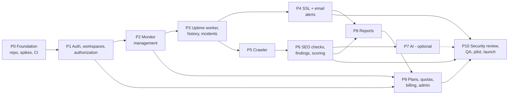

# UptimePilot Implementation Plan

| | |
|---|---|
| Status | Draft v0.1, **a plan; no application code exists** |
| Last updated | 2026-10-21 |
| Inputs | [`CLAUDE.md`](../CLAUDE.md), [`PRODUCT_SPEC.md`](PRODUCT_SPEC.md) (requirement IDs `MON-5`, acceptance criteria `AC-n`, open questions `Q-n`), [`ARCHITECTURE.md`](ARCHITECTURE.md) (spikes `S-n`, decisions `D-n`), [`DATABASE_SCHEMA.md`](DATABASE_SCHEMA.md) (validation items `V-n`) |

> Effort figures are **planning assumptions, not promises.** Task file names are **proposed**, not existing. No task is marked done without repository evidence ([§1.2](#12-status-legend-and-the-evidence-rule)).

---

## 1. How to use this plan

### 1.1 Purpose

A phased roadmap from an empty repository to a secure, working end-to-end MVP, broken into small tasks that each fit one coding session. It does not replace the specs: it sequences them, and links to them rather than repeating them (`CLAUDE.md` #15).

### 1.2 Status legend and the evidence rule

| Mark | Meaning |
|---|---|
| ☐ | Not started |
| ◐ | In progress (work exists on a branch but isn't merged/verified) |
| ☑ | **Done, with evidence** recorded beside it (commit SHA and, for code, the test/analyzer output actually run) |
| ⛔ | Blocked (reason and unblocking decision named) |

**A task may only be marked ☑ when the repository proves it.** Evidence means: the file or commit exists in `git log`/`git ls-files`, and for code, the formatter, analyzer and relevant tests were run and their real results were reported (`CLAUDE.md` #8, #12). "Looks done" and "was discussed" are not evidence. Anything not verifiable stays ☐.

### 1.3 Current state (verified 2026-10-21 from `git log` and `git ls-files`)

| Item | State | Evidence |
|---|---|---|
| `CLAUDE.md` | exists | commit `61ac6a3` |
| `docs/PRODUCT_SPEC.md` | exists | commit `3e8c5de` |
| `docs/ARCHITECTURE.md` | exists | commit `203ae69` |
| `docs/DATABASE_SCHEMA.md` | exists | commit `daf8dc5` |
| `docs/IMPLEMENTATION_PLAN.md` | this file, **not yet committed** | n/a |
| `docs/ADR/` | directory exists locally and is **empty, so git does not track it** | `git ls-files` shows no ADR files |
| `docs/STATUS.md`, `docs/NEXT_SESSION.md` | **do not exist** (`CLAUDE.md` requires them) | `ls docs` |
| Application code, `pubspec.yaml`, Firebase config, Dockerfile, CI | **none** | repository search found no `*.dart`, `pubspec.yaml`, `firebase.json`, `Dockerfile`, or workflow files |
| Cloud/Firebase projects, queues, buckets | **unknown / none assumed** | no config or IaC in the repo |

---

## 2. Planning assumptions

### 2.1 Effort ranges (given; used as assumptions)

| Block | Range | Phases it covers (my mapping) |
|---|---:|---|
| Foundation | 5–7 days | Phase 0, Phase 1 |
| Monitoring | 6–8 days | Phase 2, Phase 3 |
| SSL and alerts | 3–5 days | Phase 4 |
| Crawler | 4–6 days | Phase 5 |
| SEO scoring | 4–6 days | Phase 6 |
| AI recommendations | 2–4 days | Phase 7 |
| Reports | 3–4 days | Phase 8 |
| Plans and administration | 3–4 days | Phase 9 |
| Security, QA and pilot | 7–10 days | Phase 10 |
| **Total** | **37–54 working days** | |

The mapping of blocks to phases is **my judgement**, since the given blocks don't align one-to-one with the eleven phases (Foundation and Monitoring each span two). Confirm or adjust it.

### 2.2 What 37–54 working days means for the calendar

At five focused working days a week that is about **7.5–11 weeks** of pure build effort. The brief's estimate for an initial MVP is **approximately 8–12 weeks for a solo developer**, which is consistent only if the extra time for the factors below is absorbed in that range.

**Things that extend the schedule beyond the ranges** (none are included in them):
- **Integration and debugging.** Cross-component bugs (queue → worker → Firestore → UI) cost more than component work.
- **Deployment and environment work.** First deploys, IAM, networking, secrets, domain/DNS, email-domain authentication.
- **Unresolved spikes and decisions.** S-1 (Dart + Firebase access) and S-2 (IP-pinned TLS) can force a different approach (REST/gRPC plumbing, an egress proxy). Decision latency (provider choices, legal) stalls dependent tasks.
- **External lead times.** Email provider and payment provider onboarding, domain verification, legal review (policies, DPDP/GDPR) don't run on developer time but gate launch.
- **Rework from review.** Security review findings (Phase 10) and pilot feedback.
- **Learning curve and tooling** where a package choice proves unsuitable.
- **Part-time availability.** The ranges assume focused, uninterrupted days; fewer hours per day stretch the calendar proportionally.
- **Parallel work.** A solo developer can't parallelize build tasks. "Parallel" here means overlapping *waiting* (e.g. submit provider onboarding or legal review while building). Parallelism with more people shortens build time but adds coordination and integration cost, so it doesn't cut the schedule proportionally.

**My own caution (an opinion, not a measured fact):** the Foundation and Monitoring ranges look aggressive for an empty repository with two open technical spikes and a security-critical SSRF component. If those phases slip, everything after them slips. The cut line in §3.3 exists so the schedule can be held by shedding scope rather than quality.

### 2.3 Schedule scenarios (assumptions, to be re-baselined after Phase 1)

| Scenario | Calendar | Conditions |
|---|---|---|
| Optimistic | ~8 weeks | Spikes succeed first try, decisions made promptly, cut line applied (no payments/AI at pilot) |
| Planning case | ~10 weeks | Typical integration friction |
| Pessimistic | 12+ weeks | A spike forces redesign, external lead times, or part-time work |

**Re-baseline rule:** after Phase 1 and again after Phase 3, compare actual days to the ranges and update this section. Don't carry forward hope.

---

## 3. Principles, MVP cut line and definition of done

### 3.1 Principles

1. **A secure, working end-to-end MVP beats a complete feature list.** Build thin vertical slices (uptime end-to-end; SEO end-to-end) before widening.
2. **Security controls are built with the feature, not after.** SSRF, tenant isolation and authorization have tests in the same task that introduces the surface.
3. **One small, testable task per coding session** ([§3.4](#34-session-protocol-one-small-testable-task)).
4. **Decide, then build.** Each phase lists its decision gates; don't start a task whose gate is open.
5. **Deterministic core first, AI last.** Crawler, findings and scoring work without AI (D-3).
6. **Every external dependency sits behind an interface with a fake**, so tests don't need the network or paid services.
7. **Scope discipline.** Nothing outside the approved task is implemented (`CLAUDE.md` #13). Discovered extras become new tasks or open questions.

### 3.2 Vertical-slice order

Two usable products emerge early: **uptime monitoring with alerts** (P0–P4) and **SEO audits with a score** (P5–P6). Either can be demoed before reports and billing exist.

### 3.3 MVP cut line (a proposal; confirm as PRODUCT_SPEC Q-22)

| Tier | Content | Rationale |
|---|---|---|
| **Must for pilot** | P0–P6; CSV and basic PDF report (P8); email alerts; quotas enforced and plans assigned **by an administrator** (P9 admin + quotas); P10 | Delivers the core promise securely |
| **Should** | Payment integration and self-serve upgrades (P9 billing); audit-to-audit score delta | Valuable, but a pilot can run on manually assigned plans |
| **Could (cut first)** | AI recommendations (P7); external-link checking; API-monitor secret headers/body; report polish; digest emails | Optional or high-effort; none blocks the core loop |

**Cut order if the schedule slips:** AI → payment integration (keep admin-assigned plans) → audit comparison → external link checking → API-monitor secrets → report polish. Security controls, tenant isolation, SSRF protection, quota enforcement and tests are **never** cut.

### 3.4 Session protocol: one small, testable task

**Rule: each coding session implements exactly one task from this plan, small enough to finish, test and document in that session** (target: a few hours; if it can't be, split it first).

Per session:
1. Read `docs/NEXT_SESSION.md`, then `docs/STATUS.md`, then the relevant spec sections.
2. Restate the task and its acceptance criteria. For multi-file changes, state the plan before editing (`CLAUDE.md` #5).
3. Inspect the existing code before adding files or dependencies (`CLAUDE.md` #1).
4. Write tests first or alongside.
5. Run formatter, analyzer and the relevant tests; **record the real output**.
6. Update `docs/STATUS.md` and `docs/NEXT_SESSION.md`.
7. Commit (conventional message). Summarize: changed files, implementation, test results, known issues, next recommended task (`CLAUDE.md` #16).

**Task sizing rules:** one concern per task; if it touches more than ~5 files or needs more than one new abstraction, split; a task never both introduces a dependency *and* builds a feature on it; spikes are time-boxed (≤ 1 day) and end with a written decision, not production code.

### 3.5 Definition of done

**Task done** (all required):
- Behavior implemented to the task's acceptance criteria and nothing beyond the approved scope.
- Tests written and passing: unit for logic; integration for storage/queue boundaries; **security tests where the task touches auth, tenancy, URLs, secrets or money**.
- `dart format`, analyzer (warnings fatal) and relevant tests were **actually run**, and results are reported; unrun checks are stated as unrun.
- No secrets, tokens or production identifiers committed.
- Error, empty and loading states handled for any UI (PRODUCT_SPEC §10).
- Docs updated: `STATUS.md`, `NEXT_SESSION.md`, and any spec/ADR touched.
- Committed with evidence recorded against the task here.

**Phase done** (all required): every task ☑ with evidence; phase acceptance criteria are automated tests green in CI; the phase's security tests pass; deployed to the staging environment from Phase 3 onward and smoke-tested; rollback path exercised or documented and reviewed; known issues logged; this plan updated.

**MVP done:** Phases 0–6, 8, 10 and the "Must" part of 9 are done; PRODUCT_SPEC MVP acceptance criteria (AC-1…AC-42) pass or have an explicit, accepted waiver; §9 pre-production decisions are all finalized; a pilot has run without a severity-1 security or data-isolation defect.

### 3.6 Conventions used below

- Task IDs: `P{phase}-{nn}`.
- **Expected files/modules** use the proposed layout from ARCHITECTURE §2.3 (`apps/web`, `apps/server`, `packages/domain`, `packages/safe_fetch`, `packages/seo_engine`, `packages/api_contracts`, `firebase/`, `infra/`). Names are proposals, not existing files.
- "Tests" are grouped **Unit / Integration / Security**. Integration tests use the Firestore/Auth emulators and fakes unless stated.
- Test commands will be fixed in P0 and recorded in `CLAUDE.md` once they exist (none exist today).
- **Kill switches** (config flags, introduced as each capability lands) let operations stop a component without a deploy: dispatcher, crawler, email sending, AI, report generation, new sign-ups.

---

## 4. Phases

---

### Phase 0: Repository inspection, requirements, architecture, environments and CI

**Estimate:** part of Foundation (5–7 days, shared with Phase 1). Includes spikes S-1 and S-2.

**Objectives.** Settle what's undecided that blocks building, prove the two risky technical assumptions, scaffold the repository, and stand up CI and environments so every later task lands on a working pipeline.

**Dependencies.** None.

**Tasks**

| ID | Task | Status / evidence |
|---|---|---|
| P0-01 | Write `CLAUDE.md` | ☑ `61ac6a3` |
| P0-02 | Write `docs/PRODUCT_SPEC.md` | ☑ `3e8c5de` |
| P0-03 | Write `docs/ARCHITECTURE.md` | ☑ `203ae69` |
| P0-04 | Write `docs/DATABASE_SCHEMA.md` | ☑ `daf8dc5` |
| P0-05 | Write and commit this plan | ◐ drafted; not committed |
| P0-06 | Create `docs/STATUS.md` and `docs/NEXT_SESSION.md` (initial content from §1.3) | ☐ |
| P0-07 | Make `docs/ADR/` tracked (`.gitkeep`/README), add an ADR template, write ADR-0001 index | ☐ |
| P0-08 | **Spike S-1:** from Dart, verify a Firebase ID token and read/write Firestore and Storage (emulator first, then a dev project). Output: written findings + ADR (Admin-SDK-like package vs REST/gRPC + JWT) | ☐ |
| P0-09 | **Spike S-2:** from `dart:io`, connect to a pre-vetted IP while verifying TLS against the original hostname and sending the original `Host`. Output: findings + ADR (native vs egress proxy) | ☐ |
| P0-10 | Decision pass for Phase 1–3 blockers (see gates below); record each as an ADR or in the spec | ☐ |
| P0-11 | ADR-0002: backend framework (Shelf vs Dart Frog), informed by P0-08 | ☐ |
| P0-12 | ADR-0003: runtime platform, region, IaC tool, CI provider (the remote is on GitHub, so GitHub Actions is a candidate; unconfirmed) | ☐ |
| P0-13 | Create dev Firebase/cloud project(s) **with explicit approval** (account/billing actions are the owner's; nothing is provisioned today) | ☐ |
| P0-14 | Scaffold repo: Flutter app, server package, shared packages (`domain`, `safe_fetch`, `seo_engine`, `api_contracts`), `analysis_options.yaml`, workspace tooling (ARCHITECTURE Q-3), `.gitignore` incl. secrets patterns | ☐ |
| P0-15 | Local dev: Firebase emulators config, one-command start, README for setup | ☐ |
| P0-16 | CI: format check, analyze (fatal warnings), unit tests, emulator integration test job, secret scan, dependency audit | ☐ |
| P0-17 | Typed configuration and environment separation skeleton (dev/test/staging/prod); no secrets in repo | ☐ |
| P0-18 | Walking skeleton: server `/healthz` + `/readyz`, structured logging, containerize, deploy to dev; Flutter shell calls it | ☐ |
| P0-19 | Update `CLAUDE.md` "Commands" and "Repository status" with real commands | ☐ |

**Decision gates (finalize in P0-10):** sign-in methods (spec Q-1), one-vs-many workspaces per user (Q-2), permission matrix (Q-3), monitor types for MVP (Q-4), check intervals, failure threshold and recovery rule (Q-5), MVP boundary (Q-22), state-management/routing (Arch Q-2).

**Expected files/modules:** `docs/STATUS.md`, `docs/NEXT_SESSION.md`, `docs/ADR/0001-…0003-*.md`, root workspace config, `apps/web/`, `apps/server/`, `packages/*/pubspec.yaml`, `firebase/firebase.json` (emulators), `.github/workflows/*` (if GitHub Actions is chosen), `infra/` (stub), `Dockerfile`.

**Acceptance criteria**
- A fresh clone follows the README and gets the emulators, server and app running locally.
- CI runs on every PR and fails on format, analyzer or test errors.
- `/healthz` and `/readyz` respond in dev; logs are structured JSON with no secrets.
- S-1 and S-2 each end with a recorded decision and a working proof or a documented fallback.
- ADRs exist for each decision taken.

**Tests**
- *Unit:* config parsing (missing/invalid values fail fast), health handler.
- *Integration:* CI job that boots the emulators and passes a smoke test.
- *Security:* secret-scan job demonstrably fails on a planted fake secret; `.gitignore` covers credential file patterns; config loader refuses to start with production identifiers in non-production.

**Completion checklist**
- [ ] P0-06…P0-19 ☑ with evidence
- [ ] S-1/S-2 decisions recorded (ADRs)
- [ ] CI green on `develop`
- [ ] Dev deployment reachable
- [ ] `CLAUDE.md` commands section updated

**Risks and rollback**
- *S-2 fails* (cannot pin IP natively) → fallback is a dedicated egress proxy, which adds Phase 3 scope; decide before Phase 2 ends. *S-1 fails* → REST/gRPC plumbing adds Phase 1 effort.
- Scaffolding choices (workspace tooling, state management) are costly to reverse: keep them minimal and ADR-backed.
- *Rollback:* all Phase 0 work is additive; revert commits. Do not provision cloud resources without approval; teardown steps are recorded with each (IaC `destroy` for dev).

---

### Phase 1: Authentication, workspaces, membership and authorization

**Estimate:** completes Foundation (with Phase 0: 5–7 days total).

**Objectives.** Users can sign up/in, own a workspace, invite members, and every request is authorized server-side with tenant isolation proven by tests. This is the security spine; everything later depends on it.

**Dependencies.** Phase 0 (scaffold, CI, S-1 outcome, Phase 1 decision gates).

**Tasks**

| ID | Task |
|---|---|
| P1-01 | `packages/domain`: roles and the permission matrix as pure functions + exhaustive unit tests (PRODUCT_SPEC §4.1) |
| P1-02 | Server: ID-token verification middleware behind a `TokenVerifier` interface (fake for tests) |
| P1-03 | Server: Firestore client wrapper and `TenantContext`; repository base that builds tenant paths internally (DATABASE_SCHEMA §8.3) |
| P1-04 | `POST /me`: create/sync `users/{uid}` from verified token (idempotent) |
| P1-05 | `POST /workspaces`: transaction creating workspace + owner member + `usage/current`; free-plan entitlements snapshot |
| P1-06 | Tenancy middleware: resolve membership per request; `404` on non-membership; reject suspended/deleting workspaces |
| P1-07 | Members API: list, change role, remove (owner invariants in transactions) |
| P1-08 | Invitations API: create, revoke, accept (hash-only token, single-use, email-match); email sent via a `EmailSender` fake/console implementation until Phase 4 |
| P1-09 | Email-verified gate for creating monitors/audits (AUTH-2) |
| P1-10 | Workspace audit events for member/role/invite changes (`auditEvents`) |
| P1-11 | Request-level rate limiting for auth-adjacent and invite endpoints (store decision per DATABASE_SCHEMA V-18) |
| P1-12 | Flutter: sign-up/sign-in/sign-out/reset, session handling, API client attaching tokens, route guards, `401` handling |
| P1-13 | Flutter: create/select workspace, members list, invite and role UI, with empty/loading/error states |
| P1-14 | `firebase/firestore.rules` deny-all baseline + rules tests (**not deployed** without approval) |
| P1-15 | Generic cross-tenant test harness (DATABASE_SCHEMA §11.1) wired to workspaces, members, invitations, audit events |

**Expected files/modules:** `packages/domain/lib/permissions.dart`; `apps/server/lib/src/{auth,tenancy,http,modules/workspaces,modules/members,modules/invitations}`; `packages/api_contracts/`; `apps/web/lib/features/{auth,workspaces}`; `firebase/firestore.rules`; `apps/server/test/tenancy/cross_tenant_matrix_test.dart`.

**Acceptance criteria** (PRODUCT_SPEC): AC-1, AC-2, AC-3 (for Phase 1 resources), AC-4, AC-5; owner invariants and invitation single-use hold under concurrency.

**Tests**
- *Unit:* permission matrix (every role × action); token claim validation (expired, wrong audience/issuer, unverified email); invitation token hashing; owner invariants.
- *Integration (emulator):* workspace creation transaction; invitation accept race (two concurrent accepts → one member); removal effective on next request.
- *Security:* **cross-tenant matrix** over all Phase 1 collections (tenant B, unauthenticated, removed member, expired token, wrong-project token); mass-assignment attempts on `role`/`ownerUid`/`planId`; rules deny-all baseline; error bodies contain no other-tenant data.

**Completion checklist**
- [ ] P1-01…P1-15 ☑ with evidence
- [ ] Cross-tenant matrix green in CI and required for merge
- [ ] No endpoint reachable without a verified token except the documented public ones
- [ ] Rules baseline reviewed (deployment pending approval)
- [ ] STATUS/NEXT_SESSION updated; AC-1…5 evidence recorded

**Risks and rollback**
- *Auth is the hardest to retrofit:* resist shortcuts (e.g. trusting client `workspaceId`). A tenancy bug here invalidates everything after it.
- *Multi-workspace per user (Q-2)* affects UI and "my workspaces" query; decided in Phase 0.
- *Rollback:* feature is behind a `signupEnabled` kill switch; schema changes follow expand → migrate → contract; revert commits; the dev environment can be reset (emulators/dev project), but **no production data exists yet**, so data rollback is not a concern until Phase 10.

---

### Phase 2: Dashboard and monitor management

**Estimate:** first half of Monitoring (6–8 days, shared with Phase 3).

**Objectives.** Users can create, edit, pause, resume and delete monitors safely: URL validation (SSRF input rules) and quota enforcement are in place, but no probing yet.

**Dependencies.** Phase 1.

**Tasks**

| ID | Task |
|---|---|
| P2-01 | `packages/domain`: `Monitor` model, validation, entitlements model; free-plan seed config as data, **not** hard-coded constants |
| P2-02 | `packages/safe_fetch` (part 1, **no network**): strict URL parser/normalizer and IP policy (blocked ranges, mapped/embedded IPv6 forms, alternate notations) as pure code with the full SSRF corpus (ARCHITECTURE §15.3–15.4) |
| P2-03 | `packages/safe_fetch` (part 2): injected-resolver "validate target" (resolve all A/AAAA, reject if any blocked), used at monitor create/update |
| P2-04 | Plans/entitlements: seed `plans/*` (provisional, flagged) and compute workspace entitlements |
| P2-05 | `POST /monitors`: transaction checking `maxMonitors`, incrementing `usage/current`, `Idempotency-Key` support |
| P2-06 | Monitors API: list (cursor pagination), get, update (config only), pause/resume, delete (cascade job stub) |
| P2-07 | Shared signed-cursor pagination utility (DATABASE_SCHEMA §5.1) |
| P2-08 | Idempotency-key store (`idempotencyKeys`) |
| P2-09 | Flutter: dashboard shell (empty/loading/error), monitor list, create form with inline validation errors |
| P2-10 | Flutter: pause/resume/delete, quota-reached upgrade prompt |
| P2-11 | Monitor secrets (API monitors): encryption design per decision (DATABASE_SCHEMA V-16), `secrets/current`, write-only API. **Cut candidate** |
| P2-12 | Cross-tenant tests extended to monitors and secrets |

**Expected files/modules:** `packages/domain/lib/{monitor.dart,entitlements.dart}`; `packages/safe_fetch/lib/src/{url_policy.dart,ip_policy.dart,target_validator.dart}`; `apps/server/lib/src/modules/monitors/`; `apps/server/lib/src/http/pagination.dart`; `apps/web/lib/features/monitors/`; `firebase/firestore.indexes.json` (monitor list indexes, **not deployed**).

**Acceptance criteria:** AC-6 (creation; first check arrives in Phase 3), AC-7, AC-10, AC-13, AC-14 (state set; behavior verified in Phase 3); duplicate submits create one monitor; unavailable plan data fails safe.

**Tests**
- *Unit:* URL normalization (IDN, case, default ports, credentials, control chars, length); every blocked IPv4/IPv6 range and notation; mixed public+private DNS answers rejected; entitlement computation; pagination cursor signing.
- *Integration:* quota transaction under concurrency (N parallel creates at the limit → exactly the limit); idempotent create.
- *Security:* SSRF input corpus (AC-7, AC-10); cursor replay across tenants/routes rejected; monitor secrets never in responses/logs (canary test); cross-tenant matrix for monitors.

**Completion checklist**
- [ ] P2-01…P2-12 ☑ (P2-11 may be formally deferred)
- [ ] SSRF input corpus is a required CI check
- [ ] Quota concurrency test green
- [ ] Indexes defined in `firestore.indexes.json` and exercised by emulator tests

**Risks and rollback**
- *Index and query-shape surprises* (DATABASE_SCHEMA V-4): validate with emulator tests early.
- *Over-building the dashboard:* keep to list/create/pause/delete.
- *Rollback:* revert commits; created test monitors are dev-only. Schema is additive.

---

### Phase 3: Uptime worker, check history and incident lifecycle

**Estimate:** second half of Monitoring (with Phase 2: 6–8 days).

**Objectives.** Monitors are actually checked on schedule by background workers that keep running without a browser; results, uptime history and incidents are recorded correctly and idempotently. First notification records are written (sending arrives in Phase 4).

**Dependencies.** Phase 2; spikes S-2 (SafeFetcher approach) and S-4 (Firestore write-cost model; **decision gate** before building rollups/retention, DATABASE_SCHEMA V-1).

**Tasks**

| ID | Task |
|---|---|
| P3-01 | **Decision:** check-storage model from the cost model (per-check docs vs sampling/bucketing), plus intervals/retention defaults; update schema doc |
| P3-02 | `packages/domain`: incident state machine (pure) and uptime-percentage math with the documented gap/pause rules; heavy unit tests (HIST-2) |
| P3-03 | `packages/safe_fetch` (part 3): network layer per S-2: connect to vetted IP, TLS against original host, manual redirect re-validation per hop, timeouts, size and decompression caps, fixed user-agent |
| P3-04 | SSRF integration suite: fake resolver/socket (rebinding, redirects to private/metadata/scheme changes, loops, bombs, slow-loris) + localhost fixtures |
| P3-05 | Probe executor: monitor → `CheckResult` with error categories (MON-4) |
| P3-06 | Queue abstraction + local fake; Cloud Tasks adapter; worker auth (OIDC verification, distinct from user tokens) |
| P3-07 | Dispatcher: collection-group due query, transactional claim, deterministic task names, catch-up cap |
| P3-08 | Probe handler: one transaction creating the check (create-if-absent), updating monitor state, rollup, incident open/close; idempotent on retry |
| P3-09 | Hourly/daily rollups and bucket closure job; `purgeAt` set from retention policy |
| P3-10 | Lease reaper for stuck claims |
| P3-11 | Notification outbox writes for down/recovered (`create-if-absent`), no sending yet |
| P3-12 | API: check history, uptime windows, incidents list/detail (cursor paginated, bounded) |
| P3-13 | Flutter: monitor detail (status, response-time chart, check log, incidents), unknown/empty/error states |
| P3-14 | Canary monitor + scheduling-lag metric + `dispatcherEnabled` kill switch |
| P3-15 | Deploy workers to dev/staging; soak test against controlled targets; record measured write counts and costs |

**Expected files/modules:** `packages/domain/lib/{incident_machine.dart,uptime.dart}`; `packages/safe_fetch/lib/src/{safe_http_client.dart,redirects.dart,limits.dart}`; `apps/server/bin/{fetch_worker,ops_worker}.dart`; `apps/server/lib/src/jobs/{dispatcher,probe_handler,reaper,rollups}.dart`; `apps/server/lib/src/infra/tasks/`; `apps/web/lib/features/{monitors,incidents}/`.

**Acceptance criteria:** AC-6…AC-15 (including rebinding AC-9 and redirect-to-private AC-8), AC-11/12 (incident open/close exactly once; single failure ≠ incident), AC-14 (paused monitors run nothing), AC-15 (uptime % matches hand-computed value). Monitors keep being checked with no browser open (demonstrated in staging).

**Tests**
- *Unit:* incident machine transitions (flapping, threshold, recovery); uptime math with gaps/pauses; error-category mapping; redirect-hop logic.
- *Integration:* handler run twice and concurrently (one check, one increment, one incident, one outbox record); dispatcher claim contention; reaper; queue retry semantics.
- *Security:* **full SSRF suite as a required CI gate** (ARCHITECTURE §15.4); worker routes reject user tokens and vice versa; fetch worker identity cannot reach unrelated resources (review item); responses/logs contain no secrets.

**Completion checklist**
- [ ] P3-01…P3-15 ☑ with evidence
- [ ] SSRF suite green and required
- [ ] Soak test report committed (counts, cost, lag)
- [ ] Re-baseline §2.3 using actuals

**Risks and rollback**
- *Largest technical-risk phase.* S-2 failure, Firestore write cost, and clock/lease subtleties can each expand scope.
- *Checks that misreport "up" during outages* are a product-trust failure: missed slots must be unknown (PRODUCT_SPEC §10).
- *Rollback:* `dispatcherEnabled=false` stops all probing instantly without a deploy; revert commits; schema is additive. Existing check data is disposable in dev/staging.

---

### Phase 4: SSL certificate monitoring and expiry notifications

**Estimate:** SSL and alerts: 3–5 days.

**Objectives.** Certificate health is inspected and expiry alerts fire once per threshold; the notification pipeline (outbox → sender → email) actually delivers down/recovered/expiry email, deduplicated.

**Dependencies.** Phase 3 (SafeFetcher, queue, outbox, incidents). **Decision gate:** email provider and sender domain (Arch Q-15 / spec Q-16); SSL thresholds (spec Q-5).

**Tasks**

| ID | Task |
|---|---|
| P4-01 | Spike (time-boxed): extract certificate fields (expiry, issuer, SAN, chain validity) from `dart:io` TLS; decide if a DER parser is needed |
| P4-02 | SafeFetcher TLS inspection mode (same SSRF controls, SSL-5) |
| P4-03 | `packages/domain`: expiry-threshold logic, certificate status classification, threshold dedupe keys |
| P4-04 | Cert dispatcher + handler: `certificates` docs, `certAlerts` ledger (create-if-absent), `certState` on monitor |
| P4-05 | Certificate incidents (expired, mismatch, untrusted) separate from downtime |
| P4-06 | Email provider adapter behind `EmailSender` (sandbox in dev/staging; recipient allow-list outside production) |
| P4-07 | Notification sender worker: claim with lease, retry/backoff, `failed` state, suppression-check hook |
| P4-08 | Templates v1 (down, recovered, cert expiring/problem): no secrets, deep links to authenticated pages |
| P4-09 | Recipient resolution; notification settings + preferences API; mandatory-mail rule |
| P4-10 | Flutter: SSL panel on monitor, notification settings UI, "send test email" |
| P4-11 | Wire invitation emails to the real sender |
| P4-12 | `emailEnabled` kill switch and delivery-failure metric |

**Expected files/modules:** `packages/domain/lib/cert_expiry.dart`; `packages/safe_fetch/lib/src/tls_inspector.dart`; `apps/server/lib/src/jobs/{cert_handler,notification_sender}.dart`; `apps/server/lib/src/modules/{ssl,notifications}/`; `apps/server/lib/src/infra/email/`; `apps/web/lib/features/{ssl,notifications}/`.

**Acceptance criteria:** AC-16, AC-17, AC-35, AC-36, AC-37; each threshold alerts once per certificate even with retries and parallel workers; a down incident yields one down and one recovery email.

**Tests**
- *Unit:* threshold crossing (incl. renewal reset), status classification, template rendering (no secrets), recipient resolution with removed members.
- *Integration:* sender with a fake provider counting sends under concurrent workers and retries; backoff schedule; failure → `failed`.
- *Security:* TLS inspection obeys SSRF rules (private/metadata targets blocked); emails contain no tokens/secrets (canary test); non-production environments cannot email arbitrary addresses; notification records contain no email addresses.

**Completion checklist**
- [ ] P4-01…P4-12 ☑ with evidence
- [ ] A real alert email received end-to-end in staging
- [ ] Sender-domain authentication (SPF/DKIM/DMARC) plan recorded (executed before production)

**Risks and rollback**
- *`dart:io` may expose limited certificate detail:* a DER parser dependency may be needed (P4-01 decides).
- *Email deliverability* is external and slow to fix; start domain setup early.
- *Rollback:* `emailEnabled=false` stops sending (outbox accumulates harmlessly); revert commits; templates are versioned.

---

### Phase 5: SEO crawler, robots.txt, sitemap and internal link discovery

**Estimate:** Crawler: 4–6 days.

**Objectives.** A resumable, polite, SSRF-safe crawler fetches server-delivered HTML up to the plan's page cap, honors robots.txt, reads sitemaps, and stores bounded page facts, with progress and cancellation. No scoring yet.

**Dependencies.** Phase 3 (SafeFetcher, queue, leases); Phase 2 entitlements. **Decision gates:** definition of "same site" (Arch Q-11), robots/crawl-delay policy and user-agent string (Arch Q-12), HTML parser choice (S-5).

**Tasks**

| ID | Task |
|---|---|
| P5-01 | Start `docs/SEO_RULES.md`: the page-facts shape the rules will need (blocks fact extraction scope; V-6/V-7) |
| P5-02 | HTML parser/package selection spike (safety on malformed input, memory/time bounds) |
| P5-03 | `packages/seo_engine`: URL normalization and site-scope rules (pure) |
| P5-04 | Robots.txt parser (pure, bounded) and sitemap parser (bounded XML, index files, size caps) |
| P5-05 | HTML fact extractor (pure, bounded): titles, meta, headings, canonical, robots directives, lang, viewport, images/alt, links, mixed content, with truncation flags |
| P5-06 | `POST /audits`: URL validation via SafeFetcher rules, plan page-cap snapshot, quota transaction, idempotency |
| P5-07 | Crawl step handler: frontier from `pages` (`fetchState=queued`), per-host politeness, SafeFetcher, robots honored, deterministic page IDs |
| P5-08 | Step chaining, `nextStep` compare-and-set, cancellation check, lease reaper for audits |
| P5-09 | Link discovery, depth cap, crawl-trap protection, page-cap enforcement |
| P5-10 | Robots/sitemap metadata documents; `inSitemap` marking |
| P5-11 | Audit progress API; Flutter: new-audit form, progress, cancel, failure/retry states |
| P5-12 | Hostile-site fixture server for tests (redirect loops, redirects to private IPs, huge/compressed bodies, slow responses, malformed HTML, link explosions) |
| P5-13 | External-link checking with a strict budget. **Cut candidate** |
| P5-14 | `crawlerEnabled` kill switch; crawl metrics |

**Expected files/modules:** `docs/SEO_RULES.md` (part); `packages/seo_engine/lib/src/{normalize,robots,sitemap,extract}.dart`; `apps/server/lib/src/modules/audits/`; `apps/server/lib/src/jobs/crawl_step.dart`; `apps/web/lib/features/seo_audits/`; `apps/server/test/fixtures/hostile_site/`.

**Acceptance criteria:** AC-18 (never exceeds page cap), AC-24 (robots honored), AC-25 (redirect to private blocked), AC-26 (cancel stops fetching); crash/retry mid-audit resumes without duplicate pages or double usage counting; crawling continues with the browser closed.

**Tests**
- *Unit:* normalization edge cases; robots grammar and precedence; sitemap parsing (index, malformed, oversized); extractor on fixture HTML incl. hostile markup; truncation bounds.
- *Integration:* step replay/out-of-order (idempotent); cancellation between steps; quota/usage delta idempotency; resume after simulated crash.
- *Security:* SSRF suite applied to crawl fetches and every discovered link; crawl-trap fixtures stop at caps; decompression/size/time limits; third-party text never rendered as HTML; document size caps enforced.

**Completion checklist**
- [ ] P5-01…P5-14 ☑ (P5-13 may be formally deferred)
- [ ] Hostile-site suite green in CI
- [ ] A real audit of a small controlled site completes in staging with measured duration/writes

**Risks and rollback**
- *Crawl traps and hostile content* are the main hazards; caps are mandatory.
- *Platform request-timeout limits* (S-6) shape step size; verify before tuning.
- *Page-document size/cost* (V-6): measure on real sites.
- *Rollback:* `crawlerEnabled=false`; revert commits; audit data in dev/staging is disposable.

---

### Phase 6: Deterministic SEO checks, findings and versioned scoring

**Estimate:** SEO scoring: 4–6 days.

**Objectives.** From stored page facts, a pure rule engine produces evidence-backed findings and the **UptimePilot Technical SEO Score**, deterministic and versioned, displayed with the mandatory disclaimer. It works with no AI.

**Dependencies.** Phase 5. **Hard gate (P6-01):** the sub-score formulas must be written and approved before any scoring code (spec Q-12). Initial category weights come from the brief (20/20/20/15/10/15).

**Tasks**

| ID | Task |
|---|---|
| P6-01 | Complete `docs/SEO_RULES.md`: rule catalogue (IDs, thresholds, severities), sub-score formulas with **worked examples**, empty-category handling, rule-set versioning, disclaimer text. **Needs owner approval before P6-02** |
| P6-02 | `packages/seo_engine`: rule interface, registry, rule-set version, finding/evidence types (evidence required by construction) |
| P6-03 | Rules: metadata and headings (golden fixtures) |
| P6-04 | Rules: crawlability and indexability |
| P6-05 | Rules: HTTP status and broken links |
| P6-06 | Rules: canonical URLs and sitemap |
| P6-07 | Rules: image accessibility basics |
| P6-08 | Rules: HTTPS and technical configuration |
| P6-09 | Scorer: category sub-scores → weighted score, bounds 0–100, weights sum to 100, stored weights per snapshot |
| P6-10 | Analysis handler: read pages in bounded chunks → create-if-absent snapshot + findings, `inputDigest`, `latestScore` |
| P6-11 | API: results, category breakdown, findings (filter/sort/paginate), page explorer |
| P6-12 | Audit-to-audit score delta (if in MVP, spec Q-10). **Could** |
| P6-13 | Flutter: results page, breakdown, findings list/detail with evidence, mandatory disclaimer, scope note ("N pages crawled, cap hit") |
| P6-14 | "Audit completed/failed" notifications through the existing pipeline |

**Expected files/modules:** `docs/SEO_RULES.md`; `packages/seo_engine/lib/src/{rules/*,scorer.dart,rule_set.dart}`; `packages/seo_engine/test/{golden,fixtures}/`; `apps/server/lib/src/jobs/analyze_audit.dart`; `apps/web/lib/features/seo_audits/{results,findings}/`.

**Acceptance criteria:** AC-19 (same data → same findings and score), AC-20 (no finding without evidence), AC-21 (score = weighted sum of category scores with the recorded version), AC-22 (new version doesn't change stored audits), AC-23 (disclaimer on screen and exports); the score is described everywhere as a proprietary diagnostic, never a Google score or ranking prediction.

**Tests**
- *Unit:* each rule against positive/negative/edge fixtures; scorer property tests (determinism, monotonicity where defined, 0–100 bounds, weights sum); version immutability.
- *Integration:* analysis twice → identical IDs and documents; large audit within write/size limits; findings queries and indexes.
- *Security:* findings render untrusted page text as text only; cross-tenant matrix for audits/pages/snapshots/findings; no network access from the engine (dependency test); AI components absent from this path.

**Completion checklist**
- [ ] `SEO_RULES.md` approved and committed
- [ ] P6-01…P6-14 ☑ with evidence (P6-12 may be deferred)
- [ ] Golden tests committed and green
- [ ] Disclaimer present in UI (screenshot/test evidence)

**Risks and rollback**
- *Scoring is a product-trust surface:* a flawed formula is hard to retract; versioning and stored weights limit damage.
- *Findings volume/cost* (V-6, DQ-3): may force aggregating findings per rule.
- *Rollback:* new rule-set versions never overwrite old snapshots; a bad version is retired by bumping the version; revert commits.

---

### Phase 7: Optional AI explanations and recommendations

**Estimate:** AI recommendations: 2–4 days. **Cut-first phase;** the MVP does not depend on it.

**Objectives.** On demand, show a clearly labeled AI explanation for a verified finding. AI can never create findings, change severities or alter scores.

**Dependencies.** Phase 6. **Decision gate:** provider, model, data-handling and no-training terms, cost ceiling (spec Q-13).

**Tasks**

| ID | Task |
|---|---|
| P7-01 | Decide provider/terms/cost ceiling (record ADR); store the key in the secret manager only |
| P7-02 | `AiRecommender` interface + **disabled default** implementation; feature flag |
| P7-03 | Prompt builder from a finding's rule + evidence only; untrusted text delimited as data; output sanitizer (plain text) |
| P7-04 | Provider adapter behind the interface; timeouts, retries, token caps |
| P7-05 | `recommendations` cache keyed by `(rule, evidenceHash, promptVersion)`; per-workspace rate limit and `aiRequests` quota |
| P7-06 | API: request/get explanation for a finding |
| P7-07 | Flutter: "Get explanation" with AI label, loading, unavailable/retry states; evidence shown separately |
| P7-08 | `aiEnabled` kill switch and cost metric |

**Expected files/modules:** `apps/server/lib/src/modules/recommendations/`, `apps/server/lib/src/infra/ai/`, `apps/web/lib/features/seo_audits/ai_explanation/`.

**Acceptance criteria:** AC-27, AC-28, AC-29, AC-30; with AI disabled or failing, audit results/score/findings are unaffected.

**Tests**
- *Unit:* prompt builder includes only allowed fields; sanitizer; cache key stability.
- *Integration:* provider timeout/error/over-quota paths leave findings untouched; quota and rate limits.
- *Security:* **no write path from AI to findings/snapshots** (test doubles prove it); prompt-injection fixtures (page text instructing the model) don't change behavior or leak data; no secrets/other-tenant data in requests (inspect captured prompts); AI output rendered as text only.

**Completion checklist**
- [ ] P7-01…P7-08 ☑ with evidence (or the phase formally deferred past MVP, recorded here)
- [ ] Disabled-by-default verified

**Risks and rollback**
- *Cost and privacy exposure* if prompts grow; keep prompts minimal.
- *Quality variance:* label as advisory; never present as verified.
- *Rollback:* `aiEnabled=false`; revert commits; cached text is disposable.

---

### Phase 8: PDF/CSV reports and email delivery

**Estimate:** Reports: 3–4 days (email hardening is shared with Phase 4's sender work).

**Objectives.** Generate PDF and CSV reports from the immutable audit snapshot, store them privately, and serve them only through authorized, tenant-scoped, time-limited access; finish production-grade email delivery.

**Dependencies.** Phase 6 (snapshots), Phase 4 (email pipeline). **Decision gates:** PDF generation approach (S-5), signed URL vs streamed download (S-3), report types in MVP (spec Q-14), retention (spec Q-8).

**Tasks**

| ID | Task |
|---|---|
| P8-01 | Spikes: signed-URL generation on the runtime identity; PDF library incl. Unicode (Indian-language titles); record decisions |
| P8-02 | CSV generator (pure): stable columns, UTF-8, **formula-injection-safe** escaping |
| P8-03 | PDF generator from snapshot DTO: score, mandatory disclaimer, rule-set version, scope, category breakdown, findings with evidence, AI text clearly labeled if included |
| P8-04 | Private bucket via IaC: uniform access, public-access prevention, no public bindings (**requires approval to provision**) |
| P8-05 | `POST …/reports`: authz, completed-audit check, idempotency, quota; generation worker with lease |
| P8-06 | Download endpoint: re-authorize every time, set content-type/disposition/`nosniff`, issue short-lived signed URL or stream; download log; never store the URL |
| P8-07 | Expiry job (delete object, set `expired`) and stuck-generation reaper |
| P8-08 | Flutter: reports list, request, status, download, error/expired states |
| P8-09 | Email hardening: bounce/complaint webhook (verified), suppression list, unsubscribe for non-mandatory mail, report-ready email, SPF/DKIM/DMARC verified for the sending domain |
| P8-10 | `reportsEnabled` kill switch |

**Expected files/modules:** `packages/seo_engine/lib/src/export/{csv.dart}` (or a `reports` package); `apps/server/lib/src/modules/reports/`; `apps/server/lib/src/jobs/{generate_report,report_expiry}.dart`; `apps/server/lib/src/infra/storage/`; `apps/web/lib/features/reports/`; `infra/storage.*`.

**Acceptance criteria:** AC-31, AC-32, AC-33, AC-34, AC-37; reports contain the score disclaimer and rule-set version; a re-download matches the original snapshot.

**Tests**
- *Unit:* CSV escaping (`=`, `+`, `-`, `@`, quotes, newlines); PDF content assertions via text extraction; deterministic output from the same snapshot.
- *Integration:* generation retry/lease; expiry job; signed URL expires; bucket policy assertions.
- *Security:* **object is unreachable unauthenticated and cross-tenant** (AC-32), including guessed paths; signed URLs not logged/stored (scan test); path traversal in names; bounce webhook signature required.

**Completion checklist**
- [ ] P8-01…P8-10 ☑ with evidence
- [ ] Bucket public access prevention verified by an automated check
- [ ] End-to-end report download in staging with evidence

**Risks and rollback**
- *PDF library gaps* (fonts/Unicode/layout) can be a time sink; CSV first, PDF scoped to a plain, correct layout.
- *Storage misconfiguration* is a data-leak risk: verify with an automated policy test.
- *Rollback:* `reportsEnabled=false`; revert commits; delete generated test objects; bucket retained.

---

### Phase 9: Subscription plans, quotas, billing and administration

**Estimate:** Plans and administration: 3–4 days. **Split by priority:** quotas + administration are MVP-critical; payment integration is "Should" and may follow the pilot.

**Objectives.** Plan limits are enforced everywhere server-side from configuration; administrators can manage workspaces and plans safely with audit trails; self-serve billing is added when a payment provider is chosen.

**Dependencies.** Phases 1, 2, 8. **Decision gates:** pricing validation and quota set (spec Q-6, Q-17), downgrade behavior (Q-18), payment provider/taxes/invoicing (Q-19), admin MFA and provisioning (Arch Q-8).

**Tasks**

| ID | Task |
|---|---|
| P9-01 | Decide pricing/quota set and mark which values are still provisional; resolve every `null` quota (DATABASE_SCHEMA V-14) |
| P9-02 | Plan configuration management (admin-only) and entitlement recompute with audit logging |
| P9-03 | **Quota audit:** review every creator path (monitors, intervals, members, audits, pages, reports, AI) and add missing server-side checks with tests |
| P9-04 | Flutter: usage vs quota, plan page |
| P9-05 | Admin backend: separate router, `platformAdmins` allow-list + MFA check, workspace lookup, suspend/reactivate, plan override, system health view |
| P9-06 | Admin audit logging to `adminAuditEvents` before success; locked secondary sink (V-8) |
| P9-07 | Abuse controls: `blockedHosts` consulted by SafeFetcher; admin tooling |
| P9-08 | Flutter: admin section (hidden for non-admins; server-enforced) |
| P9-09 | `PaymentGateway` interface + provider adapter in sandbox. **Should** |
| P9-10 | Checkout/portal session creation. **Should** |
| P9-11 | Webhook endpoint: raw-body signature verification, inbox idempotency, processor, stale-event ordering, entitlement recompute in one transaction. **Should** |
| P9-12 | Reconciliation job; downgrade-over-quota handling. **Should** |
| P9-13 | Billing UI (plan, renewal, invoices). **Should** |

**Expected files/modules:** `apps/server/lib/src/modules/{billing,admin,plans}/`; `apps/server/lib/src/infra/payments/`; `apps/web/lib/features/{billing,admin}/`; `packages/domain/lib/entitlements.dart` (extended).

**Acceptance criteria:** AC-38, AC-39, AC-40, AC-41; changing configured limits changes enforcement with no code change; plan state changes only via verified provider events or audited admin action; non-admins cannot reach admin endpoints.

**Tests**
- *Unit:* entitlement computation, downgrade rules, webhook ordering logic.
- *Integration:* webhook replay/out-of-order/duplicate; concurrent quota-limited actions across all creators; reconciliation.
- *Security:* **forged/unsigned webhooks rejected and counted**; client cannot alter plan or entitlements; admin endpoints reject customer tokens and non-MFA admins; admin actions always audited; admins cannot read stored secrets; no card data stored anywhere.

**Completion checklist**
- [ ] P9-01…P9-08 ☑ (MVP-critical)
- [ ] P9-09…P9-13 ☑ or formally deferred with a manual-plan fallback recorded
- [ ] Quota audit table (every creator × enforcement test) committed

**Risks and rollback**
- *Pricing is unvalidated:* keep everything configuration-driven; do not market provisional plans as final.
- *Payment/tax complexity* (GST, refunds, dunning) is large; this is why it's deferrable.
- *Rollback:* billing behind a feature flag; fall back to admin-assigned plans; webhook processing can be paused (inbox retains events); revert commits.

---

### Phase 10: Security review, QA, deployment, pilot customers and launch

**Estimate:** Security, QA and pilot: 7–10 days (excludes calendar time spent waiting on external parties).

**Objectives.** Prove the system is safe, operable and usable; deploy production; run a controlled pilot; decide go/no-go.

**Dependencies.** All "Must" phases; §9 decisions finalized.

**Tasks**

| ID | Task |
|---|---|
| P10-01 | Threat-model walkthrough against ARCHITECTURE §15 and DATABASE_SCHEMA §8; log gaps as tasks |
| P10-02 | SSRF review: rerun the full corpus; extra manual attempts (alternate encodings, IPv6 forms, rebinding, redirect chains, cloud metadata); confirm network-layer egress controls where adopted |
| P10-03 | Authorization/tenant-isolation review: rerun the full cross-tenant matrix over *every* collection and route; review IAM/service identities for least privilege; review Firestore rules and storage policy |
| P10-04 | Dependency and secret scanning at release; rotate any development secrets; confirm no secrets in history |
| P10-05 | Independent review of the security-critical packages (`safe_fetch`, tenancy, billing webhooks), ideally by someone other than the author |
| P10-06 | Load/soak: dispatcher at target scale, crawler concurrency, cost under load; tune limits |
| P10-07 | Resilience drills: kill workers mid-job, delay queue, break email/AI/payment dependencies; verify degradation and recovery |
| P10-08 | Backup and **restore drill**; define and record RPO/RTO |
| P10-09 | Observability: dashboards, alerts (lag, queue age, dead letters, SSRF-block spikes, email failures), external dead-man's switch, runbooks |
| P10-10 | Accessibility audit (target WCAG 2.1 AA) incl. status not by color alone, keyboard, contrast, chart alternatives |
| P10-11 | Full regression of MVP acceptance criteria AC-1…AC-42; record pass/waive per criterion |
| P10-12 | Production environment: separate project, IAM, secrets, domain/DNS, email-domain authentication, bucket policy, indexes/rules/TTL deployment **with explicit approval** |
| P10-13 | Legal/policy artifacts: privacy policy, terms, acceptable-use policy; privacy/legal review (DPDP/GDPR as applicable), processor list |
| P10-14 | Staging UAT with scripted user journeys (PRODUCT_SPEC §6) |
| P10-15 | Pilot: onboard a small set of invited customers (number and selection are decisions, e.g. a handful), supervised monitoring, feedback channel, daily check of alerts/costs |
| P10-16 | Triage pilot findings; fix severity-1/2; re-run affected tests |
| P10-17 | Go/no-go review against §9 checklist and the MVP definition of done; launch plan and rollback plan rehearsed |

**Expected files/modules:** `docs/SECURITY_REVIEW.md`, `docs/RUNBOOK.md`, `docs/RELEASE_CHECKLIST.md`, `docs/ACCEPTANCE_RESULTS.md` (proposed names), `infra/prod/`, dashboards/alerts as code.

**Acceptance criteria:** AC-1…AC-42 pass or have accepted waivers; no open severity-1/2 security or isolation defects; restore drill succeeded; alerts demonstrably fire in staging; pilot ran for an agreed period with no cross-tenant incident; rollback rehearsed.

**Tests**
- *Unit/Integration:* full suite green; regression for every defect found.
- *Security:* penetration-style SSRF and authorization attempts; header/CORS/CSP checks; rate-limit and abuse tests; webhook forgery; secret scans; rules and storage-policy assertions against the *deployed* configuration.
- *Operational:* chaos drills; restore drill; synthetic canary through production.

**Completion checklist**
- [ ] P10-01…P10-17 ☑ with evidence
- [ ] §9 decision checklist 100% finalized
- [ ] Go/no-go recorded with sign-off

**Risks and rollback**
- *Late discovery of design flaws* (isolation, SSRF) is the costliest outcome; this is why security tests are required from Phase 1.
- *External lead times* (legal, email/payment onboarding, DNS) can delay launch independent of code.
- *Rollback:* blue/green or traffic-split deploys with automatic rollback on health regression; kill switches; expand → migrate → contract schema changes so a code rollback never meets an incompatible schema; documented, rehearsed data-restore path; ability to suspend sign-ups (`signupEnabled=false`) and pause dispatch.

---

## 5. Cross-cutting practices

### 5.1 Test strategy

| Layer | Scope | Where it runs |
|---|---|---|
| Unit | Pure packages (`domain`, `seo_engine`, `safe_fetch` policy), widgets/controllers | Every PR |
| Integration | Server modules against Firestore/Auth emulators and fakes (queue, email, payments, AI, storage) | Every PR |
| Security | SSRF corpus, cross-tenant matrix, secret canaries, webhook forgery, rules tests | Every PR; **required checks** |
| End-to-end | Deployed staging smoke + canary monitor | After each staging deploy |
| Manual/UAT | Scripted journeys, accessibility, pilot | Phase 10 |

Security-critical packages (`safe_fetch`, `seo_engine` rules/scorer, tenancy) target very high branch coverage; the numeric threshold is fixed in P0-16 (a proposal, not yet set). Every defect gets a regression test in the same change.

### 5.2 Branching and commits

Work on feature branches off `develop` (the current default working branch; `master` is the main branch per repository state); small commits with conventional messages (`docs:`, `feat:`, `fix:`, `test:`, `chore:`); no secrets; no force-pushes to shared branches. Branch/merge policy details are confirmed in P0-16.

### 5.3 Staying on scope

New ideas become either a new task in this plan or an entry in the spec's open questions, not code in the current task.

---

## 6. Risk register (top risks)

| # | Risk | Likelihood / impact | Mitigation | Owner phase |
|---|---|---|---|---|
| R1 | S-2 fails (no IP-pinned TLS in `dart:io`) | Medium / High | Spike in P0; egress-proxy fallback | P0, P3 |
| R2 | S-1 fails (no usable Dart Firebase/Firestore access) | Medium / High | REST/gRPC + JWT fallback; budget extra Phase 1 days | P0, P1 |
| R3 | Tenant-isolation bug | Low–Med / Critical | Structural path scoping, repository design, matrix tests as required checks | P1+ |
| R4 | Firestore cost of per-check writes | High / Medium | Cost model gate P3-01; sampling/bucketing | P3 |
| R5 | SSRF bypass | Medium / Critical | Corpus + review + defense in depth + low-privilege fetch identity | P2, P3, P10 |
| R6 | Scoring formula undefined or disputed | Medium / High | P6-01 approval gate; versioned scores | P6 |
| R7 | Unvalidated pricing blocks billing | High / Medium | Config-driven plans; admin-assigned plans at pilot | P9 |
| R8 | External lead times (email/payment/legal) | High / Medium | Start early; run in parallel with build | P4, P9, P10 |
| R9 | Scope creep from "nice" features | High / Medium | Cut line; one-task sessions | All |
| R10 | Solo-developer availability | Medium / High | Re-baseline after Phase 1 and 3 | All |
| R11 | Crawler abuse / hostile sites | Medium / High | Caps, politeness, kill switch, hostile fixtures | P5 |
| R12 | Email deliverability | Medium / Medium | Early domain setup; sandbox in staging | P4, P8 |

---

## 7. Decision checklist before production deployment

**All items must be finalized and recorded (ADR/spec) before production is deployed.** Unchecked means undecided today.

### Product and commercial
- [ ] MVP boundary and cut line confirmed (spec Q-22)
- [ ] Pricing validated or consciously launched as "pilot pricing"; every quota `null` resolved (Q-6, Q-17)
- [ ] Check intervals, failure threshold, recovery rule, SSL thresholds (Q-5)
- [ ] History/report retention per plan and data-retention policy (Q-7, Q-8)
- [ ] Permission matrix incl. member delete rights (Q-3); multi-workspace policy (Q-2)
- [ ] Domain-ownership verification policy (Q-11)
- [ ] Downgrade-over-quota behavior (Q-18)
- [ ] SEO score formulas, rule catalogue and disclaimer text approved (`SEO_RULES.md`, Q-12)
- [ ] Report types in MVP (Q-14); external-recipient email policy (V-10)

### Architecture and platform
- [ ] Backend framework ADR (Arch Q-4); runtime platform, region, IaC tool (Q-1)
- [ ] Queue/scheduler choice and verified platform limits (S-6)
- [ ] Spikes S-1, S-2, S-3, S-4, S-5 concluded
- [ ] Check-storage model after cost modelling (V-1)
- [ ] CI provider and release/rollback process (Q-24)
- [ ] Email provider; payment provider; AI provider or "AI off at launch" (Q-15, Q-19, spec Q-13)
- [ ] KMS/secret-encryption design for API-monitor secrets (Q-27) or the feature cut

### Security
- [ ] Firestore rules deployed and tested; indexes and TTL policies deployed
- [ ] Least-privilege service identities reviewed (V-15)
- [ ] Outbound port/egress policy and network-layer controls (Q-23, Q-25)
- [ ] Admin MFA and out-of-band provisioning (Q-8); immutable audit sink (V-8)
- [ ] Secrets in a managed store; rotation procedure; none in repo or history
- [ ] Independent security review completed; severity-1/2 findings closed
- [ ] Rate-limit store and limits decided (V-18)

### Legal, privacy and compliance
- [ ] Privacy policy, terms of service, acceptable-use policy published
- [ ] Legal review of applicable regimes (DPDP, GDPR as relevant); processor agreements
- [ ] GST/tax handling and invoicing if charging (Q-19)
- [ ] Account/workspace deletion and erasure procedures defined and tested

### Operations
- [ ] Backup/restore drill passed; RPO/RTO recorded (Q-14)
- [ ] Availability/performance targets (spec Q-23)
- [ ] Monitoring, alerting, dead-man's switch, on-call and support channel (Q-21, spec Q-27)
- [ ] Runbooks and kill-switch procedures tested
- [ ] Cost alerts/budgets configured
- [ ] Sending-domain SPF/DKIM/DMARC verified
- [ ] Production data kept strictly separate from non-production

---

## 8. Maintaining this plan

- Update task statuses only with evidence ([§1.2](#12-status-legend-and-the-evidence-rule)); record the commit SHA and the test/analyzer run beside the task.
- Keep `docs/STATUS.md` (what is true now) and `docs/NEXT_SESSION.md` (the next single task) current; this plan holds the sequence and acceptance criteria.
- Re-baseline §2.3 after Phases 1 and 3 and whenever actuals diverge materially.
- When a decision gate closes, record it as an ADR, update the affected spec, and tick it in §7.
- Don't copy spec content here; link to it.
